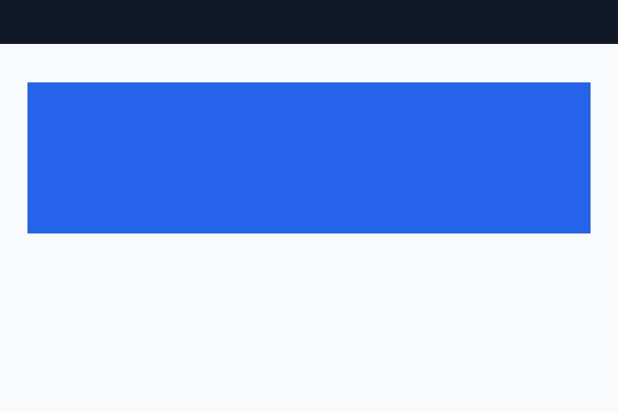
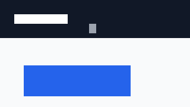
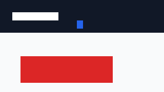
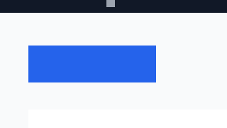
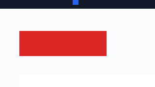
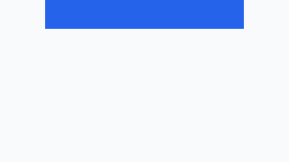
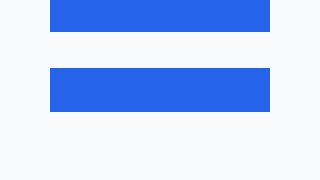
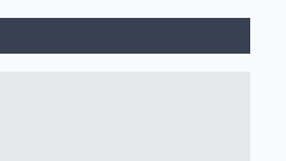
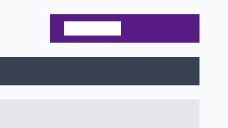

## 🗺️ StyleProof report

**4 changes to review** on `home` at 900px wide: 3 elements.

🆕 **1 new surface** with no baseline to compare: `pricing @ 900`. Review it before it becomes part of the baseline.

🧱 **2 visible elements were added or removed** — they need review.

📝 _3 content/structure change(s) below._

## One-sided pages, states, or surfaces — review first

### `pricing@900` · new surface <!-- styleproof-new -->

_pricing @ 900_

after · pricing @ 900

_No baseline to compare against._

## Changes

### Caret

<!-- styleproof-section %7B%22v%22%3A1%2C%22id%22%3A%22caret%22%2C%22paths%22%3A%5B%22body%20%3E%20header%3Anth%2Dchild(1)%20%3E%20span%3Anth%2Dchild(1)%22%5D%2C%22more%22%3A0%2C%22pairs%22%3A%5B%7B%22state%22%3A%22rest%22%2C%22before%22%3A%22crops%2Fhome%2D900%2D2%2Dbefore.png%22%2C%22after%22%3A%22crops%2Fhome%2D900%2D2%2Dafter.png%22%2C%22w%22%3A320%2C%22h%22%3A180%2C%22what%22%3A%22the%20caret%22%7D%5D%2C%22where%22%3A%5B%7B%22image%22%3A%22crops%2Fhome%2D900%2D2%2Dwhere.png%22%2C%22side%22%3A%22after%22%2C%22page%22%3A%5B900%2C600%5D%2C%22view%22%3A%5B0%2C0%2C900%2C239%5D%2C%22boxes%22%3A%5B%5B150%2C40%2C12%2C16%5D%5D%7D%5D%2C%22pages%22%3A%5B%7B%22state%22%3A%22rest%22%2C%22before%22%3A%22crops%2Fhome%2D900%2Dpage%2Dbase.png%22%2C%22after%22%3A%22crops%2Fhome%2D900%2Dpage%2Dhead.png%22%2C%22w%22%3A900%2C%22h%22%3A600%7D%5D%7D -->

The caret changes text colour from gray to blue.

 Where: 1 caret on home @ 900

| Before | After |
| --- | --- |
|  |  |

Show the CSS

`span.caret` · 1 element restyled

| Property | Before | After |
| --- | --- | --- |
| `color` | `#9ca3af` | `#2563eb` |

<!-- styleproof-section-end -->

### Cta

<!-- styleproof-section %7B%22v%22%3A1%2C%22id%22%3A%22cta%22%2C%22paths%22%3A%5B%22body%20%3E%20main%3Anth%2Dchild(2)%20%3E%20button%3Anth%2Dchild(1)%22%5D%2C%22more%22%3A0%2C%22pairs%22%3A%5B%7B%22state%22%3A%22rest%22%2C%22before%22%3A%22crops%2Fhome%2D900%2D3%2Dbefore.png%22%2C%22after%22%3A%22crops%2Fhome%2D900%2D3%2Dafter.png%22%2C%22w%22%3A320%2C%22h%22%3A180%2C%22what%22%3A%22the%20cta%22%7D%5D%2C%22where%22%3A%5B%7B%22image%22%3A%22crops%2Fhome%2D900%2D3%2Dwhere.png%22%2C%22side%22%3A%22after%22%2C%22page%22%3A%5B900%2C600%5D%2C%22view%22%3A%5B0%2C17%2C900%2C239%5D%2C%22boxes%22%3A%5B%5B40%2C110%2C180%2C52%5D%5D%7D%5D%2C%22pages%22%3A%5B%7B%22state%22%3A%22rest%22%2C%22before%22%3A%22crops%2Fhome%2D900%2Dpage%2Dbase.png%22%2C%22after%22%3A%22crops%2Fhome%2D900%2Dpage%2Dhead.png%22%2C%22w%22%3A900%2C%22h%22%3A600%7D%5D%7D -->

The cta changes background from blue to red.

 Where: 1 cta on home @ 900

| Before | After |
| --- | --- |
|  |  |

Show the CSS

`button.cta` · 1 element restyled

| Property | Before | After |
| --- | --- | --- |
| `background-color` | `#2563eb` | `#dc2626` |

<!-- styleproof-section-end -->

### Off canvas status

<!-- styleproof-section %7B%22v%22%3A1%2C%22id%22%3A%22off%2Dcanvas%2Dstatus%22%2C%22paths%22%3A%5B%22body%20%3E%20aside%3Anth%2Dchild(3)%22%5D%2C%22more%22%3A0%2C%22pairs%22%3A%5B%5D%2C%22where%22%3A%5B%5D%2C%22pages%22%3A%5B%7B%22state%22%3A%22rest%22%2C%22before%22%3A%22crops%2Fhome%2D900%2Dpage%2Dbase.png%22%2C%22after%22%3A%22crops%2Fhome%2D900%2Dpage%2Dhead.png%22%2C%22w%22%3A900%2C%22h%22%3A600%7D%5D%7D -->

The off canvas status changes opacity from `0.85` to `1`.

_On home @ 900_

_The changed element is not visible in the captured page (it is outside the screenshot canvas, hidden at this breakpoint, or background content behind an active modal), so a before/after crop would be misleading._

Show the CSS

`aside.off-canvas-status` · 1 element restyled

| Property | Before | After |
| --- | --- | --- |
| `opacity` | `0.85` | `1` |

<!-- styleproof-section-end -->

---

## 📝 Content and structure changes

_3 content/structure change(s). Pure text, invisible/zero-size DOM churn, retags, and live/age/clock text stay advisory and do not alone change the verdict; the visible additions/removals are named at the top._

### `duplicate-insertion@900` · 1 content/structure change(s)

**`button.duplicate-control`**

- element added

 Where: 1 changed element on the page

| Before | After |
| --- | --- |
|  |  |

### `home@900` · 1 content/structure change(s)

**`span.content-label`**

- before: `Old`
- after: `New`

 Where: 1 changed element on the page

| Before | After |
| --- | --- |
|  |  |

### `sibling-insertion@900` · 1 content/structure change(s)

**`div.scope-switch`**

- element added

 Where: 1 changed element on the page

| Before | After |
| --- | --- |
|  |  |

<!-- styleproof-captured %7B%22v%22%3A1%2C%22pages%22%3A%5B%7B%22base%22%3A%22duplicate%2Dinsertion%22%2C%22widths%22%3A%5B900%5D%2C%22states%22%3A%5B%5D%7D%2C%7B%22base%22%3A%22home%22%2C%22widths%22%3A%5B900%5D%2C%22states%22%3A%5B%5D%7D%2C%7B%22base%22%3A%22pricing%22%2C%22widths%22%3A%5B900%5D%2C%22states%22%3A%5B%5D%7D%2C%7B%22base%22%3A%22sibling%2Dinsertion%22%2C%22widths%22%3A%5B900%5D%2C%22states%22%3A%5B%5D%7D%5D%2C%22recipes%22%3A%5B%5D%2C%22rules%22%3A%5B%5D%7D -->
