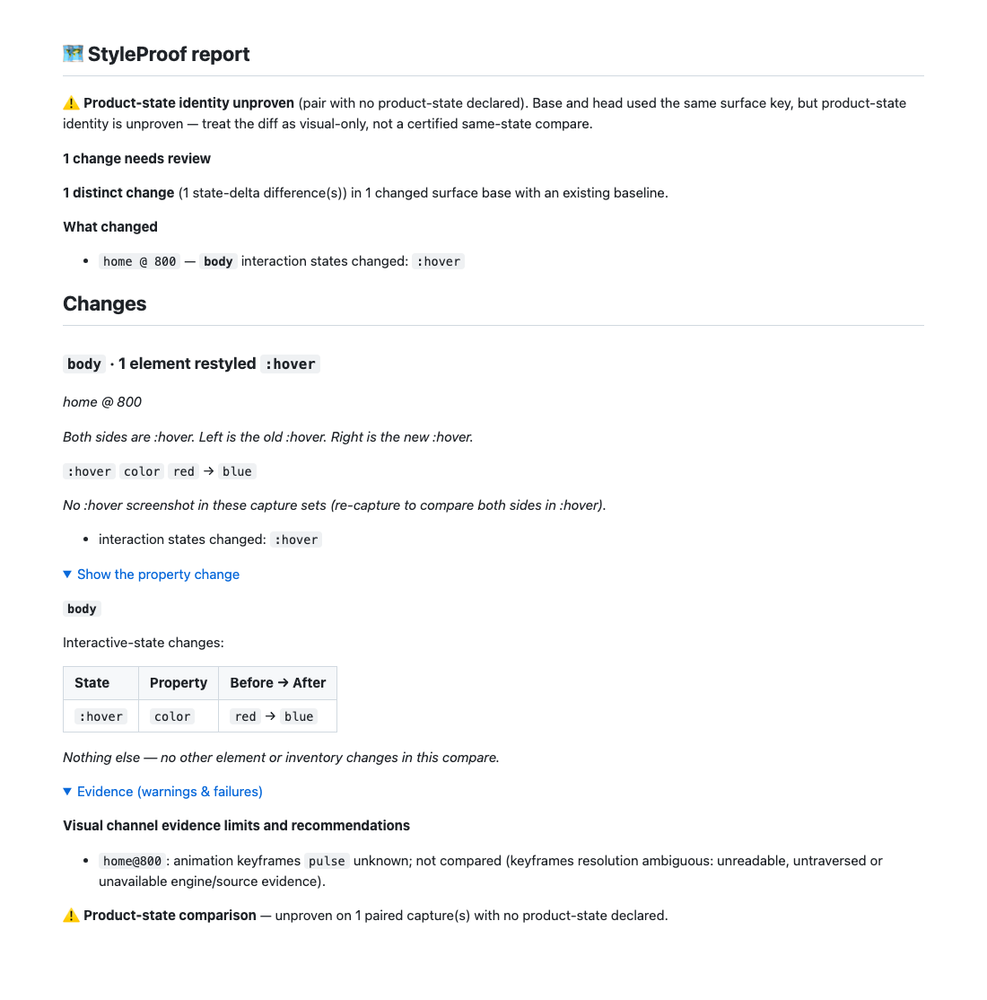

# Round 10 — resting evidence and shadow-bearing churn

QA's privacy failure reproduced on the published proof commit. Eleven machine-path
occurrences across eight proof files were replaced with portable artifact names or
repository-relative stack paths. The guard scans tracked proof text regardless of
extension, including logs and Markdown code spans. No public path exemption or gate
configuration changed. The old round-9 README now qualifies its runtime-only verify
result; it was not a pass on the published proof tree.

Unknown resting channel evidence on either side now prevents a state finding.
Missing channel state deltas use their known resting values; ordinary state-delta
semantics are unchanged. Tests cover both sides, element/pseudo layers, unloaded
images, hover-only names, genuine body edits and preservation of ordinary colour
changes. The initial unit fixtures reproduced the false findings before the fix.

Closed-root registration synchronously observes that root's live inputs. Any
motion or unreadable input holds the capture; static roots can be added and observed
roots removed without invalidating known models. Unread closed roots, unresolved
subscriptions and document replacement remain barriers. A completed failed proof
stays unknown throughout the capture. Initial liveness verification round-trips the
catalogue session too. Native units pin unread/unsubscribed removal and queued events.
An additional preservation run caught an over-hold for empty inert nodes removed
before their subscription completed. They cannot own a root and have complete
empty child metadata, so their removal is safe unless a frontier count or child
event has invalidated that evidence. Potential hosts retain the unsubscribed-removal
barrier. The old inert-churn e2e and a new unit control pin the distinction.

The component-churn e2e initially failed for both open and closed rows. The first
fix removed false findings but lost closed-root hover detection; registration-time
liveness closed that gap. The native 100ms replacement cases then passed. Candidate
reviewer runs covered 15 idle pairs and two parallel sets of 15: every pair equal,
zero false keyframes findings, 1/1 resting and 20/20 hover edits. These are candidate
results; final-tree gate and replay receipts live in external archive
`styleproof-1005-round10-proof` and are bound to the final commit and tree. No gate
success is inferred from a later proof-only commit.

The closed-host CPU scaling test uses the existing warmed minimum-CPU helper and
unchanged ratio/wall guards with smaller inputs. The MIME fixture represents one
resource per URL per frame; cross-frame observations can conflict. Generic MIME
holds decoded raster images as explicitly documented. A stateless extension of the
existing content-URL scan covers element-level replacement too, with a native red
then green regression case. Same-URL response-history and list-style-image remain
precise stabilize:false limits in REFERENCE; this change does not claim to close them.

The pictured report is a deliberate model fixture, not captured product-state or
pixel proof. It keeps the real hover colour change while naming the unknown
keyframes limit, with no fabricated keyframes state finding. Product-state-unproven
and missing-screenshot warnings remain visible. Native models, protocol hooks and
repeated captures prove the timing cases; a video would not prove their evidence
invariants. Dependencies and demo output remain unchanged.

## Confidence-aware comparison

The CPO premise check found no differing known bodies across its 176 identical
pairs; confidence asymmetry was being interpreted as a state delta. The central
comparison now resolves effective state values against the target's resting layer
and compares only known, comparable values with no resting unknown. Missing,
unknown, unloaded/blob, unproven and excluded values become counted limits in the
result and report, never changes or clean channel evidence. The findings-array API
is retained; `diffStyleMapsWithEvidence` also exposes the limits. The self-check is
unchanged and still throws when confidence differs.

`confidence-red.log` reproduces the one-sided state false finding before the fix.
A generated matrix covers 7,776 pairs across elements, pseudos and state entries.
`incomplete-report-red.log` records a second finding: both-side skipped sweeps were
not explicitly named by the report. They now render an uncertified forced-state
warning and receipt. A real Chromium disabled-sweep control pins it; churn cases
retain strict 20/20 detection and additionally require an explicit map/report reason
for any miss. The original two parallel hover misses have no retained maps, so
this does not assign their cause. Final dumps and replay outcomes are external.
No capture-side state was added; barrier, stickiness and content-image handling
remain as committed at `43b1d5ccd`.

The CLI receipt also forwards the counted limits to the shared certification
policy, structured JSON and durable verdict. `cli-confidence-red.log` records a
bound, coverage-complete, self-checked pair that incorrectly exited 0 and claimed
`certifiesFully:true` before that forwarding. It now exits 1, names the two limits
and cannot certify. The same fixture with known equal channels still exits 0 and
certifies; no gate or default-mode rule was relaxed. Capture/diff/report runtime
replays from `efed260b9` are retained with SHA-256 equivalence to this transport-only
follow-up; final gates and r10 stress receipts are bound to the pushed tree.

The same regression is pinned for the report CLI's separate clean-exit path in
`report-cli-confidence-red.log`. Both CLI entry points now retain the counted
limits, reject unknown evidence and keep the known-equal control clean. This does
not change default captures or the capture/diff/report library runtime.
