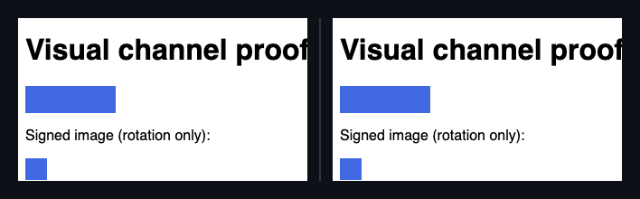
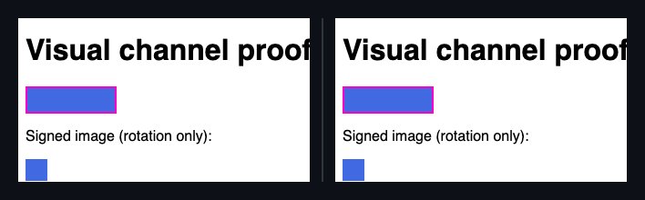
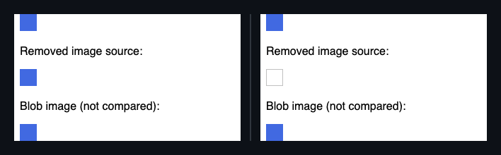
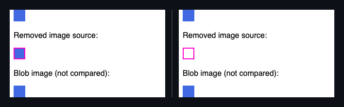
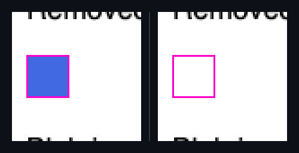

## 🗺️ StyleProof report

⚠️ **Product-state identity unproven** (pair with no product-state declared). Base and head used the same surface key, but product-state identity is unproven — treat the diff as visual-only, not a certified same-state compare.

**1 change needs review**

**1 distinct change** (2 computed-style difference(s)) in 1 changed surface base with an existing baseline.

**What changed**

- `home @ 800` — **`div.target`** +1 more · **`img`** +1 more

## Changes

### **Target** `div.target` · 1 element restyled

_home @ 800_

`animation keyframes (pulse)` `100% { background-position: var(--a); }` → `100% { background-position: var(--b); }`

◀ before  ·  after ▶ — home @ 800

Show highlight overlay

🔍 magenta boxes mark each change — changed: `div.target`

- **`div.target`** — +1 more

Show the property change

**Target** `div.target`

Style:

| Property | Before | After |
| --- | --- | --- |
| `animation keyframes (pulse)` | `100% { background-position: var(--a); }` | `100% { background-position: var(--b); }` |

### `img` · 1 element restyled

_home @ 800_

`img currentSrc` `http://assets.test/a.svg` → `(no source)`

◀ before  ·  after ▶ — home @ 800

Show highlight overlay

🔍 magenta boxes mark each change — changed: `img`

🔬 magnified 3× — change too small to see at 1:1 — changed: `img`

- **`img`** — +1 more

Show the property change

**`img`**

Style:

| Property | Before | After |
| --- | --- | --- |
| `img currentSrc` | `http://assets.test/a.svg` | `(no source)` |

_Nothing else — no other element or inventory changes in this compare._

Evidence (warnings & failures)

**Visual channel evidence limits and recommendations**

- `home@800`: img currentSrc not compared (blob URL) on 1 captured image(s).

⚠️ **Product-state comparison** — unproven on 1 paired capture(s) with no product-state declared.

