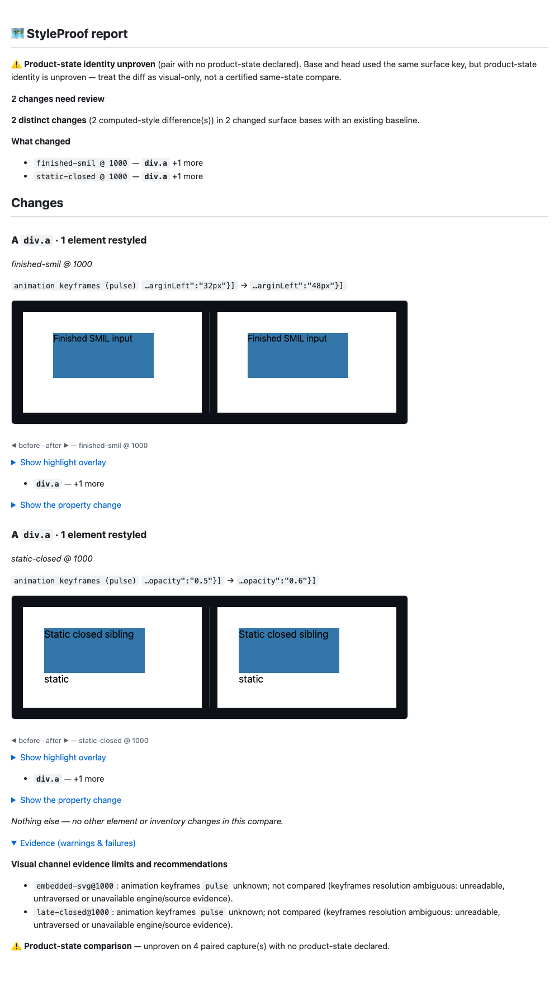

# Round 8 proof — readable liveness, watched boundaries and scoped self-checks

Final runtime source: `bae74ecbc6db0b82b0cc2de5f95a801009cf0424`. Capture implementation:
`f7a631755aab3fb2a490e5db058a4989ba5e5ebe`. Main: `4b298c004727c9ef955a72bd487ab7a36523f09f`.
The compiled artifact is bound by build-binding.json; later commits add proof only.
Full raw logs, probe inputs/maps and generated HTML reports are archived at
`/Users/chief/Mini/Operations/Inbox/styleproof-1005-round8-proof`.

The capture-scoped CDP DOM/CSS session watches native shadow/tree mutations.
Each channel read verifies the catalogue epoch; an invalidated catalogue is
rescanned with depth -1 and pierce. Closed ShadowRoots are resolved once and their
animation lists are read in the same synchronous task as document/open-root inputs
and engine models. Changed/unavailable boundary evidence stays unknown. The host
WeakSet preserves local untraversed-scope uncertainty; a static closed sibling does
not taint an unrelated document model. Session/handle cleanup covers early errors.
No shadow/embedded freeze or animation pause/play mutation was added. The extracted
interaction reset preserves existing recipe hover/focus/press behavior.

SMIL uses getStartTime, simple duration, repeat/end limits and its owner SVG clock.
Native no-current-interval covers finished filled and never-started animations;
future starts stay inactive. Active/paused inputs and unresolved timing hold models.
The timing API is described at
https://www.w3.org/TR/SVG11/animate.html#InterfaceSVGAnimationElement .
Readable object/embed documents are walked recursively. Opaque media with a source
and an intrinsic box holds models; two definite Typed-OM pixel dimensions exempt
ordinary sized SVG icons. Iframes are not followed: their content cannot resize
the iframe element. Active SMIL and surviving WAAPI spinners remain conservative
global holds. REFERENCE now states these scopes outside the stabilize:false rule.
No setting/default/schema/normalization/dependency change was needed: opt-in v1,
shared engine-derived bodies and normalized image sources remain the design.

Initial QA red: 7/11 Chromium regressions fail; initial unit red: 16 failures. Review red:
7/9 new cases fail, and the immutable pre-review build independently misses both
static closed-root edits and leaks paused object-SVG progress. The corrected DSD
fixture verifies a consumed template. Green focused suites cover static/finished
closed detection, local scope controls, active shadow inputs, embedded paused and
opaque SVG, finished/never-started/active SMIL, and 1,000 sized SVG icons. All 114
channel units pass. The final full browser gate includes all of these plus the
unchanged minimum-CPU linearity bounds and 60s wall guard.

The self-check previously flattened ALL ordinary property layers, including empty
channel projections, and lost target/state identities. Red tests reproduce false
failures from irrelevant layers and missed moved references. The final projection
keeps channel-bearing leaves with element/pseudo/state paths; missing/unknown or
moved references still fail. Five new tests pin this, including a channel-like
path name. Ordinary style self-checks remain separate and unchanged. The helper is
called only behind captureVisualChannels in runner/popup gates, so defaults are
unaffected. Its critical gate call sites were impact-reviewed and fully tested.

All 70 functional replay commands complete with exit 0: 59 earlier commands, five
additional QA scripts, and six fresh r8 scripts. Semantics are audited separately.
QA hover-only late closed/open pairs are unknown with no finding and passing
self-checks; the original QA r7 12-pair shadow probe remains stable. Static closed
and declarative closed siblings detect; inactive SMIL detects; active SMIL stays
unknown. Embedded SVG has no false model findings in either mode; default moving
regions may be excluded by stabilization and are not claimed compared. Firefox
preserves ordinary motion findings with channels on/off and names unknown models.
wrapper6 detects 4/4, O7 is known/detected, default parity matches main normally and
with captureReach, and timing/privacy/URL controls remain covered.

The native late8 cancel-trigger fixture can genuinely change which scopes have
unknown evidence while its ordinary layers also change. Those confidence gaps
still fail self-check; they are not hidden or called certified. The diagnostic
saved maps proved seven pairs had identical actual tables/references despite old
empty-layer false failures, while the eighth had additional unknown rows and must
still fail. No changed KNOWN body was sampled from animation progress. Exact final
late8 statuses and findings are retained in review8-semantic.json and raw logs.
Real CSS-edit pairs in QA/reviewer probes intentionally fail same-build self-checks;
those are expected detections, not nondeterminism.

At 1,000 roots with forced states, on-medians in milliseconds are fixed/reviewed194:
H1 static 7724/8981; H2 finished animations 8496/8820; H3 51k shadow nodes 8518/9191.
All five outer model names stay known. These are three-sample medians, not a claim
of statistical certainty. Both builds hit the existing 32k forced-state budget:
timings compare the same bounded capture work, not coverage of all 50 controls.
Cost was measured on the final capture implementation f7; the later change touches
only Node self-checking. Capture sources and finalize/diff function implementations
are identical across those builds. scale.mjs and all thresholds are unchanged.

Detection before (19427ced8) → after stays 48/48 detect, 7/7 clean, 1/1 blind. Keyframes
and image source detect; aria-label stays blind. Reach stays 18 changes/17 visual,
declared 3/17, complete 16/17, misses named 14/14, no J2/J3 run-level gap. Its keyframes
unit remains conservative blind-channel. The receipt's timestamp is restored only
after all other result data matches. Dependencies, docs/demo and gate configuration
remain identical to main. Final command tails and full corpus output are included.

The first full browser run rejected an old once-per-capture scan assertion. It was
updated to validate fresh bulk scans, then refined to watched invalidation: scans
are bounded by native tree mutations, reused across reads, with no per-host RPC
repetition. A focused run caught the necessary second scan after a real mutation;
that invariant now passes. Early commit hooks rejected excessive complexity;
helpers were decomposed, never suppressed. A console diagnostic was removed after
lint rejected it. Superseded/failed logs and all hook outcomes remain in the full
archive. Only final gate/probe manifests are claimed; no gate was bypassed or
configuration/threshold weakened. Browser fixtures use the supported 26000 worker
port block to avoid concurrent worktrees.

The report shows two real model edits (finished SMIL and static closed sibling),
plus late-closed and embedded-SVG limits. Its screenshot was inspected with Evidence
expanded. Product-state identity remains UNPROVEN on four pairs, visibly named;
this is diagnostic computed-model evidence, not certified same-state or pixel
comparison. Video is not applicable: paused-time/native interval pairs and model
bodies prove these capture cases directly. All MD crop links resolve locally.

These are local results, not hosted CI approval. No PR is opened.
