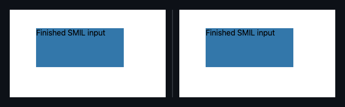

## 🗺️ StyleProof report

⚠️ **Product-state identity unproven** (pair with no product-state declared). Base and head used the same surface key, but product-state identity is unproven — treat the diff as visual-only, not a certified same-state compare.

**2 changes need review**

**2 distinct changes** (2 computed-style difference(s)) in 2 changed surface bases with an existing baseline.

**What changed**

- `finished-smil @ 1000` — **`div.a`** +1 more
- `static-closed @ 1000` — **`div.a`** +1 more

## Changes

### **A** `div.a` · 1 element restyled

_finished-smil @ 1000_

`animation keyframes (pulse)` `…arginLeft":"32px"}]` → `…arginLeft":"48px"}]`

◀ before · after ▶ — finished-smil @ 1000

Show highlight overlay

🔍 magenta boxes mark each change — changed: `div.a`

- **`div.a`** — +1 more

Show the property change

**A** `div.a`

Style:

| Property                      | Before                 | After                  |
| ----------------------------- | ---------------------- | ---------------------- |
| `animation keyframes (pulse)` | `…arginLeft":"32px"}]` | `…arginLeft":"48px"}]` |

### **A** `div.a` · 1 element restyled

_static-closed @ 1000_

`animation keyframes (pulse)` `…opacity":"0.5"}]` → `…opacity":"0.6"}]`

◀ before · after ▶ — static-closed @ 1000

Show highlight overlay

🔍 magenta boxes mark each change — changed: `div.a`

- **`div.a`** — +1 more

Show the property change

**A** `div.a`

Style:

| Property                      | Before              | After               |
| ----------------------------- | ------------------- | ------------------- |
| `animation keyframes (pulse)` | `…opacity":"0.5"}]` | `…opacity":"0.6"}]` |

_Nothing else — no other element or inventory changes in this compare._

Evidence (warnings & failures)

**Visual channel evidence limits and recommendations**

- `embedded-svg@1000`: animation keyframes `pulse` unknown; not compared (keyframes resolution ambiguous: unreadable, untraversed or unavailable engine/source evidence).
- `late-closed@1000`: animation keyframes `pulse` unknown; not compared (keyframes resolution ambiguous: unreadable, untraversed or unavailable engine/source evidence).

⚠️ **Product-state comparison** — unproven on 4 paired capture(s) with no product-state declared.

