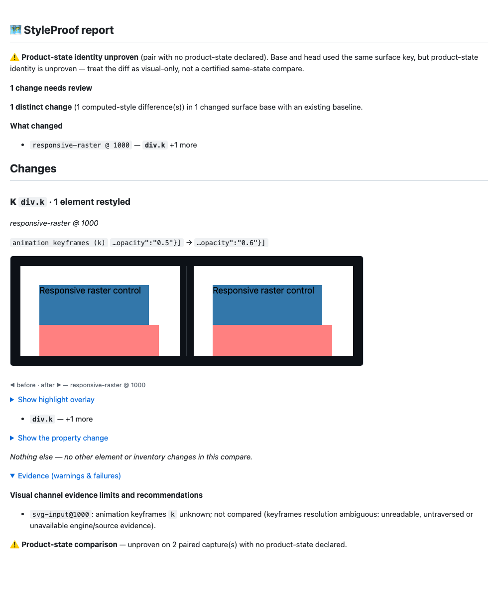

# Review r9 proof — raster evidence and stable boundary verification

Runtime `3b5060000953969618088f0c86f61d1f7c679f88`; main `4b298c004727c9ef955a72bd487ab7a36523f09f`. Later commits add proof only.
Full raw output, native probe inputs and retired preliminary builds:
`styleproof-1005-round9-review-proof`.

QA r10 correction: the verify pass below belongs to runtime `3b5060000`, before
the proof commit. The later published `2b881d0f1` failed privacy checking because
the cost manifest contained a machine path. It was not a verified final tree.
Machine paths in tracked proof are now replaced with portable artifact names or
repository-relative paths; historical logs otherwise retain their outcomes.

The default remains off. v1 shared engine-model storage, scoped references, normalisation,
image query privacy and old-map compatibility are unchanged. No runtime dependency,
setting/schema default, gate configuration, suppression or threshold changed. The QA r9
pre-freeze closed-root snapshot remains in place. REFERENCE is updated, and the dead
__spChannelHostsChecked state is removed.

Raster detection uses observed CDP Page.getResourceTree MIME metadata and data-image
headers, with no additional fetch or blob-byte read. Known raster types cannot make an
intrinsic animation input. Within the current CDP resource snapshot, evidence is
aggregated by possible SVG status: multiple raster formats stay raster while
conflicting or missing evidence stays conservative. This is not response history;
an earlier SVG response hidden by a later raster response at the same URL remains
a stabilize:false limit, documented in REFERENCE.
Deferred images without a selected currentSrc have no active image box yet; their source
channel still names unloaded/not compared. SVG/unknown intrinsic images hold models.
Under stabilize:false, image inputs, video posters and generated content URLs also
participate. Generated SVG/unknown pseudo images stay conservative even when styled to
a size, because authored pseudo sizing isn't proven. Default mode skips those added paths.

Boundary invalidation follows potential author hosts and embedded documents. The host
list follows the [DOM Standard](https://dom.spec.whatwg.org/#dom-element-attachshadow).
Known text, inert children and subscribed count-only notifications leave the catalogue
valid. If it changes, a fresh closed-root membership check can preserve proof. Document
replacement, actual root removal and genuinely unobserved frontiers stay barriers.
Only relevant scans repeat; no full scan is driven by the ordinary ticker. The MIME
API is [CDP Page.getResourceTree](https://chromedevtools.github.io/devtools-protocol/tot/Page/#method-getResourceTree).

A native CDP check found that newly inserted empty containers are initially unexpanded:
a later closed child can otherwise hide behind a count-only notification. Red tests
reproduce it in both modes. Inserted subtrees are now incrementally subscribed and
pending subscriptions settled before proof. Disconnected transient subtrees are ignored
once disconnected; an unresolved frontier cannot manufacture proof about its past.
Actual root-bearing removal remains a barrier even if final root ids match. Both the
new frontier cases and the original late-root/entry-time cases pass. This closes that
freshness edge without reintroducing blanket ticker invalidation.

Initial red: nine Chromium regressions fail while the sized-raster control passes.
Unit revalidation tests fail too; the first VM fixture omitted native URLSearchParams,
which was corrected. The module-isolated test now invokes every injected value helper,
including clock/declaration dependencies, and checks the module export/injection sets.
Mixed MIME observations and mixed raster formats are covered. Early Fallow complexity
failures were fixed by splitting helpers, not suppressing or relaxing the gate. All
first failures, fixture corrections and hook outcomes are retained in the full archive.

The preliminary full gates passed before the native frontier edge was found. Those
results and immutable artifact are retired under pre-subscription and are not claimed
as the final pass. Final verify: **6739 passed**. Full Chromium: **1411
passed plus one existing skip**. Complete-capture linearity now includes both open and
closed hosts at 1,000 roots. The round4 scan test deliberately churns text/inert lists
and bounds deep scans by 2, replacing the loose 1+all-mutations bound. The new forced
proof test is deterministic and detects 20/20 hover edits.

All **80 final functional replay commands** complete (59 earlier, five extra QA, six
reviewer r8, ten review/QA r9). Semantics are audited separately. embed9 raster rows are
known and detect 1/1; the added SVG paths stay unknown without false findings. ticker9
is 18/18 equal, with resting 1/1 and hover 20/20 every time. The selected resting/off
16ms controls and detailed status/debug variants are retained with their options.
SMIL covers 37 shapes in both modes with zero false keyframes findings. Native future
starts may honestly change confidence, as accepted in Review r9 N4.

Review r9 N7's animationcancel/important-transition callback can change ordinary volatile
coverage. Its ft9 and extra-QA confidence differences are retained and explicitly
qualified, not labelled certified equal. The extra-QA capture has stable shared known bodies and zero keyframes findings.
ft9's raw statuses/volatile counts are retained without an unsupported finding-count
claim. The accepted late8/delayed-root confidence changes also
remain flagged. See semantic audits and raw logs for exact final outcomes. wrapper6
remains 4/4, O7 stays known/detected, QA shadow liveness 12/12 stable, and real Firefox
preserves ordinary motion findings. Default parity with main is byte-identical normally
and with captureReach.

Detection before → after remains **48/48 detect, 7/7 clean, 1/1 blind**. Keyframes and
img source detect; aria-label stays blind. Reach stays **18 changes / 17 visual;
declared 3/17; complete 16/17; misses named 14/14; no J2/J3 run-level gap**. The reach
keyframes unit remains conservative blind-channel. Timestamp-only receipt churn is
restored only after every other result field matches. Demo is fresh and unchanged;
package.json/pnpm-lock.yaml and enforcement configuration match main.

shadowcost9 runs sequentially after own gates/replays against actual reviewed r8 capture
code (4805139bf; proof-only changes through 19427ced8). Its four cases, medians of three,
launch load and raw samples are retained. Both builds hit the existing 32k forced-state
work budget: timings compare bounded work, not coverage of all 50 controls. No timing
bound or scale.mjs was altered. The CLI tests already honor STYLEPROOF_E2E_PORT_BASE;
this worktree uses block26000. New native tests need no server port; reviewer scripts
use separate HP blocks.

The current report shows a responsive-raster body edit and an explicit SVG-input
not-compared limit. Expanded Evidence and product-state UNPROVEN warnings are visible
in the inspected screenshot. This is diagnostic model evidence, not certified same-state
or pixel proof. Video is not applicable: native protocol, deterministic mutation hooks,
models and report demonstrate these interval-specific capture cases. No PR is opened;
these are local results, not a hosted CI claim. Real gate tails are included.

