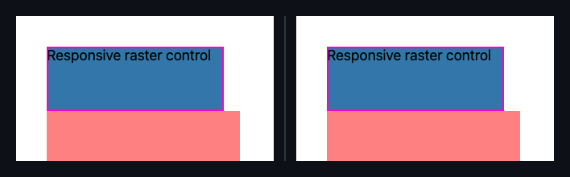

## 🗺️ StyleProof report

⚠️ **Product-state identity unproven** (pair with no product-state declared). Base and head used the same surface key, but product-state identity is unproven — treat the diff as visual-only, not a certified same-state compare.

**1 change needs review**

**1 distinct change** (1 computed-style difference(s)) in 1 changed surface base with an existing baseline.

**What changed**

- `responsive-raster @ 1000` — **`div.k`** +1 more

## Changes

### **K** `div.k` · 1 element restyled

_responsive-raster @ 1000_

`animation keyframes (k)` `…opacity":"0.5"}]` → `…opacity":"0.6"}]`

◀ before · after ▶ — responsive-raster @ 1000

Show highlight overlay

🔍 magenta boxes mark each change — changed: `div.k`

- **`div.k`** — +1 more

Show the property change

**K** `div.k`

Style:

| Property                  | Before              | After               |
| ------------------------- | ------------------- | ------------------- |
| `animation keyframes (k)` | `…opacity":"0.5"}]` | `…opacity":"0.6"}]` |

_Nothing else — no other element or inventory changes in this compare._

Evidence (warnings & failures)

**Visual channel evidence limits and recommendations**

- `svg-input@1000`: animation keyframes `k` unknown; not compared (keyframes resolution ambiguous: unreadable, untraversed or unavailable engine/source evidence).

⚠️ **Product-state comparison** — unproven on 2 paired capture(s) with no product-state declared.

