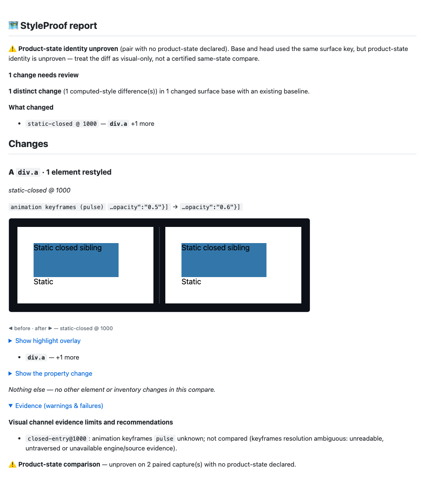

# Round 9 — retain closed-root entry liveness

Runtime: `410b545988ff1895a24e69cffd45973d3c5db16b`. Main: `4b298c004727c9ef955a72bd487ab7a36523f09f`. Later commits add proof only.
Full raw output and replay inputs: `styleproof-1005-round9-proof`.
At this QA-r9 checkpoint, the fix is committed and deliberately **held from pushing**,
pending Review r9 as requested.

With `stabilize:false`, the initial liveness read used to run with an empty closed-root
catalogue. A closed animation that finished between freezing and proof could be
missed twice and leave consistently overconfident known bodies. The opt-in unstable
path now populates the watched CDP catalogue before reading entry liveness and before
media emulation/freezing. The initial callback consumes those resolved roots. Missing
or changing boundary evidence retains unknown; the later proof still revalidates
boundaries independently. The existing session, catalogue and root registrations are
reused. No default-mode entry read or extra scan was added, and no animation is paused,
played or finished by this change. Native tests alone finish their fixture effect.

The option remains off by default. v1 shared model storage, scoped references,
engine normalization, image-source privacy and backward compatibility are unchanged.
No public setting, dependency, schema, gate configuration or threshold changed.
REFERENCE now states the pre-freeze closed-root read. Static and finished-at-entry
closed roots stay known; default mode discards entry motion that does not survive.

Red: the deterministic phase probe records six known closed/unstabilized maps,
although native logs show the driver active at entry and finished during freeze.
Chromium rejects the same case: 1 failed / 5 controls passed. The new unit entry-point
is absent on the unfixed build (unit-red); its green test verifies actual closed-root
registration and retained liveness after that effect finishes. Tests were committed
before implementation (`c28b9213b`), with normal hooks.

Green: six Chromium cases pass, including the open twin, both default-mode controls,
and static/finished closed-root controls that detect actual body edits. The phase
probe has six maps per root/mode: unstable open and closed are unknown, default open
and closed are known. The timer probe has six maps per root: all unknown under
stabilize:false. All pairs have zero findings and passing channel self-checks; native
records verify paused → finished while frozen. The status assertions catch consistent
overconfidence that equality alone cannot detect.

All 70 prior replay commands (59 primary, five extra QA, six reviewer r8) complete
with exit 0 and fresh semantic audits. wrapper6 detects 4/4; O7 stays known/detected;
QA shadow liveness stays 12/12 stable; real Firefox keeps its ordinary motion findings;
SMIL/closed/embedded and r5 dependent-input regressions hold. Default parity with main
is byte-identical normally and with captureReach. Accepted late-root confidence/scope
changes remain flagged rather than suppressed (see review8-semantic.json). No false
keyframes finding is reported for them. Raw command status is not treated as semantic
proof on its own. Two first replay attempts lacked test helpers in the isolated build;
the setup logs and original manifests are preserved in the full archive. Test helpers
were then copied, and every failed/not-run QA command was rerun successfully.

Full verify: 6,728 passed (new liveness unit plus the automatically enumerated
new-spec gate-routing case). Full Chromium e2e: 1,399 passed plus one existing skip.
Detection before → after stays **48/48 detect, 7/7 clean, 1/1 blind**. Keyframes and
img source detect; aria-label stays blind. Reach stays **18 changes / 17 visual;
declared 3/17; complete 16/17; misses named 14/14; no J2/J3 run-level gap**. The reach
keyframes unit remains conservative blind-channel. Only generated receipt-time churn
was restored after asserting all other data identical. Demo is fresh and unchanged;
package.json/pnpm-lock.yaml and enforcement configuration match main.

The full shadowcost9 matrix and a serial repeat of its noisy 51k-node row are retained
with launch load and medians. Both builds hit the existing 32k forced-state budget;
this compares bounded work, not all 50 controls. All thresholds and scale.mjs are
unchanged. The final full suite includes complete-capture linearity at 1,000 hosts.
Cost results are qualified in cost-repeat-manifest.json; no parallel timing is hidden.
The new tests use native about:blank pages and need no fixed server port. Full e2e
uses the existing STYLEPROOF_E2E_PORT_BASE=26000 convention.

The current report shows one static-control body edit, plus an explicit closed-entry
unknown/not-compared limit. Its expanded Evidence and product-state UNPROVEN warnings
are visible in the inspected screenshot. No same-state or pixel certification is
claimed. Video is not applicable: native animation handles and the deterministic
settle-phase callback prove the timing interval; snapshots/report show the model result.
No hosted CI result or PR is claimed. Real gate tails are included.

