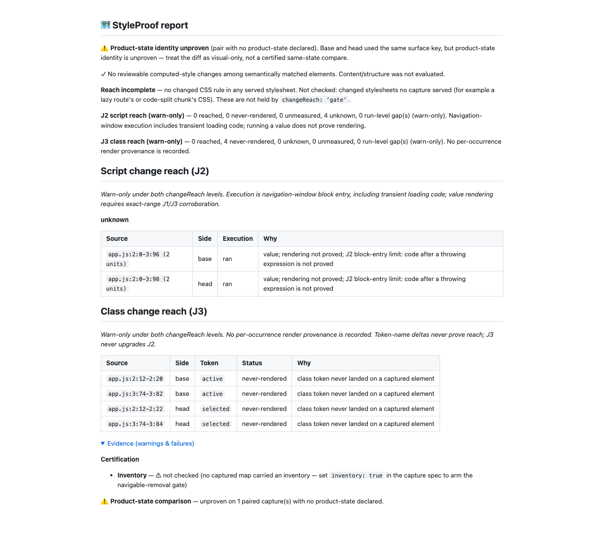

# Dependency-free J3 role analysis (#1001)

Baseline: `fdb92012dc6ffd029f16b98d68b699bea7cd5cee`, rejected for adding runtime
Babel dependencies contrary to the ADR/epic constraint. Fetched origin and rebased
onto `origin/main` (`0cc4bd2dc`); already current. The dependency/depth guards were
committed red in `be23bd68a`; the in-repo implementation is `949871eef`.
No PR is opened. Every commit/push uses the normal hooks.

## Implementation

- Both package.json and pnpm-lock.yaml are restored byte-for-byte from origin/main.
  `git diff origin/main -- package.json pnpm-lock.yaml` exits zero with no output.
  Runtime dependencies contain only pngjs. The new regression fails on any other
  dependency key. The frozen-lockfile install removed parser/types; clean dist has
  no imports of either module. No development dependency was substituted for them.
- Role analysis uses the existing src/script-join-tokens.ts lexemes through
  ClassSource. An in-repo punctuation/bracket forest retains exact source offsets,
  shields literal/regex bodies, and skips comments. A bounded work stack passes
  explicit roles only through approved helper values/containers, ternary results,
  logical RHS values, class attributes/assignments and positive classList args.
  Known cva class values and framework bindings retain support. Unknown calls/tags,
  optional/non-null/generic calls, lookups (including as/satisfies wrappers),
  binary/relational operands, arrows, void and other assignments never inherit a
  positive role. Function/method parameters and type-only bodies remain non-explicit;
  actual helpers in runtime bodies remain positive. This remains a conservative
  expression reader, not a full JavaScript/TypeScript parser or binding/type analysis.
- Bracket and expression nesting are capped at 128 using explicit work stacks;
  exceeding the cap records a named extraction gap through EOF. The unconditional
  template cap-to-EOF gap remains, including outside a class context. A 6,000-level
  parenthesis regression proves the role reader cannot exhaust the JS call stack.
- Whole-hunk ordered token/role/slot matching and its hunk bounds are unchanged.
  All 61 round-five tests remain intact, including inserted constants before/after
  calls, blank lines, changed slots, and duplicated tokens outside multiline hunks.
  J3 still has no reached path, never upgrades J2 and remains warn-only. No capture,
  verdict, report budget or J2 classification code changes in this correction.

## Red → green

The original dependency guard and deep-parenthesis guard both fail on fdb92012d
([red](red.txt)). The first lexer implementation passed 213/214 J3 cases; the
remaining computed cva key regression is retained in [initial run](unit-first.txt)
and was fixed without changing the existing test. Additional checks caught generic
parameters resembling attributes ([declarations](red-generic.txt),
[arrow](red-generic-arrow.txt)) and five declaration-as-call errors
([declaration red](red-declarations.txt)). Positive runtime-body controls passed.
All **1,068 focused unit cases** and **48 real Chromium cases** now pass, including
every previous round-five case and 14 new dependency/depth/language guards.
See [focused green](green-focused.txt) and [Chromium green](green-e2e.txt).
Initial complexity/duplication and unused-import findings were fixed before the
implementation commit; normal lint, Fallow audit and health gates pass. No gate,
threshold, existing assertion, timing bound or skip was weakened.

## Verification and measured boundaries

`pnpm run verify` passes **6,287 tests**, zero failures/skips, including type,
lint, anti-slop, format, privacy, context and suppression checks
([real tail](verify-tail.txt)). The unchanged one-second timing bounds pass:
1 MB strings/templates 183/272 ms; 16,000 scoped units classify/combine in 310/5 ms;
whole-hunk classification in 392 ms. The role work is bounded by fixed nesting
limits; hunk matching and scoped negative lookups retain their indexes/caches.

`pnpm run bench:reach:check` passes all **36 scenario checks**, including base-side
removals, with zero J2/J3 gaps ([real tail](bench-tail.txt)). The fresh receipt
matches fdb92012d exactly except its timestamp: 7 declared / 8 complete unknown,
3/17 and 16/17 shown, 14/14 declared misses named. No J3, combined or base-removal
status/count changes. pngjs is still the sole runtime dependency. The clean package
dry run passes with **386 files**, including the new in-repo reader modules,
binaries, docs/changelog and license; demo-report freshness also passes.

## Fresh real-capture proof

A disposable Git repo, esbuild source maps and Chromium reproduce the
comment-adjacent comparison refactor. Both sides render tab tab-on. The fresh
[JSON](report.json) and [Markdown](report.md) retain four J3-only candidates with
explicit false, four original executed J2 lines unknown (two coalesced rows),
zero reach blocking and zero reviewable computed-style changes. [Capture facts](capture-facts.json)
record verified v2 zero omissions. The current screenshot was inspected at 1440px.

The report retains product-state/inventory warnings and the separate unbuilt
stylesheet join. This diagnostic example does not claim certification. Video is
not applicable: the correction changes source classification, with no animated
or interactive UI change; real capture assertions and the fresh report show its
behaviour.

`pnpm run test:e2e --workers=4` passes **1,210 cases in 8.2 minutes**, zero
failures, with one existing skip ([real tail](e2e-tail.txt)): the non-Chromium
unsupported-state case at test/cross-element-state.e2e.spec.ts:112. The suite
runs Chromium; this skip is unchanged. Starting 1-minute loads were 2.86 for verify
and 3.57 for E2E; all heavy launches were below 60.

The [dependency receipt](dependency-receipt.json) records matching Git blobs for
package.json and pnpm-lock.yaml versus origin/main, and confirms both original
round-five test files are unchanged. No source edits follow the final gates; the
receipt commit adds only evidence/method notes. Push uses the exact supplied
fdb92012dc6ffd029f16b98d68b699bea7cd5cee lease, with hooks enabled.
