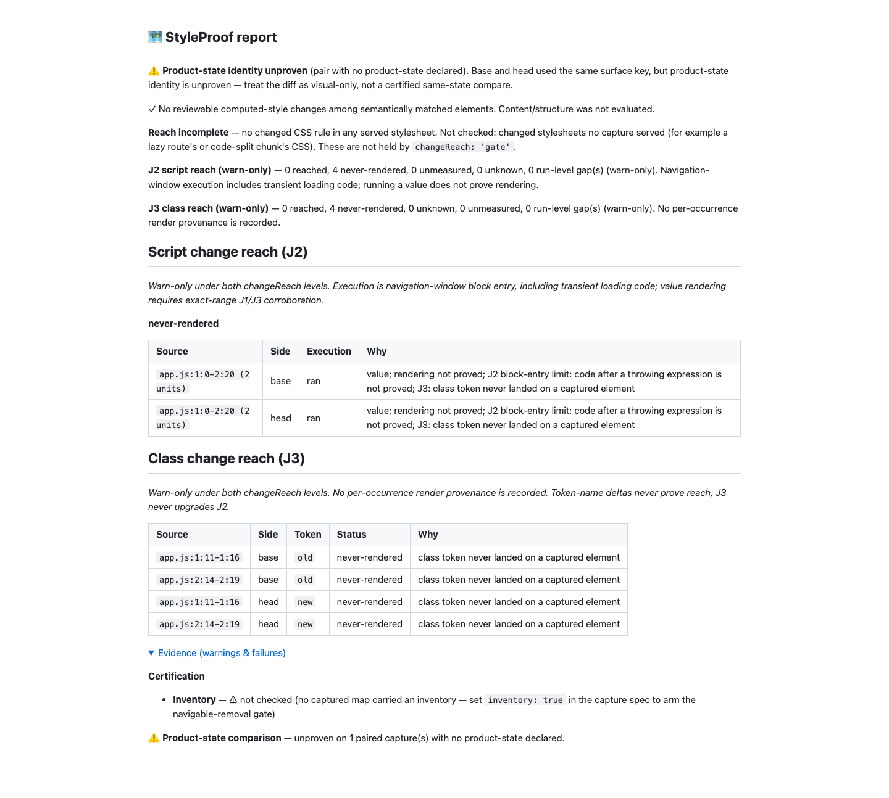

# J3 class-list delta join (#1001)

Historical round-zero proof. [Round-one corrections](round-1/proof.md) supersede
the absence-of-delta rule, extraction exclusions and corpus unknown totals below.

Base: main after #1000 / PR #1302 (`0cc4bd2dc`).

## Decisions

- Reuse the J2 Git/manifest adapter, captured revision SHAs, project-root prefixes
  and base/removal versus head/addition rules. Full blobs remain transient.
- The existing J2 lexer supplies literal starts. A separate J3 reader accepts
  vocabulary-only strings or explicit class attributes/helpers and skips prose.
  Raw changed columns and identical literal words at identical source positions
  exclude untouched tokens. This exclusion is textual, never render provenance.
- Pair captures by filename key; use certification path correspondence, same-tag
  pairs and both sides' volatile exclusions. Only directional class-list deltas
  enter J3. One-sided elements provide no paired delta.
- No delta: never-rendered. Delta without occurrence provenance: unknown. Missing
  ledgers, vocabulary, source ranges or pairing: named unmeasured gaps.
  A future type hook names source-mapped render provenance; captures record none,
  so no J3 unit can currently reach or corroborate J2.
- J3 negatives can lower overlapping J2 ranges while retaining `execution: ran`.
  J3 never upgrades J2; neither execution nor a same-line class delta proves another
  value rendered. Both levels remain warn-only and reach stays incomplete.
- JSON gives style findings priority, then shares a 64 KB J2/J3 detail budget.
  Full class status/gap counts survive truncation. Human tables/gap lists are bounded.
  Missing J3 inputs keep class-list deltas explicitly not checked.

No dependency, configuration, capture-schema or breaking public API change is needed.
The report adds class units/counts/gaps. The old J3 prototype is removed; its
historical noise-replay adapter calls the source implementation. Consumer noise
and capture-cost receipts were not remeasured by this task.

## Red to green

Retained logs replace the local checkout path with `<checkout>` and remove trailing whitespace.

- [Initial red](red.log): no J3 implementation existed; importing the required
  classifier failed. The initial tests and red output were committed before the
  implementation commit.
- [Context red](context-red.log): a className ternary with a non-vocabulary marker
  was skipped, while an untouched known alternative was included. The class-context
  tracking and identical-position word exclusion fix that regression.
- [Report red](report-red.log) pins the absent class report fields.
- [Report limits red](report-limits-red.log) pins explicit not-checked wording for
  unavailable inputs and rejects a retained complete flag when J3 detail is omitted.
- [Focused green](unit-green.log) covers classifier, contexts, direction, prose,
  collisions, source ranges, missing evidence, ordering, warn-only reporting and budgets.
- Real Git/esbuild/Chromium tests cover module definitions that execute without
  rendering, same-token collisions and the report's captured-SHA/filename pairing.

Pre-commit initially rejected unused test destructuring, then five over-complex
new functions. These were corrected and split; hooks were never bypassed.
The first full verify attempt passed all 6,077 tests but failed the runner's
shared-dist immutability guard because a separate demo/bench build ran concurrently.
Final verification was rerun after builds, without a concurrent dist writer.

## Corpus before and after

| Measurement                 | Before  | After   |
| --------------------------- | ------- | ------- |
| Cases / visual              | 16 / 15 | 18 / 17 |
| Declared shown              | 1/15    | 3/17    |
| Complete shown              | 14/15   | 16/17   |
| Declared misses named       | 14/14   | 14/14   |
| Unknown declared / complete | 5 / 6   | 5 / 8   |
| Unknown scenario cells      | 11      | 13      |

[Before command output](corpus-before.log),
[measured receipt](../../../bench/reach-corpus.results.json),
[method and case details](../../../bench/reach-corpus.review.md).

Of the original cases, declared module-constant and colliding-constant move from
unknown to never-rendered. No existing cell becomes unknown. The three complete
class cases stay unknown in the combined src judgment, replacing separately
reported prototype reached labels. The two new ADR cases add four unknown cells:
class-plus-style on the same line, and both constants changing the same token.
Net unknown-cell change: +2. All 36 case/scenario expectations pass; occurrence
counts and each occurrence's status are also checked, with zero J2/J3 source-unit gaps.

## Generated report

[Report Markdown](report.md), [report JSON](report.json).

This is an advisory visual-only comparison: product-state identity is unproven,
inventory is not checked, and the changed-stylesheet join remains not checked.
The report correctly says reach incomplete. Its four class occurrences are
never-rendered even though their J2 definitions ran; no J1 finding holds the verdict.
The screenshot was inspected at 1440 CSS pixels with all evidence details expanded;
the complete warning text, source ranges, statuses and zero reached counts agree
with the JSON and Markdown. It is behavioral proof of the report, not a certification.

## Verification evidence

- `pnpm run verify`: passed, 6,080 tests, zero failures; [real tail](verify-tail.log).
- `pnpm run bench:reach:check`: passed all 36 scenario expectations;
  [real tail](bench-tail.log).
- The initial `pnpm run test:e2e`: 1,164 passed, one existing skip;
  [real tail](e2e-initial-tail.log). The skipped scenario requires a non-Chromium
  Playwright project and is intentionally skipped in this Chromium suite.
- Final focused J3 run: 24 passed, zero failures ([output](unit-green.log)).
- `pnpm run demo:check`, context checks, privacy scan and scoped Fallow checks passed.
- Heavy suites started below the requested 1-minute load limit (final verify: 3.14).
  The branch push runs the unchanged hooks, including the full browser suite;
  its exact-head result is included in the implementation handoff.
