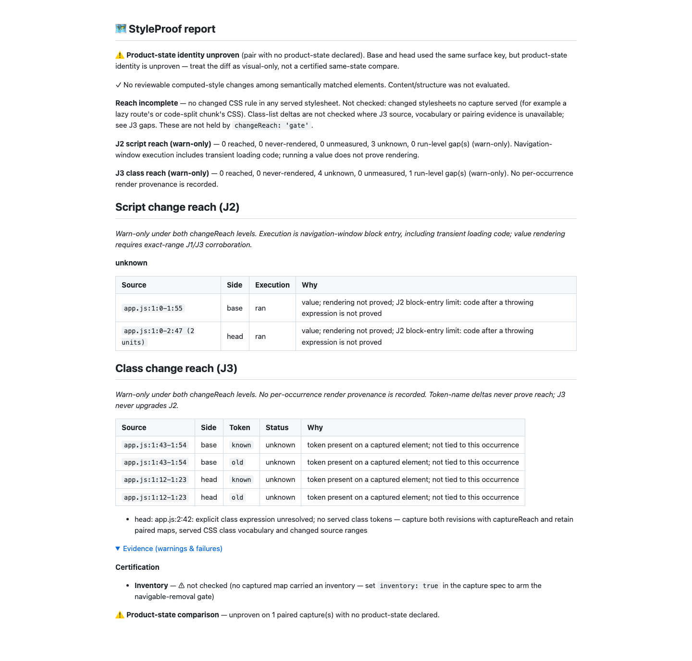

# Class delta join: round-one review and QA corrections

Historical round-one proof. [Round-two corrections](../round-2/proof.md) supersede
its omission, explicit-context and corpus claims.

Review base: `6c984fdf1f7b20e0036be52f7a8ef2e738a0f044`.
Fetched origin/main and rebased first; Git reported the branch already up to date.
The caller explicitly corrected the previous no-delta rule. ADR 0009, README and
REFERENCE now state the presence rule below. No breaking public API or verdict
change is needed; J3 still has no reached path and never upgrades J2.

## Corrections

- Pure insertion/deletion lines never use opposite-blob exclusions. Only lines at
  the same relative index within a replacement block may be compared. Stable words
  and literal values on those aligned lines can be excluded, including shifted
  line numbers, without clearing a newly inserted sibling or constant.
- Negative evidence requires absence from every captured element on the unit's
  own side: head for additions, base for removals. Presence on paired, unpaired,
  tag-replaced or volatile captured elements stays unknown. A class-preserving
  refactor cannot lower J2. Unpaired/tag replacement deltas remain token-name
  diagnostics only; no occurrence provenance is recorded.
- Missing evidence is scoped to its side/file and parser expression range when
  available, rather than downgrading every unit in the comparison.
- Source line starts are precomputed, positions use binary search, template token
  walks use only that substitution's index range, and literal lookups are indexed.
  The existing J2 lexer/execution semantics remain unchanged.
- CSS identifiers consume escapes before a dot can become a class delimiter.
  Escaped IDs/attribute values cannot invent vocabulary; escaped colons/slashes and
  class selectors within `:not()` work.
- Simple helper object keys, nested templates, Vue object/array bindings and Svelte
  directives/interpolations are read. Adjoining dynamic template fragments are
  excluded. Unresolved explicit class contexts emit named scoped gaps, including
  bare className assignments. Remaining forms are documented in REFERENCE.
- Nested prose under a class helper is pinned as a conservative candidate, as the
  review permits; ordinary prose outside explicit class contexts remains skipped.

## Red to green

[Initial red](red.log): 24 new tests, 4 passing and 20 failing. The old 1 MB scans
exceeded the child's five-second deadline. [Additional red](additional-red.log)
pins an unresolved bare className assignment that previously produced no gap.
Logs redact checkout/runtime paths and strip trailing whitespace only.

[Focused green](focused.log): 891 tests passed, including all 25 new regressions and
existing J2 regressions. The measured scanner-only 1 MB times in this run were
208.09 ms for strings and 220.78 ms for templates, both below the asserted 1,000 ms.
The test subprocess itself has a five-second timeout so a future quadratic
regression cannot hang the suite for minutes.

[Real Chromium/Git tests](e2e-focused.log): all three passed, including the new
class-preserving refactor. Its class units remain unknown and its J2 units are
not lowered, despite identical class lists. The existing unopened-constant and
same-token collision cases still pass.

One development-focused run failed on partial synthetic maps lacking `elements`;
that fallback is now safe. That run also hit the shared-dist writer guard when a
benchmark build was inadvertently overlapped; subsequent runs were sequential.
Fallow rejected one selector walk for cognitive complexity; it was split without
changing any gate or suppression.

## Corpus

All 36 scenario expectations remain pinned; the corrected colliding-constant
expectation is deliberately changed rather than hiding the measured result.

| Measurement                 | Main after J2 | First J3 head | Round one |
| --------------------------- | ------------- | ------------- | --------- |
| Cases / visual              | 16 / 15       | 18 / 17       | 18 / 17   |
| Declared shown              | 1/15          | 3/17          | 3/17      |
| Complete shown              | 14/15         | 16/17         | 16/17     |
| Declared misses named       | 14/14         | 14/14         | 14/14     |
| Unknown declared / complete | 5 / 6         | 5 / 8         | 6 / 8     |
| Unknown scenario cells      | 11            | 13            | 14        |

Declared branch-class and module-constant remain never-rendered: their head tokens
are absent. Declared colliding-constant becomes unknown because `tone-red` already
exists on the healthy delete link. Its base removal can still be negative, but
that never clears or downgrades the head occurrence. All three complete class
cases remain unknown. Zero J2/J3 source-unit gaps are asserted by the corpus.

The new presence rule therefore adds one unknown cell versus the first J3 head,
not zero. Versus main, only declared module-constant moves unknown to negative;
the two new ADR cases add four unknown cells, producing a net increase of three.

## Generated refactor report

[Markdown](report.md), [JSON](report.json).

The report was generated from the real Git/Chromium refactor fixture and inspected
at 1440 CSS pixels with every evidence detail expanded. It shows zero computed-style
changes, all three J2 units ran but stay unknown, all four class occurrences stay
unknown, and no never-rendered unit holds or lowers the verdict. The dynamic `CLS`
assignment has a separate head/app.js expression gap, which does not poison the
constant's class occurrence. Product-state identity remains unproven, inventory is
not checked, and the changed-stylesheet join remains not checked. These caveats are
preserved in the full screenshot; this is visual-only advisory proof.

## Final verification

- `pnpm run verify`: 6,105 tests passed, zero failures; [real tail](verify-tail.log).
- `pnpm run bench:reach:check`: all 36 expectations passed; [real tail](bench-tail.log).
- `pnpm run demo:check`: committed demo is up to date.
- Focused real Chromium/Git run: three passed; [output](e2e-focused.log).
- Context, privacy, lint, Fallow and commit hooks passed without bypasses.
- A proof-commit attempt raced a temporary config file removed by active CLI tests;
  the unchanged hook was rerun after verify finished. No gate rule was weakened.
- Final full browser validation runs in the unchanged pre-push hook on the exact
  committed head; its result and real tail are included in the implementation handoff.
