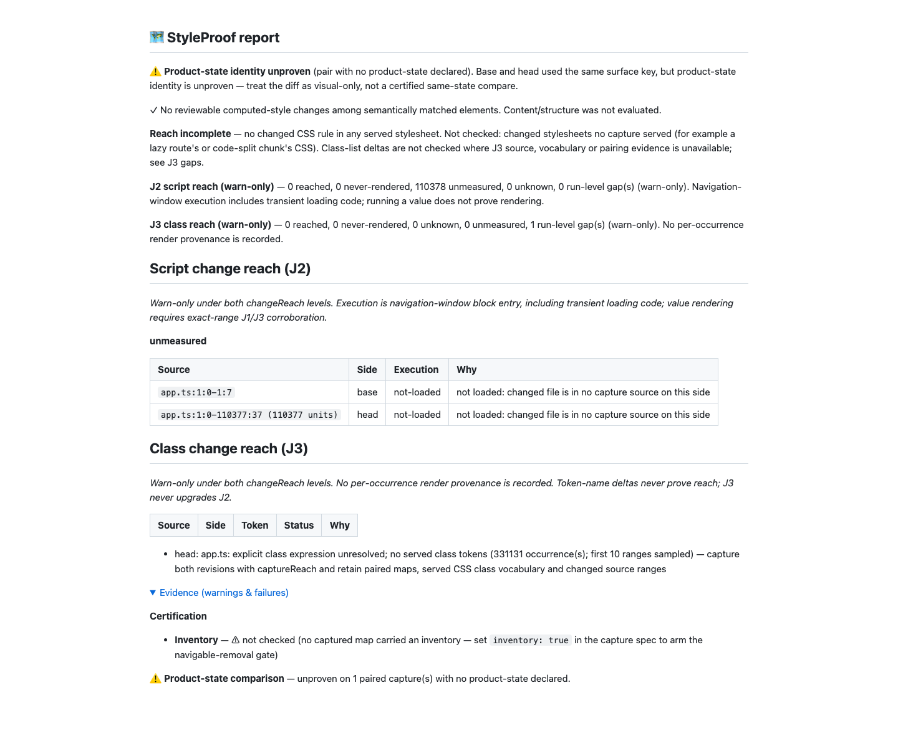

# Class delta join — round 10

Source/test commit: `d6465072d`. Baseline: `a9883f84d`. Red checkpoint: `cac681f92`.

The previous extraction fix still overflowed the argument stack in report assembly. This round tests the whole path: a 4,194,326-byte file (110,377 template lines) through `classifyClassReach`, real Git/manifests with `assessReachDirs`, and the default warn-level `styleproof-report` CLI. The final 20-test regression file fails all 20 tests against the unchanged baseline and passes all 20 on the fix. The CLI changes from exit 2/no report to exit 0 with JSON, Markdown and HTML. See [red](red-final.txt), [green](green-proof.txt) and the [actual generated report](report.md).

Unresolved explicit expressions now produce one gap per source file and side: `occurrenceCount` counts distinct ranges, and `sampleRanges` contains the first ten in numeric source order. The 331,131 unresolved occurrences in this fixture become one summary. Exact ranges stay internal to the evidence lookup, so summarization does not make unrelated known class units unmeasured. Duplicate/reordered changes retain deterministic counts and samples. Fragment/depth gaps remain separately named. All detail still passes through the existing report budget after style findings.

The CLI artifacts total 13,603 bytes (JSON 7,116; Markdown 2,444; HTML 4,043). J3 classes/gaps occupy 1,032 compact JSON bytes. No byte ceiling or timing guard was raised. The 16k scoped lookup guard classifies in 175.810 ms and combines in 5.927 ms; the replacement-hunk guard classifies in 428.724 ms. The standalone 4 MB extraction takes 1,906.945 ms in the final verification run.

The source audit removes 46 argument-spread call sites, including all array append and maximum/minimum argument spreads. Ordinary array-literal spreads remain safe. A dev-only TypeScript AST test pins the production append/maximum rule. The five remaining calls have bounded shapes: browser executable components (fixed platform list), description rule aliases (static lists), evidence-file path segments (native filesystem path limits), crop images (at most two), and surface context maps (paired before/after call sites). Wide CDP child/root traversal (150,000 author roots) and 150,000 disjoint backtick runs in `codeValue` have regression tests. No runtime dependency was added.

Compact `>=`/`>>=`/`>>>=` splitting now requires an established type root. Runtime comparisons remain operators. Compact aliases/annotations/defaults from round 9 remain non-explicit, while `n<lo?...:n>=hi?...`, compact helper conditions and shift assignments retain their runtime roles.

## Oracle evidence

Both expanded columns use the same generator and accepted programs: four languages, 4,000 accepted programs per language per seed, 48,000 total. The expansion adds compact runtime comparisons and shift-assignment fragments. Type false positives and extraction errors are zero on every seed.

| Seed | Type literals / false positives | Runtime positives | Previous misses | Fixed misses | Hidden with gap | Hidden without gap | Retained non-explicit |
| ---- | ------------------------------- | ----------------- | --------------- | ------------ | --------------- | ------------------ | --------------------- |
| 1    | 216,376 / 0                     | 69,870            | 4,102           | 886          | 254             | 333                | 299                   |
| 2    | 215,613 / 0                     | 68,950            | 3,973           | 884          | 239             | 356                | 289                   |
| 3    | 218,034 / 0                     | 68,864            | 4,058           | 947          | 270             | 335                | 342                   |

All hidden counts are identical to the baseline for each seed and language. Runtime misses fall from 12,133 to 2,717, entirely through recovered positive roles. CI separately pins hidden-with-gap, hidden-without-gap and retained non-explicit counts for each language; the existing percentage ceilings remain unchanged. Seed 1 at 1,000 programs/language pins TS `0/0/0`, TSX `61/77/95`, Vue `19/5/0`, Svelte `16/5/0`.

The original, unchanged round-9 generator was also rerun. Its three seeds match the approved source exactly: zero type positives over 656,464 literals; runtime misses 953, 950 and 954 (2,857 / 200,629 positives). No hidden-count regression. Full raw seed JSON and the counterfactual baseline fixture accompany the private run receipt. [Expanded data](oracle.json) · [comparison](oracle.html).

## Behavioural proof and limits

This is a synthetic report robustness fixture, with clean real Git SHAs, stamped manifests and identical empty style maps. Its script ledger deliberately has no mapped files, so 110,378 J2 units remain unmeasured/not-loaded. The report records no reached J3 unit and stays reach-incomplete. It does not certify rendering or capture coverage. Product-state identity is unproven, inventory is not checked, content/structure is not evaluated, and the unbuilt changed-stylesheet join remains named. The screenshot opens the evidence section so its warnings remain visible. There is no motion to prove; video is not applicable.

The report and screenshot were read at 1,440 px; the oracle chart was inspected at 728 and 390 px with no console errors or clipping. Existing lexical residuals remain: the TSX slash/regex ambiguity, SFC generic-arrow markup and template-literal types. This round does not change J2 syntax, add occurrence provenance, upgrade J2, evict visual findings or change the warn verdict.

## Verification

`pnpm run verify`: 6,592 tests / 32 suites passed; zero failures, cancellations, skips or todos; 251,953.805792 ms. Launch load 2.29. [Real tail](verify-tail.txt).

`pnpm run test:e2e --workers=4`: 1,216 passed (8.3m), one existing skip at `test/cross-element-state.e2e.spec.ts:112` because it requires a non-Chromium project. Launch load 4.29. [Real tail](e2e-tail.txt).

`pnpm run bench:reach:check`: all 36 scenarios pass, including independent base removals. Unknown totals remain 7 declared / 8 complete, 18 cases / 17 visual cases, all 14 declared misses named, no J2/J3 gaps. The fresh receipt matches the baseline except its generated timestamp. Launch load 3.46. [Real tail](bench-tail.txt).

`npm pack --dry-run --json` succeeds with 390 files, including the new compiled gap module and declarations; the dev-only oracle is excluded. Demo freshness and final privacy scans pass. No package or lockfile diff against main. No PR is opened.

Intermediate failures were retained honestly: public transcripts initially contained local file URLs and were made relative for privacy; a missing fixture source binding initially produced exit 1 until trusted expected SHAs were supplied; a parenthesization error in the append conversion was caught by capture tests and corrected. A final redundant rebase attempt while proof files were uncommitted was refused; main was unchanged and remains an ancestor, and rebase is rechecked after this proof commit. The earlier health output flagged added loop complexity; the normal source commit passes the unchanged audit and health hooks. Full raw transcripts remain in the run folder.
