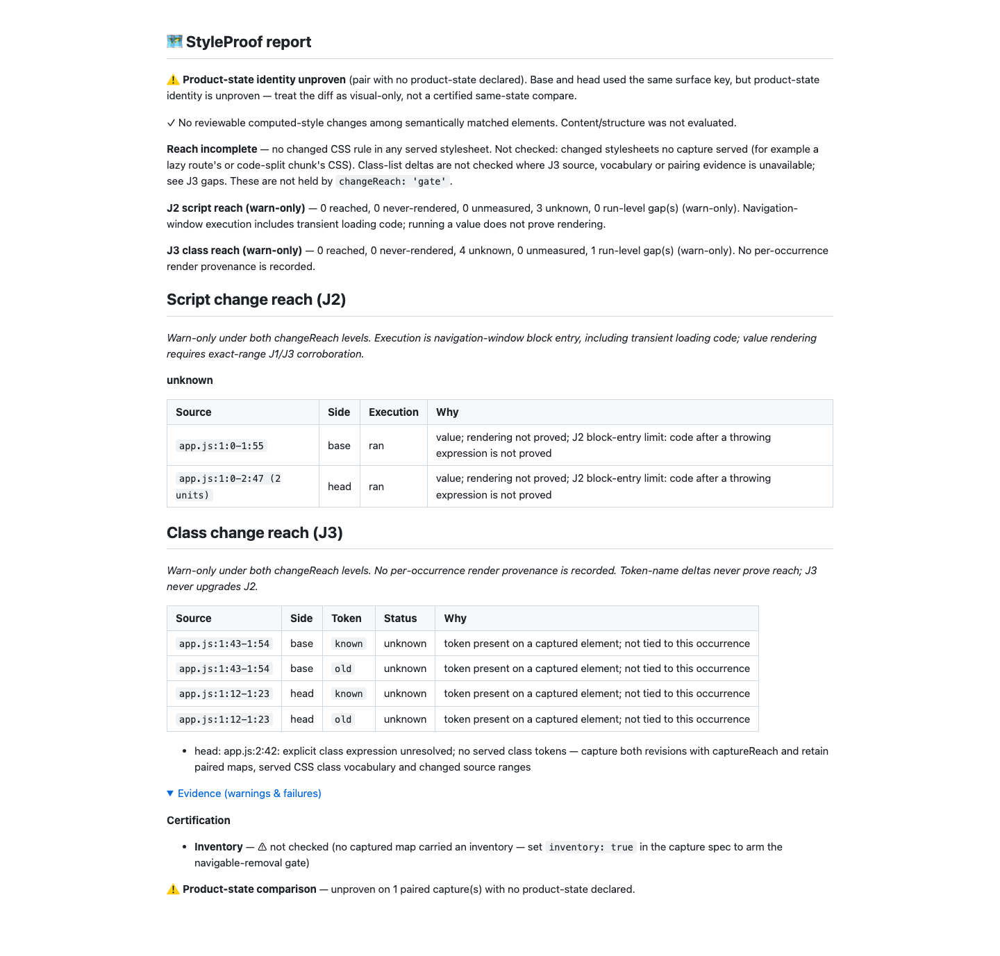

# J3 review corrections, round two (#1001)

Review baseline: `95e6f7cd55f07a2105e49d363c0c17d29cca9f23`. The branch was
fetched and rebased onto the latest origin/main; it was already current. Changes
are additive map/unit metadata and advisory classification corrections. No
breaking change is required. No J3 unit reaches, upgrades J2 or changes a verdict.

## Decisions

- Token absence is negative only when every map on the occurrence's side records
  no omissions. Volatile elements, a configured ignore list, untraversed shadow
  hosts/frames or legacy maps missing omission facts keep absence unknown.
  `classPresence` version 1 persists an ignored boolean and shadow-host/frame
  counts, including cross-origin frames. Selector text is not persisted. The
  internal hover sink and UA-default iframe are capture tools, not omissions.
- `ClassUnit.explicit` distinguishes class attributes/assignments, helper values
  and classList calls from vocabulary-only candidates. Only an explicit negative
  may lower an overlapping J2 range. Legacy units without this flag cannot lower
  J2. Vocabulary-only J3 units remain visible without lowering script evidence.
- cva base/variant values are class contexts. Bare, quoted and computed variant
  keys, default selections and compound conditions are not class values. Quoted
  `variants` option keys retain their class values. Solid classList keys are read.
- A word touching changed columns, including a zero-width edit at its edge, is
  changed unless excluded by aligned opposite-line evidence. Prefix/suffix edits
  retain both base and head tokens. Concatenated class fragments produce named,
  scoped gaps even when only their dynamic suffix changes.
- Scoped gaps and explicit negatives are grouped by source key and side. Their
  sorted intervals are merged once and queried with binary search. No per-unit
  all-gap scan or J2-by-J3 cross product remains.
- The corpus retains and independently checks base-side removals on replacement
  lines. REFERENCE names the remaining textual line-alignment exclusion: base
  `const A='tone'` can align with head `const B='tone'` before `const A='tone2'`.
  Undiscoverable closed roots and forms requiring data flow remain documented
  limitations; no binding or render provenance is inferred.

## Red to green

[Initial unit red](red.log): all 20 new regressions failed. The 16,000-line case
measured 2,990.29 ms for classification and 1,051.13 ms for combination, both over
the individual 1,000 ms limits. [Capture red](capture-red.log): four failures
(ticker, ignore, shadow and frame), with the present-token control passing.

Additional failing tests pin [base-side corpus retention](corpus-red.log), the
[hover-sink omission false positive](control-red.log), and [computed/quoted cva
configuration](cva-red.log). Public logs normalize checkout paths and trailing
whitespace only; raw logs are retained in the handoff directory.

The focused green run has 922 passing tests, including all 21 round-two unit
regressions, the corpus adapter test and existing J2 regressions,
and eight real Chromium/Git cases: unopened constant, same-token collision,
class-preserving refactor, plus the control/ticker/ignore/shadow/frame captures.
See [focused output](focused.log) and [Chromium output](capture-green.log).

A preliminary full run failed on the extra cva regression and capture harnesses:
my initial hover-sink check used a new DOM method and changed selector-check order.
Restoring the existing selector contract avoids extra attribute work; all 108
targeted capture/J3 tests pass without weakening their assertions. The final full
run below supersedes that development run. Fallow also required splitting the
literal and corpus checks; no hooks, checks or suppressions were bypassed.

## Corpus

All 36 scenario expectations include the existing J2 gates and the new independent
base-removal checks. No J2/J3 run-level source-unit gaps are ignored.

| Measurement                 | Main after J2 | Round one | Round two |
| --------------------------- | ------------- | --------- | --------- |
| Cases / visual              | 16 / 15       | 18 / 17   | 18 / 17   |
| Declared shown              | 1/15          | 3/17      | 3/17      |
| Complete shown              | 14/15         | 16/17     | 16/17     |
| Declared misses named       | 14/14         | 14/14     | 14/14     |
| Unknown declared / complete | 5 / 6         | 6 / 8     | 7 / 8     |

Declared branch-class's explicit head occurrence is absent and remains
never-rendered. Module-constant's head J3 token remains never-rendered, but its
combined ran/unknown J2 range is no longer lowered by a vocabulary-only candidate.
Colliding-constant's head token is present and unknown; its absent base removal
is never-rendered. Complete tokens on both sides remain unknown. No J3 token
status changed from the corrected round-one corpus; the combined module cell did.
The four extra unknown cells versus main come from the two added ADR scenarios.

## Generated report

[Markdown](report.md), [JSON](report.json).

Generated from the real Git/Chromium refactor fixture and inspected at 1440 CSS
pixels with evidence expanded. It preserves zero reviewable computed-style
changes, three ran/unknown J2 units, four unknown J3 units and the scoped head
expression gap. The JSON distinguishes explicit base occurrences from head
vocabulary candidates. Product-state identity and inventory caveats remain
visible. This is visual-only advisory proof. No product UI layout changed, so no
motion/video proof applies; ticker behavior is checked by real capture tests.

## Final verification

- `pnpm run verify`: 6,128 tests passed, zero failures; all context, suppression,
  type, lint, format and privacy checks passed. [Real tail](verify-tail.log).
- `pnpm run bench:reach:check`: all 36 scenario expectations passed, including
  independent base-removal counts/statuses. [Real tail](bench-tail.log).
- `pnpm run demo:check`: the checked-in demo remains current.
- The focused browser run passes all eight cases. The full `pnpm run test:e2e
--workers=4` gate runs through the normal pre-push hook; its exact-head output
  accompanies the final handoff instead of being committed after that hook.

Hooks stay on for every commit and push. Heavy suites and the push start only
below the requested 60 load limit. The push uses the exact round-two lease;
no pull request is opened.
