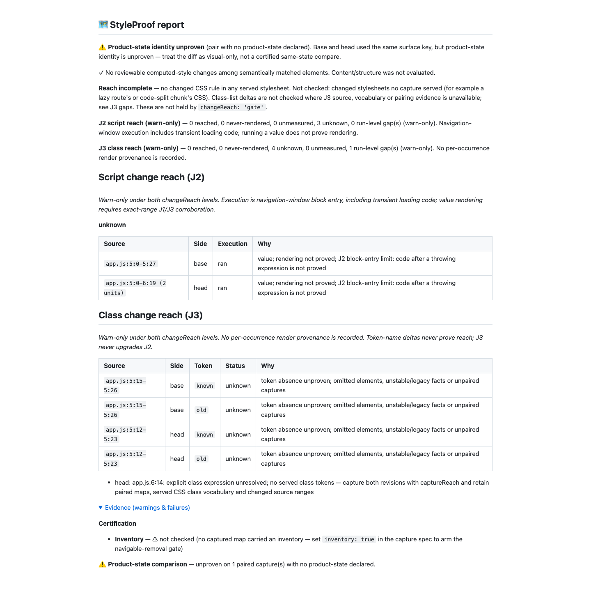

# J3 review corrections, round three (#1001)

Review baseline: `ac3bbae589e1295ff8848d0b27ba5551309359de`. Fetched and rebased
onto latest origin/main (`0cc4bd2dc`); already current. All hooks stay enabled.
The map facts are versioned additively; older maps remain readable and conservative.
No breaking API change, reached path, J2 upgrade or verdict change is introduced.

## Decisions

- Only classList.add arguments and the second replace argument are positive class
  contexts. Queries, removals, toggles, other replace arguments and data-class
  attributes stay J3-only. An unrelated nested call blocks inherited positive
  evidence, including template substitutions and Vue/Svelte binding expressions.
  Conservative vocabulary/helper candidates remain listable without lowering J2.
- classPresence version 2 requires verified CDP author-root counts, no outside-body
  children, no embedded documents, no configured ignores/volatile elements, and
  complete capture pairing on both sides before absence can be negative. Version-1
  maps, missing fields and failed/unsupported CDP probes keep absence unknown.
  HTML children outside head/body are counted rather than traversed. Frame counts
  cover iframe/frame/object/embed throughout the main document, including head.
- DOM.getDocument with depth -1 and pierce true sees open/closed author roots.
  User-agent roots are excluded. Capture and the CDP scan share FRAMEWORK_IGNORE,
  including Next announcers and their shadow roots. The internal UA-default iframe
  is removed before document counts are read. CDP sessions are registered as
  StyleProof-owned, read without profiling changes, and detached in cleanup.
  The probe runs only with captureReach; ordinary captures retain the existing
  CDP command/cleanup contract and cannot prove absence without verification.
- Self-check compares omission facts and marks the retained first map unstable
  whenever they differ. A later cleaner read cannot clear uncertainty, in either
  direction. The existing CSS-ledger self-check remains unchanged. Facts can vary
  across independent runs; they are not rendering provenance.
- Shifted unchanged neighbours match within hunk-aligned literals, preserving
  token order and multiplicity. Pure additions/deletions keep their occurrences.
  Reordered class words remain measured. Binding identity is still unknown: the
  previously documented A='tone' / B='tone' line-alignment residual remains.
- ADR item 5, its Consequences corpus paragraph, README, CHANGELOG and REFERENCE
  now state these rules. QA's stale "J3 is not built" sentence is corrected:
  J3 is implemented, but has no per-occurrence render provenance to corroborate J2.

## Red to green

[Initial unit red](red.log): 23 failures / 6 passes across 29 tests.
[Real Chromium red](capture-red.log): all ten initial cases fail, including actual
class assignment inside object/embed documents. Additional red evidence pins a
[frame outside body](head-frame-red.log), prevents [overmatching reordered words](alignment-red.log),
and covers the same [context leaks in Vue/Svelte](framework-context-red.log).
The mixed-word expectation was corrected to the required code-point order.
Public logs normalize checkout paths and trailing whitespace only.

[Focused green](focused.log): 1,045 tests pass, including all 36 new unit tests,
existing J2 regressions and capture's DOM-work contract. [Chromium green](capture-green.log):
all 23 cases pass, including 15 new cases covering omissions, non-positive classList
refactors, framework exemptions with open/closed roots, UA roots and a head iframe.
The Vue/Svelte reader is pure source logic and is covered by exported-classifier
unit tests; no framework application or product UI layout changed.

One focused run exceeded the unchanged 1,000 ms template timing limit; its raw
output is retained with the handoff. A targeted repeat and subsequent full focused
runs pass without relaxing the bound. The order-preserving matcher was added after
its first multiset implementation erased reordered words; the regression remains.

## Corpus

All 36 scenario expectations pass, including independent base-side removal checks.
No J2/J3 run-level source-unit gaps are ignored. The round-three receipt preserves
all round-two J3 and combined statuses.

| Measurement                 | Main after J2 | Round two | Round three |
| --------------------------- | ------------- | --------- | ----------- |
| Cases / visual              | 16 / 15       | 18 / 17   | 18 / 17     |
| Declared shown              | 1/15          | 3/17      | 3/17        |
| Complete shown              | 14/15         | 16/17     | 16/17       |
| Declared misses named       | 14/14         | 14/14     | 14/14       |
| Unknown declared / complete | 5 / 6         | 7 / 8     | 7 / 8       |

Declared branch-class has J3/combined never-rendered. Module-constant has a
never-rendered head J3 candidate and unknown combined status. Colliding-constant
has unknown head J3/combined status and never-rendered base J3. All complete base
and head class occurrences stay unknown. The two added ADR scenarios account for
the four additional unknown cells versus main. No occurrence reaches or
corroborates J2.

## Generated closed-root refactor report

[Markdown](report.md), [JSON](report.json), [actual capture facts](capture-facts.json).

A real Git/Chromium fixture extracts 'old known' to a constant while its span stays
inside a closed author root. Both captures record shadowHosts 1 and successful CDP
verification. Neither token is in the compared element map, so absence is unproven.
The report shows three ran/unknown J2 units, four unknown J3 units, no reached or
never-rendered units, no blocking and zero reviewable computed-style differences.
The unresolved head assignment retains its scoped gap. Product-state identity,
inventory and changed-stylesheet caveats stay visible. The expanded report was
inspected at 1440 CSS pixels. No motion/video proof applies to this static refactor;
the real capture tests verify the boundary behavior.

The [first full browser hook](browser-gate-red-tail.log) found seven CDP round-trip/cleanup assertion failures:
the new probe had also run with Change Reach disabled. It is now gated on
captureReach; the existing assertions are retained unchanged. The new opt-out
[red test](probe-off-red.log) also proves the default should open no CDP probe.
All nine targeted [round-trip/cleanup tests pass](probe-gate-green.log). Final gate evidence
below supersedes that failed push attempt.

## Final verification

- `pnpm run verify`: 6,165 tests passed, zero failures. Context, suppressions,
  typecheck, lint, format and privacy checks pass. [Real tail](verify-tail.log).
- `pnpm run bench:reach:check`: all 36 scenario expectations pass, including base
  removal counts/statuses. [Real tail](bench-tail.log).
- `pnpm run demo:check`: the checked-in demo remains current.
- The focused browser run passes all 23 cases. The full `pnpm run test:e2e
--workers=4` gate runs through the normal pre-push hook; its exact-head output
  accompanies the final handoff instead of being committed after that hook.

Heavy suites and the push start only below the requested 60 load limit. The
round-three push uses the exact lease against ac3bbae589e1295ff8848d0b27ba5551309359de;
all hooks remain on. No pull request is opened.
