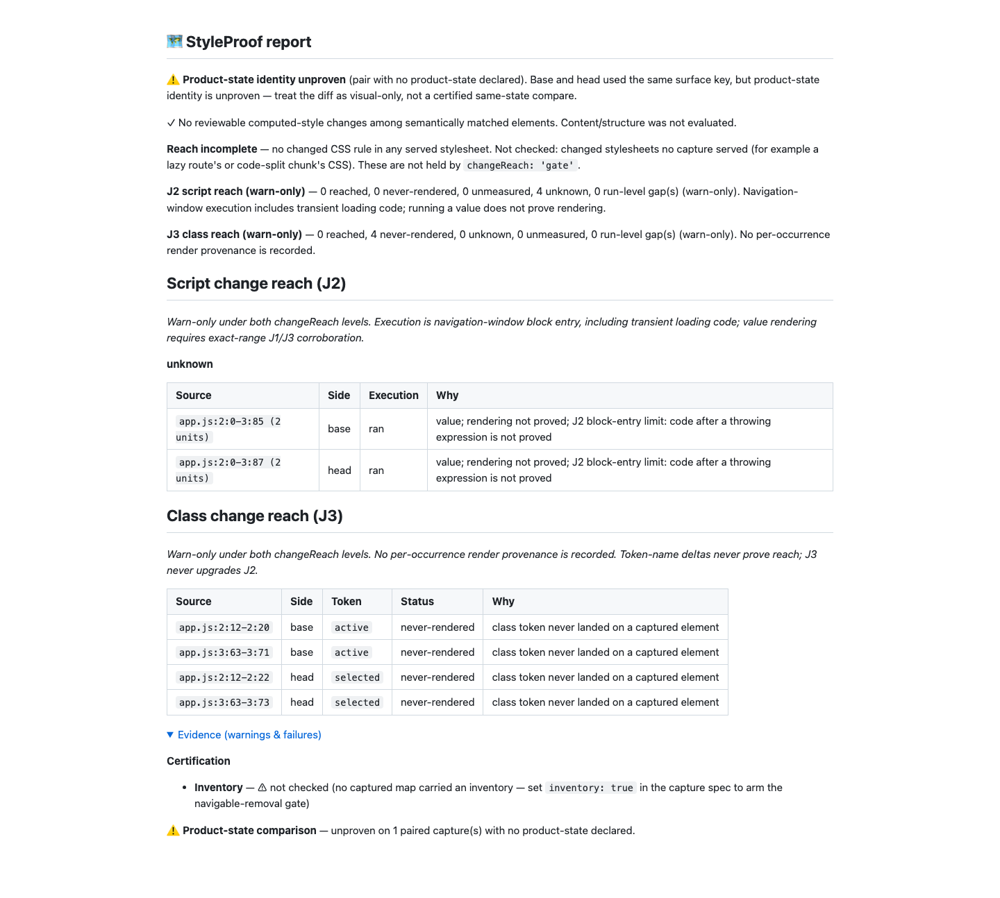

# J3 review corrections, round four (#1001)

Review baseline: `60663942ce06eb98e7d1822cc6e6a33d7e6dadc2`. Fetched and rebased
onto latest origin/main (`0cc4bd2dc`); already current. All hooks remain enabled.
No PR is opened. J3 has no reached path, never upgrades J2, and stays advisory.

## Decisions

- Equality/inequality operands, case labels, method arguments, computed property keys, receiver arrays and
  immediately indexed object keys stay J3-only. This includes parenthesized
  operands, methods named like helpers, and computed/wrapped method calls. Helper
  object keys, ternary results, right-hand && results and indexed-object values
  retain positive class evidence. The role reader uses indexed delimiters.
- Dot/bracket dataset.class assignments cannot lower J2. Plain class properties
  remain explicit for Vue h() props; unrelated data-object ambiguity is documented
  in CHANGELOG and REFERENCE. This remains a lexical reader without data flow.
- Identical token strings match with multiplicity on aligned counterpart lines
  before remaining literals pair for word comparison. Inserted constants do not
  turn unchanged helper arguments into changes. Word matching still preserves
  order within a literal. Pure addition/deletion exclusions and the documented
  binding-identity residual remain unchanged.
- Omission scans and classPresence output are opt-in with captureReach. Default
  capture retains the pre-feature output keys and does not run the author-root
  CDP probe. Head author content and any head element with computed display other
  than none count as omissions; metadata/resource tags with display none remain
  exempt. Route-announcer ownership covers only the host and its shadow tree:
  omitted author light-DOM descendants count, and CDP inspects their author roots.
- A new optional documentBoundsVerified marker distinguishes complete version-2
  facts from older version-2 captures that did not scan these regions. Older maps
  remain readable but cannot prove absence without this marker. This is an
  additive, conservative compatibility change.
- Template nesting is capped at 128 levels and produces a named scoped extraction
  gap covering the capped template and remaining blob, retaining no partial negative evidence. A 4,096-level regression no longer
  overflows the stack. Transient classes removed before capture can correctly
  read never-rendered: the presence rule is a capture-time snapshot.

## Red to green

[Initial unit red](red-unit.txt): 15 failures / 15 passes. [Real Chromium red](red-e2e.txt):
all nine initial scenarios fail. QA additions pin [literal insertion](red-qa-unit.txt)
and [default output shape](red-qa-e2e.txt). The default key assertion was corrected
against main's source to include its existing viewport and state-proof fields;
classPresence was the only added key. The depth-gap assertion uses the public
`reason` field. Further red tests pin [wrapped operands/dataset assignments](red-wrapped.txt),
[computed/wrapped methods](red-methods.txt), and [older v2 facts](red-bounds.txt).
The first full browser run caught a missing className-assignment gap after a
queried receiver ([tail](browser-regression-red-tail.txt)); 1,194 other cases
passed, with one existing skip. [Assignment red](red-assignment.txt) preserves the
repro without weakening the original browser assertion. The corpus then caught
class context leaking into a following JSX style attribute ([red](corpus-boundary-red.txt)).
[JSX boundary tests](red-jsx-boundary.txt) pin adjacent style/title attributes and
keep the alternate ternary result positive. [Computed lookup red](red-lookup.txt)
prevents index/property keys from lowering J2. Object colons, ternary colons and
assignment equals now have separate lexical roles.

[Focused green](green-unit.txt): all 151 class-join unit tests pass, including 45
new round-four regressions and controls. [Chromium green](green-e2e.txt): all 33
focused real-capture/Git cases pass, including ten new round-four cases.

Public logs normalize checkout paths and trailing whitespace; raw logs remain in
the handoff. Hooks initially rejected an overly complex frame reader; extracting
role helpers resolved it. The privacy gate rejected raw local paths in proof logs;
normalizing public copies resolved it without altering test outcomes.

## Corpus

All 36 expectations cover 18 cases, including independent base-side removals.
Only the receipt timestamp changes from round three; every case and J2/J3 gap list
is identical. Declared/complete unknown totals remain 7/8, versus main's 5/6 across
16 cases. The two ADR scenarios add four unknown cells versus main. Visual findings
remain 3/17 declared and 16/17 complete, with all 14 declared misses named.

| Case                  | Declared J3 / combined          | Complete J3 / combined |
| --------------------- | ------------------------------- | ---------------------- |
| branch-class          | never-rendered / never-rendered | unknown / unknown      |
| module-constant       | never-rendered / unknown        | unknown / unknown      |
| colliding-constant    | unknown / unknown               | unknown / unknown      |
| same-line-class-style | unknown / unknown               | unknown / unknown      |
| same-token-collision  | unknown / unknown               | unknown / unknown      |

The declared colliding-constant base removals remain never-rendered; its head token
is present, so the head J3 and combined statuses stay unknown. The other two declared
class cases retain negative base-side evidence. See the measured receipt and corpus
review for per-occurrence counts.

## Report proof

[Generated JSON](report.json), [Markdown](report.md), and [capture facts](capture-facts.json)
come from a real two-revision Git fixture, esbuild source maps, Chromium capture,
and the public report generator. Both revisions render class="tab tab-on". State
predicate strings change from active to selected, with both words in served CSS.
Four executed J2 units stay unknown; four absent J3 vocabulary candidates have
explicit:false and cannot lower J2. There are no reviewable style findings, no
reached J3 units, no blocking reach findings, and reach remains incomplete. The
expanded 1440px report screenshot was inspected. Identity, inventory and unchecked
stylesheet caveats remain visible; this diagnostic is not a certification.

No product UI layout or motion changed. The screenshot proves report semantics;
exported-classifier tests cover the lexical forms without framework runtime builds.

## Verification

Validated source: `6a521cd6d`. Final `pnpm run verify` passes all 6,211 tests
with zero failures/skips, including type, lint, format, privacy, context and
suppression checks. [Real tail](verify-tail.txt). `pnpm run bench:reach:check`
passes all 36 expectations with no J2/J3 run-level gaps ([tail](bench-tail.txt)).
All heavy stages begin only below the required 1-minute load of 60.

The unchanged timing bounds pass: 1 MB strings 258.57 ms, templates 306.00 ms;
16,000 changed lines classify in 324.79 ms and combine in 6.30 ms. Every bound
remains 1,000 ms. The demo report freshness check also passes.

Final `pnpm run test:e2e --workers=4` passes 1,195 cases in 8.2 minutes, with
one existing skip ([real tail](e2e-tail.txt)). The skip is
`test/cross-element-state.e2e.spec.ts:112`, the non-Chromium unsupported-state test
in this Chromium project. No assertion or skip was weakened. Final starting loads
were 2.64 for verify, 4.50 for corpus and 4.29 for E2E.

No source changes follow these gates. The final receipt commit adds documentation
and measured artifacts only; push hooks stay enabled and the branch uses the exact
60663942c lease supplied for round four. Raw logs and rejected/intermediate runs
are retained with the handoff.
