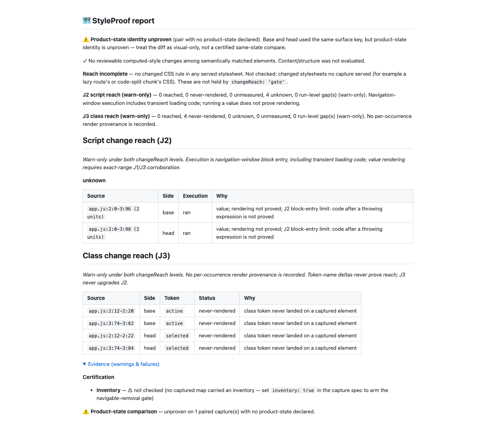

# J3 review corrections, round five (#1001)

Review baseline: `ae5480987afff646756f108a2f7cd346a770c1df`. Fetched and rebased
onto latest origin/main (`0cc4bd2dc`); already current. Test-first checkpoint:
`01135cb9c`; initial implementation: `ba7525a92`; boundary regression:
`793092bf7`; final source: `40a30d752`.
Hooks remain enabled. No PR is opened.

## Design and boundary

- Replace inherited/deny-list explicit status with a positive AST role visitor.
  Babel parser/types are runtime dependencies: parsing JS/TS/JSX handles comments,
  tags, optional calls, relational expressions and typed lookup wrappers without
  guessing operand roles. Parsing never executes source. Unknown syntax supplies
  a named gap. See [Babel parser options](https://babeljs.io/docs/babel-parser).
- Only direct helper values/container keys or elements, ternary results, logical
  RHS results, class attributes/assignments and positive classList arguments pass
  positive roles. Known cva values and supported framework bindings retain support.
  Calls/tags, predicates, lookups, callbacks, unary expressions and ordinary
  assignments cannot inherit a role. README, REFERENCE and ADR item 5 state the
  precise allow-list and conservative residuals, including plain class-property
  and helper-name/type ambiguities. Indexed-object values are now J3-only too.
- Replacement alignment matches ordered token values plus positive role/local
  slot across every line of a replacement hunk. It respects multiplicity and is
  cached per side/hunk. Unchanged card survives constants before/after calls and
  intervening blank lines; moving values between roles/slots still yields units.
  Pure additions/deletions have no exclusion. Binding identity remains unproved.
- A depth cap always emits a named gap from the capped template through EOF,
  including outside class contexts. Later unread occurrences cannot disappear
  silently. Escaped dynamic text/encoded component values stay conservative.
- J3 still has no reached path or provenance, never upgrades J2 and remains
  warn-only. Only explicit negative class values may lower J2. This round does not
  change capture code or default output, statuses, verdict policy or report budgets.

## Red → green

On the review baseline, the initial 48 unit cases had **33 failures / 15 passes**;
15 real Chromium cases had **12 failures / 3 passes**. The three passing browser
controls still lower J2 for genuinely absent positive values. Red tests were
committed first; [red units](red-unit.txt) and [red Chromium](red-e2e.txt) retain
actual failures.

The expanded focused run passes **1,054 units**, including **61 round-five cases**,
and **48 Chromium cases** across all J3 rounds (15 new). It covers tags, in/hasOwn,
optional/non-null/generic calls, comments, relational operators, optional/typed
lookups, arrow/void/assignment operands, depth gaps, whole-hunk alignment and
positive controls. During implementation, tests also exposed lost component brace
bindings, markup text mistaken for source, expando assignments, and encoded values;
[red framework](red-framework.txt), [red markup](red-markup.txt),
[red assignment](red-class-assignment.txt) and [red encodings](red-encodings.txt)
record those failures. The expanded [green focused run](green-focused.txt) and
[green Chromium run](green-focused-e2e.txt) include their passing regressions.

One old indexed-object-value expectation changes to J3-only under the new rule.
The old 16k timing fixture now uses actual `.className` assignments rather than a
bare className variable; its assertions and one-second bound remain. No gate,
assertion count, hook, complexity threshold or timing bound was bypassed/relaxed.

Measured focused costs: 1 MB string/template tests complete in 288/319 ms;
16,000-line scoped classification/combination in 440/17 ms, and whole-hunk
replacement classification in 679 ms (each has the existing one-second bound).
A final manual multiline check found that an unchanged duplicate token outside a
replacement hunk could hide a changed token inside it. Two additional regression
cases failed, were committed in `793092bf7`, and now pass with token matching
restricted to the hunk bounds. [Boundary red](red-hunk-boundary.txt) retains both
failures; the final green runs include both directions.
The first local complexity check flagged five functions; splitting parsing,
recording and assembly helpers cleared the unchanged limits before commit.
An intermediate TypeScript build caught missing internal cooked-value fields;
the subsequent clean build and all reported green runs include the correction.

## Corpus before/after

The fresh round-five receipt matches round four exactly except its timestamp.
All 36 scenario cells, J3 occurrences, base-removal statuses/counts, and zero J2/J3
gaps are unchanged. Unknown totals remain **7 declared / 8 complete**, versus
main's **5/6**. The two added ADR cases account for the four extra unknown cells;
no existing main case changes combined status. Shown counts remain 3/17 declared
and 16/17 complete; declared misses named remain 14/14.

| Case                  | Declared J2 / J3 / combined                 | Complete J2 / J3 / combined |
| --------------------- | ------------------------------------------- | --------------------------- |
| branch-class          | never-ran / never-rendered / never-rendered | ran / unknown / unknown     |
| module-constant       | ran / never-rendered / unknown              | ran / unknown / unknown     |
| colliding-constant    | ran / unknown / unknown                     | ran / unknown / unknown     |
| same-line-class-style | ran / unknown / unknown                     | ran / unknown / unknown     |
| same-token-collision  | ran / unknown / unknown                     | ran / unknown / unknown     |

The module constant's absent head J3 token cannot lower its vocabulary-only J2
range. Colliding-constant has a present head token and absent declared base token.
Both sides are unknown with complete captures. Independent base checks remain in
the corpus oracle. See [measured receipt](../../../../bench/reach-corpus.results.json)
and [method](../../../../bench/reach-corpus.review.md).

## Real capture/report proof

A disposable real Git repository supplies two source-mapped esbuild revisions.
Chromium renders `tab tab-on` on both sides while an equality operand with an
adjacent block comment changes active → selected. The served CSS contains both
predicate names; neither is a class on a captured element. The generated
[JSON](report.json) and [Markdown](report.md) show four J3-only never-rendered
candidates, all `explicit: false`; four original executed J2 lines stay unknown
(two coalesced rows), with no J2 lowering, zero reviewable computed-style changes
and zero reach blocking. [Capture facts](capture-facts.json) have verified v2 zero
omissions. The 1440px screenshot was inspected for labels, ranges and clipping.

This is a diagnostic comparison, not certification: the report visibly retains
product-state identity and inventory warnings, and the separate unbuilt stylesheet
join. No motion/UI flow changed, so video is not applicable; the real-capture
assertions and fresh report screenshot supply behavioural proof.

## Final verification

`pnpm run verify` passes **6,273 tests**, zero failures/skips, including context,
suppression, type, lint, anti-slop, format and privacy checks ([real tail](verify-tail.txt)).
`pnpm run bench:reach:check` passes all **36 scenario expectations**, with independent
base removals and no J2/J3 gaps ([real tail](bench-tail.txt)). Final verify timing:
1 MB strings/templates 231/364 ms; 16,000 scoped units classify/combine in 351/5 ms,
and whole-hunk replacement classification in 614 ms. All bounds stay 1,000 ms.
The frozen-lockfile install, production dependency audit (no known vulnerabilities),
package dry run (382 files, required runtime/bin/docs content checked), and demo
report freshness check pass. Babel dependencies are additive; no public API or
capture-output migration is required.

`pnpm run test:e2e --workers=4` passes **1,210 cases in 8.3 minutes**, zero
failures, with one existing skip ([real tail](e2e-tail.txt)). The skipped case is
`test/cross-element-state.e2e.spec.ts:112`, which requires a non-Chromium project.
No assertion or skip was weakened. Final starting 1-minute loads were 3.42 for
verify, 3.60 for corpus and 4.89 for E2E, all below 60.

The final source is `40a30d752d5b0d4d21cfc9086510daeaa83b3e86`; no source changes
follow these gates. The receipt commit adds only proof and measured tails. Push
uses the exact supplied `ae5480987afff646756f108a2f7cd346a770c1df` lease with
hooks enabled. Raw logs, load receipts, intermediate runs and the reproducible
real Git/Chromium fixture are retained in the local round-five handoff.
