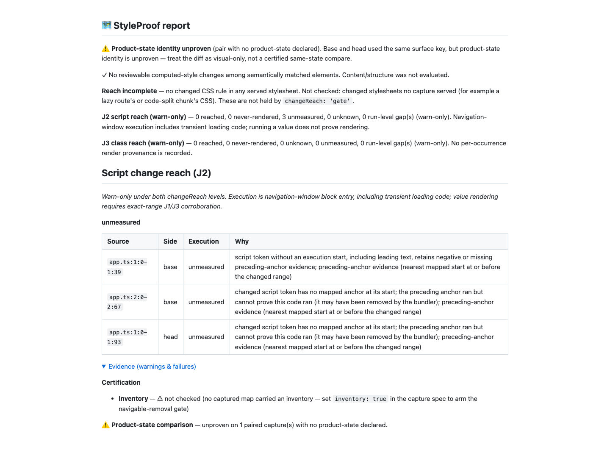

# J3 round-six correction (#1001)

Baseline: dd080f3add12ea88a12ca3f6b2b8ba9254aac797. Fetched/rebased onto origin/main
(0cc4bd2dc); already current. Regression checkpoint: e266ac3e3. Final source:
8ba4baa25e2c27bdff1322a881bab863151fd38f. Hooks remain enabled; no PR is opened.

## Changes

Inline parameter/binding annotations (including optional/definite assignment and
destructured bindings), return annotations, extends constraints and as/satisfies
object types now enter type scope. Property-value colons and runtime ternary
colons keep their class values. An annotation-colon marker distinguishes optional
?: syntax from actual ternary branches; object methods retain return-type handling.
The reader still uses the existing lexer and stdlib only. Dependency files remain
identical to origin/main; no J2 classification, capture or verdict logic changes.

Bracket caps retain completed top-level roots before the first unfinished frame.
That frame is covered through EOF; within a template substitution the entire
unread expression is covered through EOF. Thus neither an earlier complete root
nor an earlier word in the unfinished frame silently loses measurement. Template
depth gaps remain unconditional. Bracket/expression gaps are promised only where
role analysis runs: files with recognized class syntax or explicit bindings.
ADR item 5 and REFERENCE now state that boundary.

Flat else-if chains are scanned once into disjoint condition/result slices. They
consume one ternary nesting level, with compact arm slots instead of an unbounded
alternate path. Actually nested expressions retain the 128-depth cap. A 10,000-arm
regression checks all 10,001 result literals, no depth gap and the unchanged 1s bound.

Receiver-only and neighbour-word alignment residuals are pinned and documented:

- el1.className='card' → el2.className='card' can exclude both occurrences.
- el.className='old'; other.className='old new'; →
  el.className='new'; other.className='old new'; can match against unchanged
  neighbour words. With detached elements J3 has zero units/gaps; J2 stays unknown.
  The matcher is unchanged. Adding an assignment ordinal would disturb correspondence
  when assignments are inserted or split across lines. It currently tracks ordered
  value/role/slot, not assignment/receiver identity; these are named losses of
  negative evidence, not positive render proof.

## Red → green

On the baseline, the first 24 round-six cases had 13 failures / 11 passes
([red](red-unit.txt)): ten inline-type forms, completed-prefix preservation,
incomplete-frame coverage and the long flat chain failed. Existing extends/as/
satisfies negatives, six runtime-colon controls and both accepted residuals passed.
An additional substitution-prefix case also failed ([red](red-substitution.txt)).
All **25 round-six cases** and **1,093 focused J3/J2 cases** now pass
([green](green-focused.txt)). No prior round-five test or bound was changed.

The real Git/Chromium alias-to-inline refactor failed before the fix and passes
now ([red](red-e2e.txt), [green](green-e2e.txt)). It observes that the handler runs
(dataset mode becomes old) while old is absent from captured class lists. The
first fixture assertion expected a ran J2 row; the actual esbuild maps conservatively
leave erased-type tokens unmeasured. The corrected regression asserts the observed
failure: J3 changed the head row from unmeasured to never-rendered. After the fix it
retains unmeasured. The initial fixture output remains in the private handoff and
is not counted as product red evidence.

The first Fallow run rejected the combined ternary scanner for cognitive complexity;
scan/emission helpers cleared the unchanged threshold. All hooks run normally;
no tests, limits or gate configuration were weakened.

## Final verification

pnpm run verify passes **6,313 tests**, zero failures/skips, with type/lint/format,
privacy, context and suppression checks ([real tail](verify-tail.txt)). Its timing
receipts: 1 MB strings/templates 179/264 ms; 16,000 scoped units classify/combine
in 298/7 ms; whole-hunk classification 392 ms; 10,000 ternary arms 47 ms.
Every timing bound stays 1,000 ms.

pnpm run bench:reach:check passes all **36 scenario checks**, including independent
base removals, with no J2/J3 gaps ([real tail](bench-tail.txt)). The remeasured
receipt matches dd080f3ad exactly except timestamp: unknown totals remain 7/8,
shown counts 3/17 and 16/17, and declared misses named 14/14. The package dry run
passes with 386 expected files; demo freshness passes. Runtime dependencies stay
pngjs only; package.json and pnpm-lock.yaml have an empty diff against origin/main.

## Real report proof

The copied disposable Git/Chromium fixture supplies the captured maps, source maps
and comparison revisions. The current [JSON](report.json) and [Markdown](report.md)
show three unmeasured J2 rows, zero J3 units/gaps, zero reach blocking and zero
reviewable computed-style changes. The unchanged type string is now a J3-only
candidate on both sides and is excluded by ordered matching; it cannot lower J2.
[Capture facts](capture-facts.json) retain verified v2 zero omissions.
The fresh 1440px screenshot was inspected for statuses, labels and clipping.

The report preserves product-state/inventory warnings and the separate unbuilt
stylesheet join. This is diagnostic proof, not a certification claim. Video is
not applicable: no animated/interactive UI changed; the real-capture regression
and generated report establish the classification behaviour.

Full pnpm run test:e2e --workers=4 passes **1,211 cases in 8.2 minutes**, zero
failures, with one existing skip ([real tail](e2e-tail.txt)): the unsupported-state
case at test/cross-element-state.e2e.spec.ts:112 requires a non-Chromium project.
No existing skip or assertion was changed. Verify and E2E launch loads were
1.91 and 2.93; all heavy launches were below 60.

No source edits follow these gates. The receipt commit contains only proof/method
notes, README clarification and the measured corpus timestamp. Push uses the exact
dd080f3add12ea88a12ca3f6b2b8ba9254aac797 lease with normal hooks. Raw red/green
logs, load samples, intermediate Fallow/fixture runs and the copied real-capture
Git fixture are retained in the local round-six handoff.
