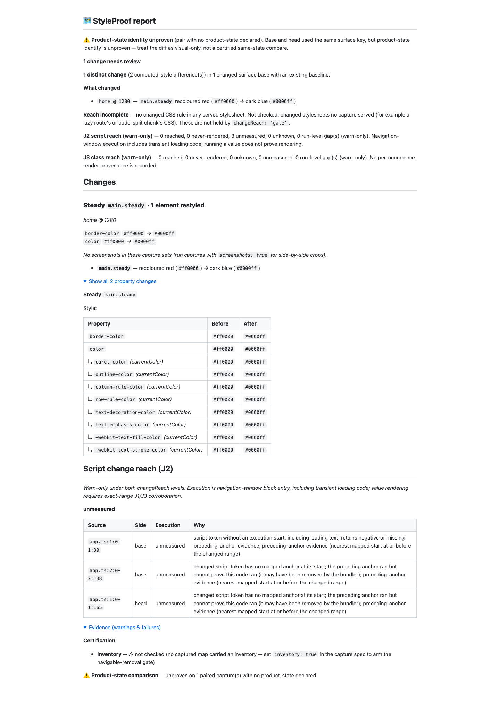

# J3 round-seven type-mode correction (#1001)

Baseline: 6dc28f584884ec249449c72a3063ebc895e8d112. Fetched and rebased onto
origin/main (0cc4bd2dc); already current. Test-first checkpoint: bf89166b3.
Inherited mode: d7cb4bd1e. Final source: 4f0f69a81e8301667fe3ea68d318fd55dd065e7b.
No new runtime dependency; package.json and pnpm-lock.yaml match origin/main.
Hooks and all existing limits remain enabled. No PR is opened.

## Behaviour

Type mode starts at annotations/return types, aliases/interfaces/implements,
as/satisfies assertions and balanced type parameters/arguments. Nested groups
retain that mode, including tuples, parentheses, generics, unions/intersections,
conditional arms, constraints/defaults and function types. The mode ends at
runtime initializers, parameter/statement boundaries or function bodies.
Comments are already skipped by the lexer. The implementation uses an iterative
work stack and a linear angle-balancing pass, with a fast path for regions without
type syntax. Runtime case/default/statement labels (including Svelte $:) and
property/ternary values retain positive roles.

Balanced angles that are ambiguous with comparisons conservatively lose positive
evidence. This is a lexical reader, not a full TypeScript parser or binding
analysis. Unsupported/ambiguous syntax stays J3-only; plain runtime class-shaped
data objects remain the documented Vue h() ambiguity. No J2 classification,
capture, report rendering or verdict code changed.

A bracket cap now drops the unfinished statement back to the previous top-level
semicolon and names that remainder through EOF. Earlier completed statements keep
their roles. Implicit semicolons can widen the conservative gap. Substitutions
retain whole-expression EOF gaps. Existing template-depth behaviour is unchanged.
ADR item 5, README, CHANGELOG and REFERENCE state these boundaries. Both accepted
receiver/neighbour matching residuals from round six remain pinned and documented.

## Red to green

The initial 35 tests failed 26 cases. After the six QA additions, 32 of 41 failed
on the baseline ([unit red](red-unit.txt)); every pinned type case checks that
combining J3 leaves J2 unchanged. Both real Git/Chromium cases failed before the
fix ([browser red](red-e2e.txt)), including the refactor with red-to-blue on the
same source line. The added runtime-boundary controls caught five intermediate
regressions ([red](red-boundaries.txt)); a Solid regression was also caught by the
existing focused suite. All are fixed. Fallow initially rejected the combined
scanner; separate declaration/runtime steps pass the unchanged thresholds.

Two additional function-type conditional results failed on the first mode pass
([red](red-function-types.txt)) and now retain inherited type mode. All 55 pinned
round-seven cases and all 1,148 focused J2/J3 tests pass ([focused output](green-focused.txt)).
The dev-only TypeScript AST oracle checks 8,011 type-position literals in 8,006
sources (8,000 generated samples plus the six exact QA cases), with zero positive
roles. The initial generated sample exposed 4,129 positives before the fix;
the final sample also includes function-type wrappers. Runtime src never imports
TypeScript. The existing pngjs-only runtime dependency test remains intact.

## Real report proof

The fixture comes from the final-source full Chromium run: a real Git repository,
esbuild external source maps, both captured revisions and version-2 verified
omission facts. Both tests observe the handler executing through dataset.mode;
the visual-change case additionally checks computed color red then blue.
The [JSON](report.json) and [Markdown](report.md) retain three unmeasured J2 rows,
zero J3 units/gaps, and the visible change: one distinct change with two displayed
computed-style differences (color and border-color, plus derived currentColor
rows). No type unit lowers J2. Ordered matching excludes the unchanged type word;
this is not per-occurrence render provenance or a reached claim.

The fresh report was inspected at 1440px, including every warning and table row.
Product-state identity remains unproven, inventory is not checked, capture sets
have no element screenshot crops, and the separate changed-stylesheet join stays
not checked. This is diagnostic visual proof, not a certification claim. Video
is not applicable: there is no animated/interactive flow change; static computed
color assertions and the generated report prove this regression.

## Final gates

pnpm run verify: 6,369 tests pass, zero failures/skips, duration_ms 246783.991417
([real tail](verify-tail.txt)). The existing 16k guards pass at 282 ms scoped
classification and 477 ms whole-hunk classification, retaining their 1s limits.
Verify launched at load 3.10. Full pnpm run test:e2e --workers=4 passes 1,213
cases in 8.2m, with one existing non-Chromium skip
([real tail](e2e-tail.txt), [round-seven cases](green-e2e.txt)); launch load 4.09.
The skip remains test/cross-element-state.e2e.spec.ts:112, requiring a non-Chromium
project. No assertion or skip was weakened.

pnpm run bench:reach:check passes all 36 scenarios, including independent base-side
removals ([real tail](bench-tail.txt)); launch load 2.64. A fresh measured receipt
matches 6dc28f584 exactly except its generated timestamp. The tally stays 18 cases,
17 visual, 7 declared / 8 complete unknown, 3/17 and 16/17 shown, 14/14 declared
misses named, with zero J2/J3 gaps. The timestamp comparison helper initially used
the wrong key (generatedAt); correcting it to generated confirms the exact match.
No scenario expectation or committed corpus receipt changed.

npm pack --dry-run --json passes with 388 files, including the new compiled type
scope module and declaration, bin, README, CHANGELOG and LICENSE. Its prepare
prefix is excluded when reading the JSON receipt. Demo freshness passes.
package.json and pnpm-lock.yaml still have an empty diff against origin/main.
No source changes follow these gates. Normal push hooks and the exact supplied
6dc28f584884ec249449c72a3063ebc895e8d112 lease remain required; the raw gate/hook
logs and real capture fixture are retained in the round-seven local handoff.
