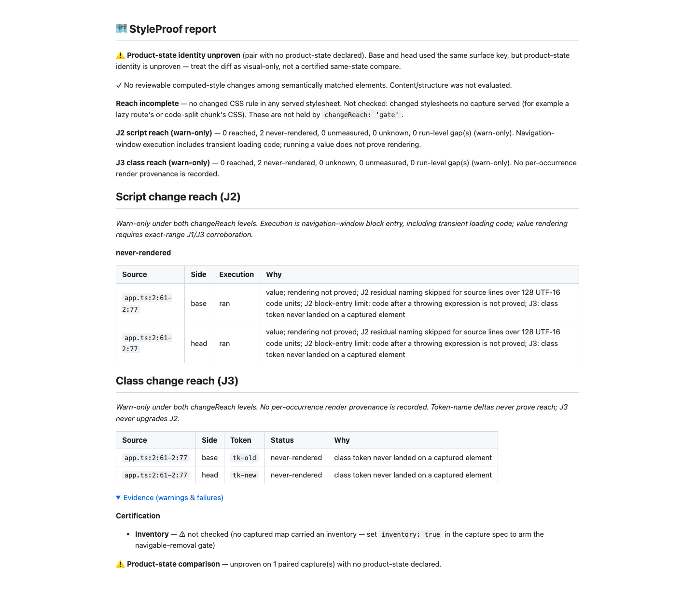
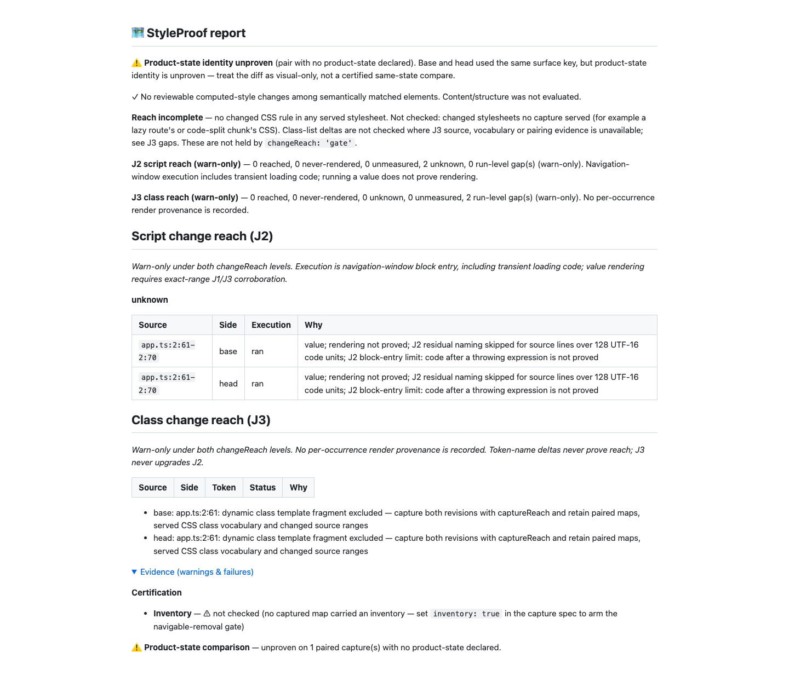

# J3 round-eight runtime-boundary correction (#1001)

Baseline: fa8f46a8c5abed28cbc0c38b73bff504d96ee22d. Fetched/rebased onto
origin/main (0cc4bd2dc); already current. Test-first checkpoint: 343285ca1.
Library source: 80321b3835955ab9d01b0bf1b86b956c891a91e4. Broad CI guard:
f9a80cfda8ce6999c7dd95840f98e74b6de0ed87. Runtime dependency files match
origin/main; no runtime parser dependency was added. Hooks remain enabled.

## What changed

An arrow after a parenthesized return annotation now ends type mode unless a
later arrow at the same level, before a statement/declarator boundary, establishes
a function-type arrow. Function and method return types remain type-only. A
reverse arrow pass makes this lookup bounded and linear rather than rescanning
the suffix for every arrow.

Angle pairing stops at runtime operators, statements, declarator commas and ASI
boundaries. Generic parameter defaults stay type-only. The next runtime statement
also bounds class assignment values, so an ASI expression cannot absorb a later
declaration. Runtime statement words, non-null/index/optional receivers, bare
blocks, labels and case expressions resume discovery. A case/default flag keeps
parenthesized or call labels runtime; export default is not a switch label.

J2 emits some generic-looking TSX prefixes as opaque negative tokens. J3 re-lexes
only those disjoint chunks with the existing TS lexer to retain type groups;
J2 itself is unchanged. Generic Ident-extends prefixes never start markup mode.
The first class helper in a runtime ternary branch is no longer mistaken for a
method return annotation. These passes use the existing lexer and stdlib only.

This is a lexical reader, not full JS/TS parsing or binding analysis. Unsupported
forms, opaque JSX and a balanced comparison resembling type arguments can still
omit both a candidate and its gap. An absent J3 row does not establish complete
checking. Recognized depth/fragment failures retain named gaps. ADR item 5,
REFERENCE, README, CHANGELOG and the superseded round-seven proof state these
limits plainly. No capture, J2 classification or verdict implementation changed.

## Red to green

The final pinned round-eight test file without its later broad guard has 126
cases: 84 failed on a separately built, unchanged fa8f46a8c snapshot
([unit red](red-unit.txt)). Both real Git/Chromium regressions fail there
([capture red](red-e2e.txt)) and pass on the fix ([capture green](green-e2e.txt)).
The temporary baseline is a disposable dependency/test fixture, not a second
persistent checkout; the working branch was never reset for red evidence.

A first fragment fixture incorrectly used whitespace before the substitution;
that is a whole value. The corrected adjacent tk-old${suffix} fixture proves
actual fragment gaps. Its test checks the existing reason field. An initial
baseline capture run lacked test/helpers.mjs; that setup failure is not counted
as product red evidence. The copied helper cleared it before the genuine red run.
All intermediate logs remain in the local handoff.

The reviewer oracle caught a temporary type regression: a broad default-label
flag treated export default as a switch label. Two pinned export-default controls
failed and the flag now requires default followed by a colon. The final oracle
has zero type positives. Fallow rejected combined loops/declaration handling;
small helpers pass the unchanged complexity limits. No limit, gate, concurrency,
assertion or dependency configuration was weakened.

All 127 round-eight cases pass, including the broad CI guard
([green](green-unit.txt)). The strict targeted oracle covers 8,011 type-position
literals and 10,676 runtime-positive literals across TS/TSX/Vue/Svelte with zero
errors in either direction ([output](green-targeted-oracle.txt)). The earlier
1,304-test focused J2/J3 run passes before the extra CI guard was added
([output](green-focused.txt)); final verify below includes the guard.

## Both directions of the reviewer oracle

The original supplied fuzz.mjs runs with seeds 1, 2 and 3, 4,000 accepted programs
per language per seed: 48,000 accepted programs total. TypeScript AST positions
are the oracle; runtime src never imports TypeScript. [Machine-readable counts](oracle.json)
and the [matched-seed chart](oracle.html) retain denominators and residuals.

| Language | Type positives / type literals, all 3 seeds | Runtime misses / positives, all 3 seeds | 6dc28f5 runtime misses, seed 1 | Fixed runtime misses, seed 1 |
| --- | --- | --- | --- | --- |
| TS | 0 / 164,225 | 1 / 49,806 | 866 / 16,640 | 0 / 16,640 |
| TSX | 0 / 165,362 | 2,513 / 50,467 | 3,237 / 16,946 | 836 / 16,946 |
| Vue | 0 / 162,662 | 152 / 50,205 | 1,001 / 16,833 | 55 / 16,833 |
| Svelte | 0 / 164,215 | 193 / 50,151 | 1,016 / 16,863 | 63 / 16,863 |

Misses are separated below: hidden-with-gap means no word occurrence was emitted
but a named extraction/unresolved-context gap covers its AST position;
hidden-no-gap has neither; non-explicit retains the word without a positive role.
Gap coverage uses the complete generated-token vocabulary, with source ranges
translated through SFC prefixes. No capture/ledger gap is fabricated. These are
three-seed counts over the same programs; 6dc28f5 is the comparison baseline.

| Language | 6dc28f5: gap / no gap / non-explicit | Round 8: gap / no gap / non-explicit |
| --- | --- | --- |
| TS | 0 / 0 / 2,688 | 0 / 0 / 1 |
| TSX | 679 / 868 / 8,220 | 632 / 915 / 966 |
| VUE | 94 / 58 / 2,729 | 102 / 50 / 0 |
| SVELTE | 137 / 56 / 2,687 | 147 / 46 / 0 |

Hidden totals do not increase versus 6dc28f5, but TSX has 47 more hidden-no-gap
cases and 47 fewer with-gap cases. The absence of a row/gap is not checking proof.
The pre-existing J2 lexer causes include TSX `/>` being read as a regex after `}`,
plain `<G>(e...) =>` being read as markup in SFCs, and template-literal types
interacting with the template reader. The TSX slash/regex defect is deferred to a
follow-up issue; round nine changes only safe token accumulation in that lexer.
Round nine records current counts and pins each kind's hidden counts separately
from retained-but-non-explicit counts. Its ASI fix also removes two non-explicit
misses; the historical round-eight totals below remain unchanged.

Total type positives: 0 / 656,464. Runtime misses: 2,859 / 200,629; no throws.
These are finite sample results, not a claim of full language coverage. The
round-seven implementation-base seed-one type sample also has zero positives; the separately pinned
nested TSX extends defect is reproduced by its regression and fixed.

The in-repo dev-only copy is formatted and removes one unused generator parameter
for lint, preserving generation semantics. CI runs seed 1 with 1,000 accepted
programs per language: zero type positives, runtime miss ceilings TS 0%, TSX 6%,
Vue 1%, Svelte 1%. Current counts are TS 0/4,243, TSX 224/4,173, Vue 8/4,142,
Svelte 25/4,016. The guard fails for all four languages on baseline
([red](red-oracle-ci.txt)). It is a separate AST oracle, not an implementation-mirroring test.

The supplied [probe](review-probes.txt), [join](review-joins.txt) and
[ASI-join](review-asi-joins.txt) harnesses also run. Their e2e.mjs names describe
static joins over synthetic maps; the separate Playwright tests above provide
actual Chromium capture evidence.

## Real report proof

Both fixtures are real Git repositories with esbuild external maps, captured
revision SHAs and complete v2 omission facts. The test observes the handler run
through dataset.mode. Its class setter changes a detached element, so no captured
element carries the token. The ordinary literal retains both explicit J3
never-rendered units; both ran J2 ranges consequently read never-rendered.

The adjacent dynamic template retains zero whole-token units and both named
fragment gaps; its ran J2 ranges remain unknown.

The JSON/Markdown pairs ([literal JSON](report.json), [literal Markdown](report.md),
[fragment JSON](report-fragment.json), [fragment Markdown](report-fragment.md))
and omission facts are retained. Fresh 1440px reports were inspected in full.
Both report zero reviewable style/DOM/state changes, reach blocking zero and no
reached class path. They preserve product-state identity/inventory warnings, the
unbuilt stylesheet join, and J2's long-line/block-entry caveats. This is diagnostic
proof, not certification. Video is not applicable: no animated/interactive UI
flow changed; capture assertions and the generated reports prove this behaviour.

## Verification

pnpm run verify passes 6,527 tests with zero failures/skips; duration_ms
245780.150291 ([tail](verify-tail.txt)). The existing 16k guards pass at 272 ms
scoped classification and 478 ms whole-hunk classification, retaining 1s limits.
Verify launch load: 2.55. pnpm run test:e2e --workers=4 passes 1,215 cases
in 8.3m with one existing non-Chromium skip ([tail](e2e-tail.txt)); launch load
3.78. The skip is test/cross-element-state.e2e.spec.ts:112, requiring a
non-Chromium project. No assertion or skip was weakened.

pnpm run bench:reach:check passes all 36 scenario checks, including independent
base-side removals ([tail](bench-tail.txt)); launch load 2.67. A fresh receipt
matches fa8f46a8c exactly except generated timestamp: 18 cases, 17 visual,
unknown 7 declared / 8 complete, shown 3/17 and 16/17, all 14/14 declared misses
named, and zero J2/J3 gaps. No expected scenario or committed receipt changed.

npm pack --dry-run --json succeeds with 388 files, required runtime/bin/docs/license
present, and the dev-only oracle excluded. Demo freshness and final privacy pass.
Dependency files still have an empty diff against origin/main. Library source is
frozen at 80321b383; only test/proof files follow it.

Every proof transcript is normalized to remove trailing whitespace. The original
QA failure (28 trailing-whitespace diagnostics) is retained in the local handoff;
working, staged and origin/main...HEAD diff checks now pass. These checks run
again immediately before pushing. Normal hooks remain enabled, using the exact
supplied fa8f46a8c5abed28cbc0c38b73bff504d96ee22d lease. Full raw outputs and
capture fixtures are retained in the round-eight handoff. No PR is opened.
