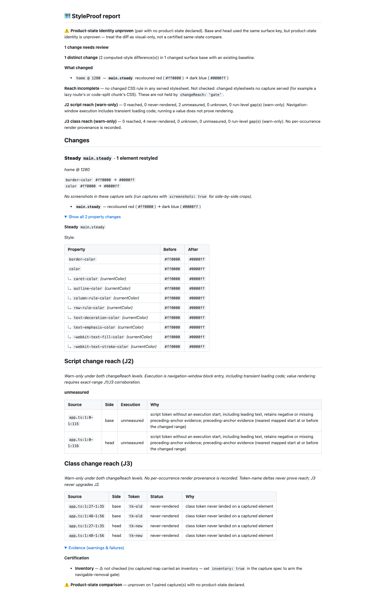

# J3 round-nine compact-boundary and bulk-input correction (#1001)

Implementation base: 1a1fcbc46fcced3de63a6a7935003b62d4a8a25c. Fetched and rebased
onto origin/main (0cc4bd2dc); already current. Red checkpoint: e936335f8.
Final source: d2d8001f810722c566c179459de1962adf6fbf7b. Hooks remain enabled;
no runtime dependency or public capture schema changes. No PR is opened.

## Changes

At a bounded type-angle match, a compact >= closer is separated from its
initializer. The same normalization supports combined >>= / >>>= closers; the
current lexer already separates multi-closers in some forms. Offsets retain the
original source columns. Unmatched ordinary comparison/shift operators remain
operators. Normalization rebuilds the token list linearly rather than inserting
one token at a time into a growing array. J2 lexer syntax decisions are unchanged.
Valid function coverage uses compact constraint/default and annotated-parameter
initializers; a bare function f<T>=... is not a valid TS function declaration.

ASI declaration starters abstract, declare, enum and namespace resume discovery
when followed by a word. Type fields stay non-explicit while runtime initializers
and bodies retain positive roles. Compact no-whitespace forms are included in
the dev-only targeted AST sample.

Every spread-into-push call in src/class-join*.ts and src/script-join*.ts is replaced
with bounded iteration, preserving order. Literal qualification also avoids an
unnecessary giant flatMap intermediate. This removes the argument-count ceiling
without changing joins, verdicts or the existing one-second timing limits.
No TSX slash/regex rule is changed; that pre-existing lexer defect is deferred.

## Red to green

On the working baseline, 10/34 initial regressions fail, including the large-input
RangeError. The final 39-case file fails 11 cases against a separately compiled
unchanged 1a1fcbc46 snapshot ([red](red-unit.txt)). Its extra enum-initializer case
is a real runtime body rather than a statement after a semicolon. Tests cover TS,
TSX, Vue and Svelte compact aliases, nested closers, valid function forms, runtime
initializer controls and ASI starters.

The real Git/esbuild/Chromium repro fails before the fix ([red](red-e2e.txt)) and
passes afterward ([green](green-e2e.txt)). It checks actual red then blue computed
color and asserts that erased type strings cannot lower J2. All 39 round-nine
cases and 1,349 focused J2/J3 cases pass ([focused](green-focused.txt)). The strict
expanded AST sample checks 8,019 type literals and 10,682 runtime positives with
zero errors in either direction. Runtime src never imports TypeScript.

The 4,194,326-byte case contains 110,377 template lines / 331,131 literals. It
completes in 1.70 seconds under final full verification, where the old code throws
Maximum call stack size exceeded. Fallow initially rejected angleEnds at cognitive
complexity 16; simpler closer counting clears the unchanged threshold. No gate,
configuration, assertion, skip, dependency or concurrency limit was weakened.

## Three-seed oracle and miss categories

The generator and accepted programs remain unchanged: seeds 1/2/3, 4,000 accepted
programs per language per seed, 48,000 total. AST positions determine type versus
runtime. [Receipt](oracle.json) and [matched-seed chart](oracle.html) retain the
comparison to 6dc28f5 and the approved round-eight head.

| Language | Type positives / literals | Runtime misses / positives | Hidden with gap | Hidden no gap | Retained non-explicit |
| --- | --- | --- | --- | --- | --- |
| TS | 0 / 164,225 | 0 / 49,806 | 0 | 0 | 0 |
| TSX | 0 / 165,362 | 2,512 / 50,467 | 632 | 915 | 965 |
| Vue | 0 / 162,662 | 152 / 50,205 | 102 | 50 | 0 |
| Svelte | 0 / 164,215 | 193 / 50,151 | 147 | 46 | 0 |

Total: zero type positives / 656,464 type literals; 2,857 misses / 200,629 runtime
positives, zero throws. The approved head had 2,859 misses. Hidden-with-gap and
hidden-no-gap counts are unchanged; two retained-but-non-explicit misses improve.
The comparison first expected exact equality and correctly exposed the two
improvements; non-regression checks compare direction and denominators instead.
These finite samples do not establish full language coverage.

Hidden means no word occurrence emitted. With-gap means a named extraction or
unresolved explicit-context gap covers the AST position under the complete
generated-token vocabulary; capture/ledger gaps are not invented. No-gap has no
such coverage. Non-explicit means the word remains without a positive class role.
The corrected round-eight proof splits all categories and uses 6dc28f5 as its
metric baseline. Its total hidden count is the same as 6dc28f5, though gap coverage
shifts between categories; it does not claim all omissions have a gap.

Remaining pre-existing J2 causes include TSX /> treated as a regex after }, plain
<G>(e...) => treated as markup in SFCs, and template-literal type interactions.
The slash/regex behaviour is a follow-up, outside this change. Unsupported lexical
forms can still omit both an occurrence and a gap; an absent J3 row is not proof
of complete checking.

The fixed-seed CI guard now pins hidden-with-gap / hidden-no-gap separately from
non-explicit counts: TS 0/0/0, TSX 59/75/90, Vue 6/2/0, Svelte 20/5/0. It also
requires fn to equal the category sum, retains zero type positives and preserves
the existing total miss-rate bounds. A new swallow or demotion fails the exact
category checks rather than fitting silently inside a percentage allowance.

## Real report proof

The copied fixture is a real Git repository with both captured SHAs, esbuild
external source maps and complete v2 omission facts. The fresh [JSON](report.json)
and [Markdown](report.md) retain two unmeasured J2 ranges. All four known-name J3
candidates are explicit:false; their token-absence status cannot lower J2. No
per-occurrence render provenance is asserted, and there is no reached class path.
The visible red-to-blue change remains one distinct change with two displayed
computed-style differences (color/border-color plus derived currentColor rows).

The 1440px report was inspected in full. Product-state identity/inventory warnings,
missing element screenshot crops and the separate unbuilt stylesheet join remain
visible. This is diagnostic proof, not certification. Video is not applicable:
no animated/interactive flow changed; Chromium color assertions and the generated
report prove the classifier behaviour.

## Verification

pnpm run verify passes 6,572 tests, zero failures/skips, duration_ms 250931.771417
([real tail](verify-tail.txt)). The existing 16k guards pass at 282 ms scoped
classification and 474 ms whole-hunk classification, retaining their 1s bounds.
Verify launch load: 2.11. pnpm run test:e2e --workers=4 passes 1,216 cases in
8.3m with one existing non-Chromium skip ([tail](e2e-tail.txt)); launch load 2.80.
The skip is test/cross-element-state.e2e.spec.ts:112, requiring a non-Chromium
project. No assertion or skip was weakened.

pnpm run bench:reach:check passes all 36 scenario checks, including independent
base removals ([tail](bench-tail.txt)); launch load 2.08. A measured receipt equals
1a1fcbc46 except generated timestamp: 18 cases, 17 visual, unknown 7 declared /
8 complete, shown 3/17 and 16/17, declared misses named 14/14, zero J2/J3 gaps.
No expected scenario or committed corpus receipt changed.

npm pack --dry-run --json passes with 388 files, required runtime/bin/docs/license
present, and the dev-only oracle excluded. Demo freshness and final privacy pass.
Runtime dependency files still match origin/main. Library/test source is frozen
at d2d8001f8; only proof documentation follows these gates.

The push-spread audit has no matches in src/class-join*.ts and src/script-join*.ts.
Every proof transcript is normalized for trailing whitespace. Working, staged and
origin/main...HEAD diff checks pass and are repeated immediately before push.
Normal hooks remain enabled with the exact supplied
1a1fcbc46fcced3de63a6a7935003b62d4a8a25c lease. Full raw outputs, the disposable
6dc/1a baseline snapshots and capture fixture are retained in the local handoff.
No PR is opened.
