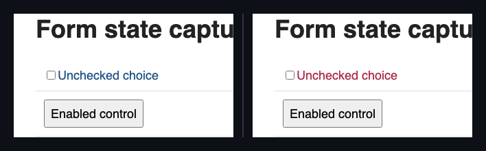
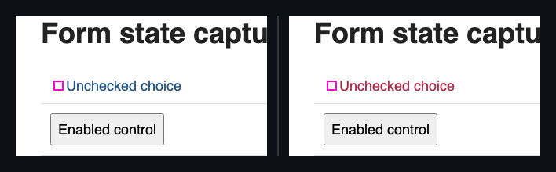
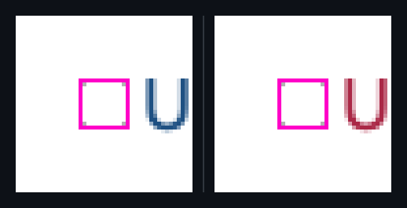
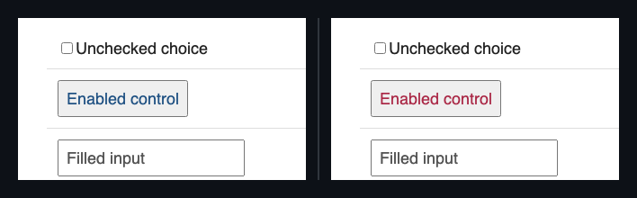
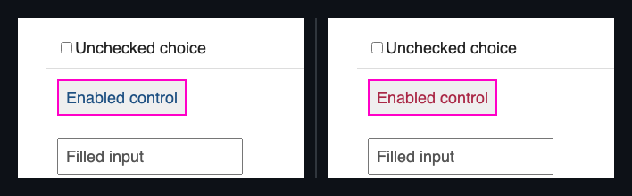
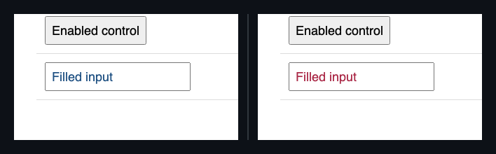
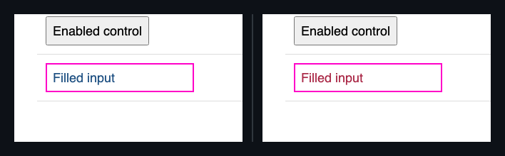

## 🗺️ StyleProof report

⚠️ **Product-state identity unproven** (pair with no product-state declared). Base and head used the same surface key, but product-state identity is unproven — treat the diff as visual-only, not a certified same-state compare.

**1 change needs review**

**1 distinct change** (4 state-delta difference(s)) in 1 changed surface base with an existing baseline.

**What changed**

- `form @ 800` — **`input`** interaction states changed: `:checked` · **`button`** interaction states changed: `:disabled` · **`input`** interaction states changed: `:placeholder-shown`

## Changes

### `input` · 1 element restyled `:checked`

_form @ 800_

_Both sides are :checked. Left is the old :checked. Right is the new :checked._

`:checked` `border-color` `#1e5082` → `#aa2846` 
`:checked` `color` `#1e5082` → `#aa2846`

◀ base :checked  ·  head :checked ▶ — both sides are :checked

Show highlight overlay

🔍 magenta boxes mark each change — changed: `input`

🔬 magnified 5× — change too small to see at 1:1 — changed: `input`

- interaction states changed: `:checked`

Show all 2 property changes

**`input`**

Interactive-state changes:

| State | Property | Before → After |
| --- | --- | --- |
| `:checked` | `border-color` | `#1e5082` → `#aa2846` |
| `:checked` | `color` | `#1e5082` → `#aa2846` |
| `:checked` | ↳ `caret-color` _(currentColor)_ | `#1e5082` → `#aa2846` |
| `:checked` | ↳ `outline-color` _(currentColor)_ | `#1e5082` → `#aa2846` |
| `:checked` | ↳ `column-rule-color` _(currentColor)_ | `#1e5082` → `#aa2846` |
| `:checked` | ↳ `row-rule-color` _(currentColor)_ | `#1e5082` → `#aa2846` |
| `:checked` | ↳ `text-decoration-color` _(currentColor)_ | `#1e5082` → `#aa2846` |
| `:checked` | ↳ `text-emphasis-color` _(currentColor)_ | `#1e5082` → `#aa2846` |
| `:checked` | ↳ `-webkit-text-fill-color` _(currentColor)_ | `#1e5082` → `#aa2846` |
| `:checked` | ↳ `-webkit-text-stroke-color` _(currentColor)_ | `#1e5082` → `#aa2846` |

### `button` · 1 element restyled `:disabled`

_form @ 800_

_Both sides are :disabled. Left is the old :disabled. Right is the new :disabled._

`:disabled` `color` `#1e5082` → `#aa2846`

◀ base :disabled  ·  head :disabled ▶ — both sides are :disabled

Show highlight overlay

🔍 magenta boxes mark each change — changed: `button`

- interaction states changed: `:disabled`

Show the property change

**`button`**

Interactive-state changes:

| State | Property | Before → After |
| --- | --- | --- |
| `:disabled` | `color` | `#1e5082` → `#aa2846` |
| `:disabled` | ↳ `caret-color` _(currentColor)_ | `#1e5082` → `#aa2846` |
| `:disabled` | ↳ `outline-color` _(currentColor)_ | `#1e5082` → `#aa2846` |
| `:disabled` | ↳ `column-rule-color` _(currentColor)_ | `#1e5082` → `#aa2846` |
| `:disabled` | ↳ `row-rule-color` _(currentColor)_ | `#1e5082` → `#aa2846` |
| `:disabled` | ↳ `text-decoration-color` _(currentColor)_ | `#1e5082` → `#aa2846` |
| `:disabled` | ↳ `text-emphasis-color` _(currentColor)_ | `#1e5082` → `#aa2846` |
| `:disabled` | ↳ `-webkit-text-fill-color` _(currentColor)_ | `#1e5082` → `#aa2846` |
| `:disabled` | ↳ `-webkit-text-stroke-color` _(currentColor)_ | `#1e5082` → `#aa2846` |

### `input` · 1 element restyled `:placeholder-shown`

_form @ 800_

_Both sides are :placeholder-shown. Left is the old :placeholder-shown. Right is the new :placeholder-shown._

`:placeholder-shown` `color` `#1e5082` → `#aa2846`

◀ base :placeholder-shown  ·  head :placeholder-shown ▶ — both sides are :placeholder-shown

Show highlight overlay

🔍 magenta boxes mark each change — changed: `input`

- interaction states changed: `:placeholder-shown`

Show the property change

**`input`**

Interactive-state changes:

| State | Property | Before → After |
| --- | --- | --- |
| `:placeholder-shown` | `color` | `#1e5082` → `#aa2846` |
| `:placeholder-shown` | ↳ `caret-color` _(currentColor)_ | `#1e5082` → `#aa2846` |
| `:placeholder-shown` | ↳ `outline-color` _(currentColor)_ | `#1e5082` → `#aa2846` |
| `:placeholder-shown` | ↳ `column-rule-color` _(currentColor)_ | `#1e5082` → `#aa2846` |
| `:placeholder-shown` | ↳ `row-rule-color` _(currentColor)_ | `#1e5082` → `#aa2846` |
| `:placeholder-shown` | ↳ `text-decoration-color` _(currentColor)_ | `#1e5082` → `#aa2846` |
| `:placeholder-shown` | ↳ `text-emphasis-color` _(currentColor)_ | `#1e5082` → `#aa2846` |
| `:placeholder-shown` | ↳ `-webkit-text-fill-color` _(currentColor)_ | `#1e5082` → `#aa2846` |
| `:placeholder-shown` | ↳ `-webkit-text-stroke-color` _(currentColor)_ | `#1e5082` → `#aa2846` |

_Nothing else — no other element or inventory changes in this compare._

Evidence (warnings & failures)

⚠️ **Product-state comparison** — unproven on 1 paired capture(s) with no product-state declared.

