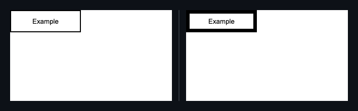
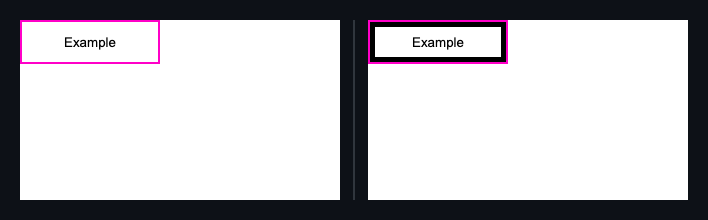

## 🗺️ StyleProof report

⚠️ **Product-state identity unproven** (pair with no product-state declared). Base and head used the same surface key, but product-state identity is unproven — treat the diff as visual-only, not a certified same-state compare.

**1 change needs review**

**1 distinct change** (1 computed-style difference(s)) in 1 changed surface base (3 variants) with an existing baseline.

**What changed**

- `home-contrast @ 1280` +2 more surface(s) — **`button.subject`** border 2px → 7px

## Changes

### **Subject** `button.subject` · 1 element restyled

_Identical across 3 surfaces: home-contrast · variant -contrast- @ 1280 · home-dark · variant -dark- @ 1280 · home-print · variant -print- @ 1280_

`border-width` `2px` → `7px`

◀ before  ·  after ▶ — home-contrast @ 1280 · variant `contrast`

Show highlight overlay

🔍 magenta boxes mark each change — changed: `button.subject`

- **`button.subject`** — border 2px → 7px

Show the property change

**Subject** `button.subject`

Style:

| Property | Before | After |
| --- | --- | --- |
| `border-width` | `2px` | `7px` |

_Nothing else — no other element or inventory changes in this compare._

Evidence (warnings & failures)

⚠️ **Product-state comparison** — unproven on 3 paired capture(s) with no product-state declared.

