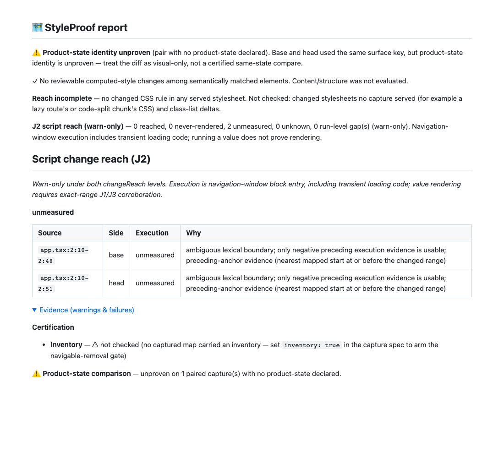
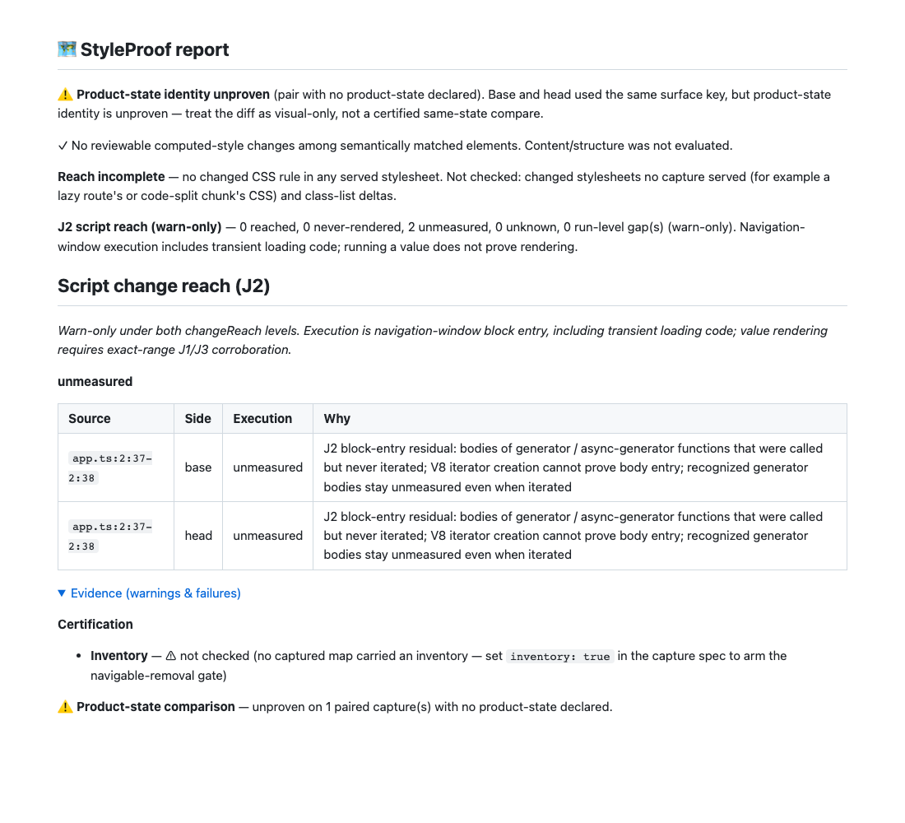
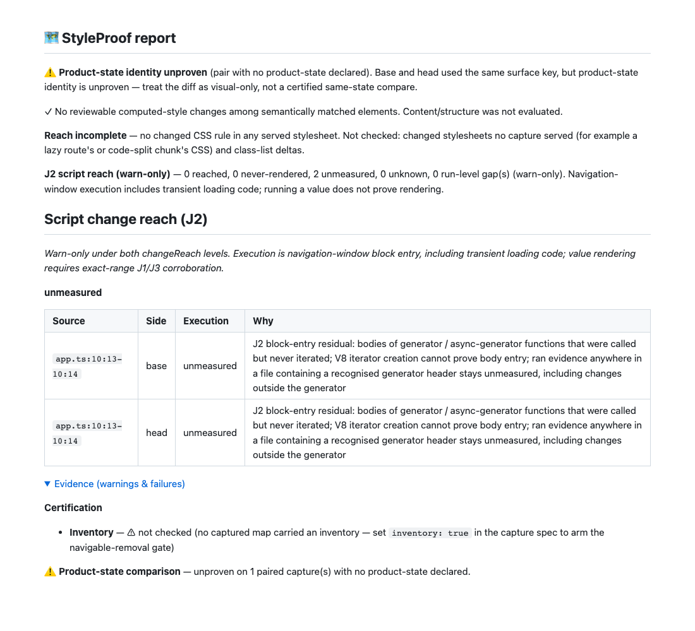
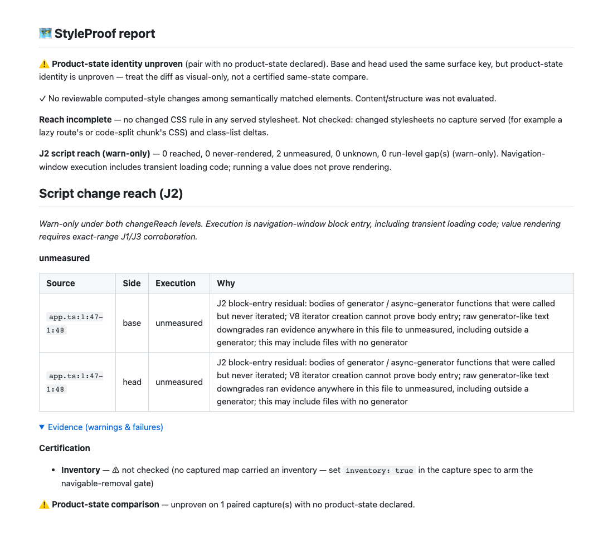
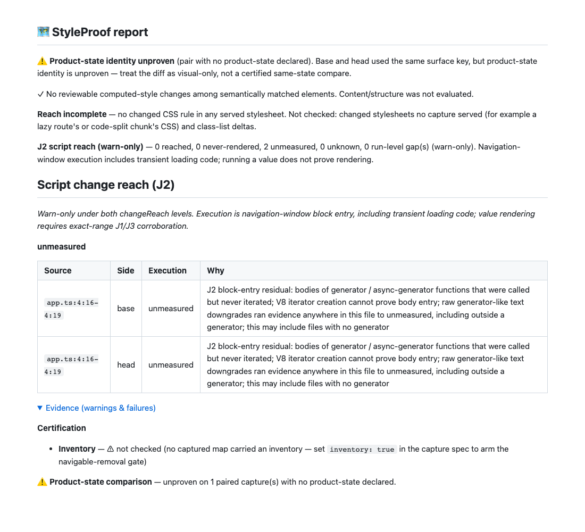

# Script join: issue #1000

J2 is advisory execution evidence, not rendering certification. The git adapter
uses the compared map manifests' SHAs, including a reused ancestor, and the
project-root prefix recorded by each capture. Added ranges use head evidence;
removed ranges use base. Complete blob-byte hashes must match sourcesContent.

The QA correction judges execution starts inside the changed-token range. An
enclosing mixed or idle span cannot flag an evaluated child operand. Mapping
starts retain their innermost V8 entry state when the other state interval has a mapping
start. An unrepresented state interval inside a generated extent stays mixed, retaining
coarse-map uncertainty. A distant same-counter anchor cannot clear a resumed interval. Column-zero maps fall back explicitly to line
scope. Git LF line numbers are converted through blob offsets to JavaScript
terminator line numbers. Execution alone leaves values unknown; only exact
source/side/changed-token-range J1/J3 provenance can corroborate them.

## QA red → green

Regressions and corpus expectations were changed before implementation. Retained
outputs normalize checkout/temporary paths, remove file-URL prefixes and ANSI
codes, and trim trailing whitespace: [unit red](qa-red-unit.txt),
[review red](qa-red-review.txt), [browser red](qa-red-browser.txt),
[producer red](qa-red-producer.txt), [corpus red](qa-red-corpus.txt).
The first unit run had 10 failures / 9 passes; the expanded review run had 7
failures. The original three browser cases had 2 failures / 1 pass. The focused
producer regression failed, and the corpus rejected five result cells.

| Review item           | Red evidence                                                                                                               | Green evidence / resulting behavior                                                                                                                                                                                             |
| --------------------- | -------------------------------------------------------------------------------------------------------------------------- | ------------------------------------------------------------------------------------------------------------------------------------------------------------------------------------------------------------------------------- |
| 1. Evaluated operands | Enclosing-span and cheap-map unit failures; real Chromium nullish operand falsely partly-ran; producer entry-state failure | Units pass; four real esbuild/Chromium cases pass: nullish operand, selected ternary consequent, selected alternative, unopened nullish fallback. Evaluated operands are ran/unknown; unopened fallback remains never-rendered. |
| 2. Dropped files      | Unloaded MDX/template/extensionless-path gap test failed                                                                   | Every unjudged path is named in a sorted run gap; explicit submodule and Unicode ordering tests also pass.                                                                                                                      |
| 3. Line numbering     | Git line 3 was read as JS line 3 after a Unicode separator                                                                 | Test passes for CR, U+2028 and U+2029: git line 3 maps to JS line 4 and the correct blob text.                                                                                                                                  |
| 4. Quadratic join     | 6,000-line getter-backed source test failed                                                                                | Anchors are indexed once per side/source/line; the test passes with bounded source-array reads.                                                                                                                                 |
| 5. Git work           | No-evidence early-return test and all-path diff/blob-batch test failed                                                     | No git work without scriptReach; 42-file fixture uses one diff and one batch, retaining healthy files after a missing blob.                                                                                                     |
| 6. Report size        | 3,000-line compression / fragmented table cap test failed                                                                  | Adjacent equal units render as ranges; tables cap at 100 rows with a remaining count; exact JSON units remain intact.                                                                                                           |
| 7. Project root       | Capture-prefix/cwd-independence test failed                                                                                | Captured prefixes bind paths; unmatched captured keys emit a gap. Browser captures assert the recorded nested-package prefix.                                                                                                   |
| 8. Partial coverage   | Missing-capture test incorrectly reported not loaded                                                                       | Test passes: absent coverage is unmeasured / coverage missing.                                                                                                                                                                  |
| 9. Trimming           | Equal-count hunk / insertion test failed                                                                                   | Unrelated replacement lines retain line scope; pure inline insertions emit no empty base unit.                                                                                                                                  |
| 10. Corpus provenance | Five revised expectations failed under the prototype override                                                              | All expectations pass; J3-prototype has its own field/label and never overrides src J2.                                                                                                                                         |
| 11. Formatting churn  | Manual diff review of the rejected commit                                                                                  | Blank-line-only edits in the four named files and unrelated config-table repadding are removed. No behavioral test applies to whitespace removal.                                                                               |
| 12. Type contract     | Manual comment review                                                                                                      | RuleReach.sourceRange documents conservative changed-token-range matching. No runtime behavior changed.                                                                                                                         |

The first full pre-push browser run caught a stale drift-location assertion: the
containing `if` at original line 2 no longer inherits branch-span state, so the
first changed entry is correctly the branch at line 3. The exact location
assertion was updated from 2 to 3; drift must still become unknown. That run
reported 704 passed, one failed and one skipped; its [failure output](qa-red-full-e2e.txt) is retained.

The targeted classifier, adapter, producer, report and corpus tests pass
**190/190**, with no failures, cancellations or skips. The expanded browser
regression passes **4/4**. The existing warn opt-in behavior stays unchanged:
no reach/scriptReach evidence omits the section; script-only captures show J2.

## Corpus before → after

| Measurement                        | Original prototype | Rejected 9cf55d77f | Corrected join |
| ---------------------------------- | ------------------ | ------------------ | -------------- |
| Cases / visual cases               | 14 / 13            | 16 / 15            | 16 / 15        |
| Declared: visual changes shown     | 1/13               | 1/15               | 1/15           |
| Complete: visual changes shown     | 12/13              | 14/15              | 14/15          |
| Declared: misses named             | 11/12              | 14/14              | 14/14          |
| Unknown cases, declared / complete | 0 / 0              | 3 / 3              | 5 / 6          |
| Error handler, both scenarios      | never-rendered     | never-rendered     | never-rendered |

Against the rejected commit, **three existing cases move to unknown in five
scenario cells**: module-constant and colliding-constant in both scenarios, and
branch-class in complete. Against the original prototype, runtime-css-in-js also
moves to unknown in both scenarios; render-scope-value and eager-jsx-element are
two new unknown cases. The corrected receipt has eleven unknown cells. Separate
J3-prototype rows retain their prototype results and explicitly defer to #1001
for ADR 0009 per-occurrence provenance. See the [corpus review](../../../bench/reach-corpus.review.md).

## Report evidence

The current [generated excerpt](report-excerpt.md), [reach JSON](reach.json) and
screenshot show both changed operands ran and remain unknown. Blocking stays zero
under gate, and reach remains incomplete. The unrelated product-state warning is
preserved: this is diagnostic evidence, not a certified same-state comparison.

Final verification and the enforced pre-push browser suite are reported with
actual command tails in the implementation handoff. No hook or gate is bypassed.

## Round 2: coarse maps, JSON priority and complete changed-line attribution

Rebased onto main (67b7521da). Before implementation, the retained
[round-two unit run](round2-red-unit.txt) failed **14 tests**, with 24 passing;
the [real-browser run](round2-red-browser.txt) failed both cases. The root-counter
browser fixture records one git-prefix lookup across two surfaces and their
self-checks after the fix. Targeted units subsequently passed **205/205** and
capture/J2 browser scenarios **34/34**.

| Item | Red → green                                                                                                                                                                                                                                                                                                                                                                    |
| ---- | ------------------------------------------------------------------------------------------------------------------------------------------------------------------------------------------------------------------------------------------------------------------------------------------------------------------------------------------------------------------------------ |
| 1    | The column-zero ternary read ran/unknown for whole-line and red-token changes; both now read partly-ran/never-rendered with line scope. The original mapper mixed-boundary test is restored. Existing nullish operands, both ternary arms and the unopened fallback stay green.                                                                                                |
| 2    | The 1,500-line fixture lost all 20 style findings; both whole-line and token-range variants now retain 20/20 within 450 KB. A tighter configured budget also keeps all style findings. Only equal whole-line units merge with counts; token units use remaining bytes up to a 64 KB cap. Omitted source units get an exact named gap, full counts and a visible report notice. |
| 3    | A blank line added inside css template text vanished; added and deleted blank lines now remain zero-width unmeasured units with the no-anchors reason. Empty opposite-side token ranges still disappear.                                                                                                                                                                       |
| 4    | A type change and CR followed by diff-header-like content killed all paths; sections now pair by their Git-quoted header paths, including two sections for one type change. Malformed sections leave per-file gaps while healthy siblings survive.                                                                                                                             |
| 5    | An unloaded-only change vanished on a key mismatch; valid recorded prefixes now remain usable and produce not-loaded units plus the warning.                                                                                                                                                                                                                                   |
| 6    | Configured inter-hunk context attributed unchanged lines; fixed diff options and walking actual +/- body lines keep only changed lines.                                                                                                                                                                                                                                        |
| 7    | The long unbalanced residual input entered expensive regexes; lines above 2048 UTF-16 code units skip naming explicitly and remain unknown.                                                                                                                                                                                                                                    |
| 8    | Root provenance was absent from settings and the browser fixture counted three Git lookups; settings now resolve it once and pass it to surfaces, self-checks and popups.                                                                                                                                                                                                      |
| 9    | A J2 gap suppressed the incomplete J1 fallback; only existing ledger-kind gaps now suppress that fallback. Gate still holds the J1 gap.                                                                                                                                                                                                                                        |
| 10   | Adjacent token columns were merged, a missing-evidence side lost its lines, and Unicode reasons sorted as UTF-16; exact token/status assertions, per-side unmeasured units and explicit code-point ordering now pass.                                                                                                                                                          |

A follow-up [interval regression](round2-red-interval.txt) first failed against
the counter-sharing guard. The corrected producer checks each flat V8 interval
independently. In the tiny `a ?? b;` two-anchor fixture, the idle operand remains
mixed when its extent contains an unrepresented executed semicolon; it is still
never-rendered. The real esbuild operand assertions remain ran/unknown. Its fallback’s generated
extent also contains an unanchored executed continuation, so the [exact raw-state
assertion](round2-red-fallback.txt) now requires partly-ran; both base and head
must still be never-rendered. The separate fine-anchor nullish test still requires
ran for the main operand and never-ran for the fallback.

The corpus still has **5 declared / 6 complete unknown cases**. No scenario moved
status in round two; all J3-prototype labels remain separate. The original and
rejected-head comparisons above still apply.

The generated [budget summary](round2-budget-summary.json) and
[report JSON](round2-report.json) record **20/20 findings listed, zero omitted,
75,427 JSON bytes within 450,000**, 3,000 unknown source units, 135 detailed units
retained and **2,865 explicitly truncated**. Human tables independently stop at
100 rows. The screenshots retain the product-state warning, advisory reach status
and the fixture's lack of captured screenshots. They prove diagnostic reporting
and budgeting, not a certified same-state comparison.

The first full verify attempt cancelled `test/ci-cli.test.mjs` at its unchanged
300,000 ms file timeout (4,741 passed, one cancellation, zero assertion failures).
The CI file passed 81/81 separately; a full verify before the final multiline
scope regressions passed 4,823/4,823, with zero cancellations or skips. No gate or timeout configuration was changed.

The first full browser run reported 706 passed, one skipped and one failure in
the provenance counter fixture. Its Node-based Git shim exceeded the resolver's
one-second startup deadline under load, before writing a counter record. The
[retained failure](round2-red-provenance-shim.txt) is instrumentation timing, not
permission to relax the resolver deadline or the one-lookup assertion. A plain
POSIX shell shim now records the same calls and delegates to Git without another
Node startup. The root path includes spaces and an apostrophe to check quoting;
both round-two browser cases pass with that shim. Product code is unchanged.

A final [scope regression](round2-red-scope.txt) exposed a missing line-scope
label when a changed range spans JavaScript terminator lines. Both the label
and multiline fallback failed before the fix; the exclusive-ending-line control passed. The join now marks coarse
rows across the whole selected range and ignores an anchor exactly on the
excluded ending line. The same binary-search index remains in use.

The final targeted unit run passes **208/208**, including all three multiline
scope tests. Final `pnpm run verify` passes **4,826/4,826**, with zero failures,
cancellations or skips. `bench:reach:check` passes all 32 scenario cells and
`demo:check` confirms the generated demo is current. Browser gate tails and the
published SHA are reported in the handoff.

## Round 3: bounded gaps and complete provenance

The retained [unit red run](round3-red-unit.txt) has **10 expected failures**;
the [browser red run](round3-red-browser.txt) has **2 failures and 1 passing
real-Git control**. Final targeted checks pass **221/221 units** and **37/37
browser cases**, including the existing evaluated operands and coarse ternary.

| Item | Red → green                                                                                                                                                                                                                                                       |
| ---- | ----------------------------------------------------------------------------------------------------------------------------------------------------------------------------------------------------------------------------------------------------------------- |
| 1    | 5,000 unjudged JSON paths evicted all 20 style findings. Short reserved notices and a shared post-findings budget now keep 20/20 findings; both JSON and Markdown bound gap records and paths with named omissions.                                               |
| 2    | A self-check rewrite or prefix-less unmapped surface removed head app.ts:1. Early returns and rewrites retain provenance, unmapped evidence cannot conflict with a measured surface, and missing-prefix sides keep unmeasured git-path units with side and lines. |
| 3    | A never-called arrow header read ran/unknown. A different-state run now needs an anchor for the same source and original line; whole-header and tone-token changes read partly-ran/never-rendered.                                                                |
| 4    | A 1.2-second successful lookup exceeded the old one-second deadline. Root lookup now has ten seconds; a failed cached lookup persists as projectRootIssue and a named gap. This is the generous-timeout option, not parent-process IPC.                           |
| 5    | The unbalanced 2,046-character residual input exceeded ten milliseconds of CPU. Naming now stops above 128 UTF-16 units, explicitly; adversarial inputs at and above the boundary pass the CPU checks.                                                            |
| 6    | Added a real Chromium → stored evidence → git adapter control with two changed lines, a recorded package prefix, configured inter-hunk context and file-to-symlink patch pairing. It passes before and after the fixes.                                           |

Two further budget guards first failed: the [first omitted gap preview](round3-red-gap-records.txt)
and [UTF-8 notice growth](round3-red-gap-growth.txt), which used 1,442 bytes against
600 available. Both now pass; notice growth stays inside J2's post-findings budget.
The existing drift assertion moves from original.js:3 to :2 because the if-header
interval is now mixed; it still requires the exact location and unknown status,
and additionally checks that the prefix survives the rewrite.

The [generated summary](round3-budget-summary.json) and [report JSON](round3-report.json)
record **20/20 style findings, zero omitted, 68,556 / 450,000 JSON bytes,
8,934 Markdown bytes, 5,000 unjudged paths, 868 JSON path records and 4,132
explicitly omitted paths**. Human detail independently lists at most 100 paths.
The screenshots retain the product-state identity warning, warn-only J2 status,
and the fixture's lack of captured screenshots. This is synthetic diagnostic
budget proof, not a certified same-state comparison. Final gate tails and the
publication result are reported in the handoff.

## Round 4: retain both token sides

The retained [red unit run](round4-red-unit.txt) on `834f57a07` has **31 failures
and two passing insertion/deletion controls**. Twenty-four failures cover
shortening and lengthening strings, numbers and identifiers, at their ends and
interiors, through both `classifyScriptReach` and `readScriptChanges`. The head
anchor is idle, so losing it hides a never-rendered finding. Symmetric token
expansion now retains both ranges: the earlier start and smaller trailing suffix
apply to both sides. Only a side still empty after expansion is omitted.

Four red cases cover EOF-newline and CRLF/LF-only edits alongside another changed
line. A [baseline probe](round4-red-separated-newlines.txt) additionally reproduces
both sides disappearing in separate newline-only hunks. Both forms now retain
line-scope unmeasured units with an explicit line-ending reason. Matching identical
changed text by content does not positionally pair unrelated hunk lines.

The remaining three red cases cover omission wording and gap counts. Truncation
now says **more omitted from report.json** or **more omitted from this report**.
The retained `scriptGapCount` counts actual evidence gaps before detail is capped;
presentation notices do not inflate it. The existing 5,000-path report regression
also asserts the displayed count after JSON/Markdown reconciliation.

The [red corpus run](round4-red-corpus.txt) exposed the previously unchecked
project-root failures. Its temporary tree is now a Git repository, so capture
resolves `src/base` and `src/head`. The oracle asserts exactly the two remaining
unsupported-script URL gaps, one per side, and the receipt records them in
`j2Gaps`. The review document states that the corpus supplies hand-built one-line
patches and judges head units; real Git adapter coverage is in unit and e2e tests.
**Zero corpus cells moved status**, including zero moves to unknown; unknown
counts remain five declared and six complete. The REFERENCE also names the
different-git-top-level limitation for nested repositories and submodules.

Final targeted checks pass **247/247 units** and **37/37 browser cases**. One
earlier unit rerun passed all assertions but correctly failed the shared-dist
guard because a concurrent demo build rewrote it. The clean rerun follows that
build and passes the guard. No test or hook configuration changed.

The first full verify run passed 4,868/4,875 tests, with seven failures in the
corpus's mocked harness: real Git could not start in its synthetic `/capture`
directory. The [retained failure](round4-red-corpus-harness.txt) leads to a
child-process stub that also asserts the exact Git initialization command and
cwd. All **nine harness tests** now pass, including incomplete-ledger and drift
rejections. The full verification rerun passes **4,875/4,875**, with no failures,
cancellations or skips; `bench:reach:check` passes all 32 scenario cells.

The current [report JSON](round4-report.json) and [budget summary](round4-budget-summary.json)
record **20/20 style findings**, zero omitted, **68,591 / 450,000 JSON bytes**,
8,954 Markdown bytes, **one real J2 gap**, 5,000 unjudged paths and **4,132 paths
omitted from JSON**. This is synthetic diagnostic proof; it retains the
product-state identity warning and does not certify reach-complete. JSON and
Markdown assertions verify the changed copy and counts; the round-three images
above remain historical evidence. Full gate tails and publication status are in
the handoff.

## Round 5: insertion points inside tokens

The retained [red run](round5-red-unit.txt) on `5331f9535` has **24 failures**:
all 21 new cases and three updated line-attribution assertions. Before the rebase,
targeted checks pass **277/277 units** and **37/37 browser cases**.

| Item | Red → green |
| --- | --- |
| 1 | Twelve cases join and split shared identifier prefixes, member access and argument separators, through both the classifier and real Git adapter. A zero-width point now widens only to a token strictly containing it. Both ranges retain their anchors; idle head anchors produce never-rendered units. |
| 2 | Four new insertion/deletion cases and three updated assertions require a unit on each changed side. Empty token ranges now fall back to their whole changed line and use that side's evidence. Nonempty token ranges keep their columns. |
| 3 | Four operator-only insertion/deletion cases fall back to line scope instead of emitting punctuation fragments such as `=`. |
| 4 | A legacy summary with one listed gap and seven omitted records now counts eight real gaps. Unit/path notices add nothing; an explicit `scriptGapCount` still takes precedence. |

The [current report JSON](round5-report.json) and [Markdown](round5-report.md)
exercise the real Git adapter with stored synthetic anchors for
`const v = base + baseOffset;` → `const v = baseOffset;`. They retain base
`app.ts:1:10-1:27` as ran/unknown and head `app.ts:1:10-1:20` as
never-ran/never-rendered. The product-state identity warning, no computed-style
changes and reach-incomplete status remain visible. This proves diagnostic
attribution with synthetic execution evidence; it does not prove rendering or
certify a same-state comparison. No report layout changes are involved.

`bench:reach:check` passes all **32 scenario cells** with zero status changes;
unknown counts remain five declared and six complete. The corpus still judges
head units from hand-built one-line patches. Adapter coverage is in the unit and
browser tests. `demo:check`
confirms the generated demo is current. Final full-gate tails and the published
SHA are in the handoff.

The first full verify attempt passed 4,895/4,896 with one load-sensitive failure:
`spawnSyncToCompletion names a child killed at the bound, with its last output`.
Its child had not printed before the unchanged 400 ms deadline. All six timeout
fixture tests pass unchanged on immediate recheck. The full verification rerun
passes **4,896/4,896**, with zero failures, cancellations or skips.

The first push of round five passed all hooks (4,896 units; 710 browser cases,
one expected skip). `main` advanced during that run, so the feature branch is
rebased onto `08cee3559`. Its #1287 injected-script fix removes the corpus's two
previously expected unsupported-script gaps. The [integration red](round5-rebase-corpus-red.txt)
records actual `[]` against the old two-gap assertion. The oracle now requires
zero J2 gaps on every source unit, and the receipt/review document reflect that
stronger evidence. Corpus case statuses remain unchanged. Rebased targeted checks
pass **330/330 units** and **45/45 browser cases**, including the new upstream
capture and HTML tests. Rebased full verification passes **4,936/4,936**, with
zero failures, cancellations or skips. Corpus and demo checks also pass again.

## Round 6: uninstrumented text uses preceding evidence

The branch is rebased onto `47f41b41b`; the REFERENCE conflict keeps upstream's
10.0.0 job-conclusion documentation and the J2 guidance. The retained
[unit red](round6-red-unit.txt) has **31 failures** and the
[Chromium red](round6-red-browser.txt) has **two failures**. Final targeted checks
pass **355/355 units** and **47/47 browser cases**.

| Item | Red → green |
| --- | --- |
| 1 | Real esbuild starts cover CSS templates, multiline/single-line JSX, numeric forms, regex literals and private names, on unopened and executed overlay paths. An anchor-free range now uses the nearest preceding start in its own source, labels `executionScope: 'preceding-anchor'` and names it in the reason. No future anchor or other source can supply this evidence. Numeric/private/regex/JSX tokens retain complete starts; division and quoted JSX-like strings stay distinct. |
| 2 | Appending a property or call retains the evaluated token, excluding the idle nullish fallback. Empty points select a touching token, preferring the left neighbour. The additional [right-touch red](round6-red-right-touch.txt) caught an unchanged suffix being imported into the opposite deletion; the right-only token now stays local to its side. Earlier empty-side assertions require precise touching tokens where available. |
| 3 | A fully executed start clears mixed evidence only from the same script URL. Other chunks retain mixed evidence, including when two scripts occur in one capture; reversing capture order changes nothing. |

Nearest-start lookup and anchor-range queries use the existing sorted indexes.
Mixed preceding evidence still produces partly-ran/never-rendered for an idle
nullish fallback; an operand with its own executed start remains ran/unknown.
Coarse column-zero evidence still carries its existing line-scope label. The JSX
scanner advances through a line, and the 6,000-line indexing regression stays green.

The new browser regressions run esbuild, real Chromium, both Git revisions and
`readScriptChanges`: unopened CSS-template and JSX-text changes are never-rendered;
the opened controls remain unknown without rendering corroboration.
The [report JSON](round6-report.json), [Markdown](round6-report.md) and screenshot
below come from real unopened-overlay captures with source hashes and map SHAs.
All four base/head units are never-rendered, J2 remains warn-only, and reach stays
incomplete. The report retains the product-state identity warning and the absence
of computed-style changes; this is diagnostic execution proof, not a certified
same-state comparison. Every visible label in the screenshot was inspected.

Corpus and demo checks pass. No corpus case changed status: unknown counts stay
five declared and six complete, J3 prototype labels remain separate, and the
corpus still asserts zero J2 run-level gaps. Full gate tails and publication
status are in the handoff.

Final full verification passes **5,021/5,021**, with zero failures, cancellations
or skips. No test or hook configuration changed.

The push uses the CLI fixture's existing concurrent-worktree setting,
`STYLEPROOF_E2E_PORT_BASE=28000`, for a separately checked port block. The fixture
documents this setting in `test/cli-flow.e2e.spec.ts`; all hook tests, assertions
and timeout bounds still run unchanged.

## Round 7: preceding starts supply only negative evidence

Rebased onto `66789afa5`; the README conflict preserves upstream's clipped-map
validation guidance alongside the J2 contract. The retained [unit red](round7-red-unit.txt)
has four failures and two passing negative controls. The [Chromium red](round7-red-browser.txt)
has two failures and two passing overlay controls.

| Reproduction | Red → green |
| --- | --- |
| Unreachable declaration after `return` | esbuild `minifySyntax: true` removes the declaration. Its changed literal inherited ran/unknown from preceding executed code; it now stays unmeasured on both revisions with the bundler-removal reason. Real Chromium capture and the real Git adapter cover this path. |
| Optimized idle ternary arm | The removed arm likewise inherited ran/unknown; it now stays unmeasured on both revisions. A second real-Chromium/Git case covers this path. |
| Unopened multiline function without body starts | A coarse executed header previously supplied positive execution, even allowing an exact-range proof to promote the unit to reached. It now stays unmeasured. Unexecuted and mixed preceding starts still produce never-rendered, including under corroboration. |
| Column-zero start outside a trimmed token | Positive line fallback previously read ran. Only a start inside the changed range may now prove ran; a preceding column-zero start stays unmeasured while retaining the line-scope label. |

An opened CSS/JSX overlay control with no start inside the changed range now reads
**unmeasured**, replacing round six's unknown. Both are non-reached. The unopened
controls remain never-rendered; the nullish-operand, token-join/split and
same/different-script capture-merge regressions retain their earlier semantics.
Three older unit assertions are aligned with this stricter rule, including the
3,000-token report-budget fixture, which still requires all twenty style findings
and the same JSON byte cap.

The current [report JSON](round7-report.json), [Markdown](round7-report.md) and
screenshot below use real minified esbuild builds, real Chromium evidence, two
Git revisions and the report's real adapter. Both changed `app.tsx:4` literals
are unmeasured with the removal caveat, J2 is warn-only, and reach is incomplete.
The product-state identity warning, absent computed-style changes, inventory
not-checked warning and unbuilt joins remain visible in the report artifacts.
This is diagnostic execution evidence, not a certified same-state comparison.
Every visible label and both reasons were inspected at reviewer size.

Before the addendum, targeted checks passed **406/406 units** and **73/73 browser cases**. The corpus
passes all **32 cells** with no status changes: unknown counts remain five
declared and six complete, J3 prototype labels remain separate, and every cell
still asserts zero J2 run-level gaps. Fallow audit reports zero new dead code,
complexity or duplication. Full-gate tails and publication status are in the handoff.

Before the addendum, full verification passed **5,205/5,205**, with zero failures, cancellations or
skips. The push uses the CLI fixture's existing `STYLEPROOF_E2E_PORT_BASE=28000`
resource-isolation setting. All hook tests, assertions and timeout bounds run
unchanged; no gate configuration changed.

### Round 7 addendum: leading unmapped text and report order

The [additional unit red](round7-addendum-red-unit.txt) retains four leading-text
failures and eight passing controls. The [additional browser red](round7-addendum-red-browser.txt)
retains three real-Chromium failures and eight passing controls. New minified
production-define, post-throw and merged-return regressions already pass under
the negative-only fallback; the merged head cannot inherit the selected zero
branch's positive evidence.

Leading text before the first in-range start is tokenized and joined to its
preceding evidence, using the same negative-only rule. Idle template tails,
multitoken edits, clsx text and empty map callbacks can no longer disappear
behind later executed starts. An unmeasured leading prefix stays unmeasured
unless a known idle portion already establishes never-rendered. Punctuation-only
prefixes do not borrow a neighbour's state. The lookup uses sorted line/column
indexes without slicing the full line index per changed unit; the 6,000-line
regression stays green. Final targeted checks pass **451/451 units** and
**81/81 browser cases**, including the real two-line-hunk control.

The [report-order red](round7-addendum-red-report.txt) fails against the original
allocation order. Reach detail now queues after chrome, gallery and content. Its
regression checks both ordering and preservation of chrome detail under a 5 KB
Markdown budget; JSON retains all 300 rule records. The block allocator is shared
by J1 and J2 reach detail. The [additional JSON](round7-chrome-report.json) and
[Markdown](round7-chrome-report.md) use real captures and the Git adapter with a
nav addition on two surfaces. They retain the visible structure review gate,
two unmeasured removed literals, the named `index.html` gap, product-state
identity warning and inventory-not-checked warning. These are diagnostic
artifacts, not a certified same-state compare. Every visible screenshot label
and the full Markdown were inspected.

Comment/type-only ranges continue to use conservative execution classification;
the optional no-executable-code naming heuristic is not added.

Before the second addendum, combined verification passed **5,215/5,215**, with zero failures,
cancellations or skips. The corpus remains **32/32**, with no status changes.
Fallow audit and the hook's production health check pass with zero new findings
and zero threshold violations. No gate configuration or timeout changed.

### Round 7 second addendum: vendor-only maps and current main

Rebased cleanly onto `841add62d`, retaining both upstream and J2 README content.
The branch includes `655471bbd`, `087c362bd` and `c4c5dc31c`. The corpus already
requires zero J2 run-level gaps; its earlier unsupported-script gap expectation
was removed in round five, so no stale two-gap expectation remains.

The [F8 unit red](round7-f8-red-unit.txt) fails on the vendor-only entry, with
legacy/absent/unreadable-map controls passing. The [real esbuild/Chromium red](round7-f8-red-browser.txt)
fails on a shared vendor chunk and passes with its map missing. The browser
fixture builds two ES-module entries with splitting, loading an app entry and
an actual shared node_modules chunk on both revisions. A third control gives
the chunk a readable app-source map with no mapped segments; that must retain
the gap too.

Capture now records optional `nonAppSourcesOnly: true` only after map reading,
validation and identity resolution succeed, the source list is nonempty and
contains no anonymous/null entries, and every identity is non-app. Empty app
mappings cannot supply that marker. The join ignores only that marked
unmeasured/no-mapped-app-sources entry. Missing, failed or older ambiguous entries
still produce gaps. The marker survives tuple compaction without changing the
capture evidence version; no public API breaks. The reference validation folder
was read only and was not modified.

After this rebase and F8 fix, targeted checks pass **456/456 units** and
**84/84 browser cases**. The corpus passes all **32 cells**, with zero J2 gaps
and no case-status changes; unknown counts remain five declared and six complete.
The existing zero-gap oracle expectation remains correct. The [stored vendor
example](round7-vendor-evidence.json) is actual browser evidence plus the join
result: both changed app units stay unknown, the shared chunk carries the marker,
and no run-level gap is emitted. The report examples were recaptured on this
rebased source and inspected again, with Evidence expanded in both screenshots.

Final verification on `841add62d` plus the complete round-seven fix passes
**5,221/5,221**, with zero failures, cancellations or skips. Fallow audit and
production health checks pass unchanged. The earlier formatting addition briefly
raised classifyRange cognitive complexity to 17; simplifying reason concatenation
removed the finding without changing thresholds. Full gate tails and the final
published SHA are in the handoff.

## Round 8: token-start proof and residual visibility

Rebased onto `6a711821e`. The history check after the reboot shows only the eight
expected issue-1000 commits, ending at rebased `71bed0a28`; origin/main has not
moved. No unrelated commits were incorporated.

The retained [unit red](round8-red-unit.txt) has six failures and two passing
controls. The [browser red](round8-red-browser.txt) has two failures and thirteen
passing controls. The production-defined same-line closing-brace repro, its
line-break control and the two-token optimized ternary now all read unmeasured
on both sides through real esbuild mappings, Chromium and the Git adapter.
A live closing delimiter cannot prove the eliminated development arm ran.

Positive execution is now token-based: every script token in a range needs its
own start inside that range to prove ran. Punctuation supplies negative evidence
only. Missing starts use only negative preceding evidence, whether before or
after another live start. Idle/mixed evidence still names never-rendered; an
executed neighbour cannot prove removed or unmapped code. Binary-search indexes
are retained, and the 6,000-line regression passes. JavaScript-line text is now
sliced from blob offsets before tokenizing, with real-esbuild CR/U+2028/U+2029
controls. Prior coarse whole-line fixtures now require unmeasured rather than
ran when tokens have no starts; explicit evaluated-operand and idle-fallback
controls retain their exact assertions. Synthetic range/residual fixtures use
explicit per-token execution witnesses to isolate those behaviors.

The first corpus attempt exposed two eager-JSX expectation failures, retained
in [corpus red](round8-red-corpus.txt). The expectation was never changed.
The [JSX regression red](round8-jsx-red-unit.txt) has three failures: the lexer
mistook the name in a closing tag for another executable token (and could read
that slash as a regex). For the source line
`  const banner = <strong className="sp-banner">Down</strong>;`, esbuild records
starts at zero-based columns **2, 8, 17, 18, 25, 35, 47, 51**. All executable
tokens start at **2, 8, 18, 25, 35, 47**. The name at column 53 is inside the
closing delimiter, with no separate evaluation. Closing JSX tags now remain
delimiter syntax, while raw idle/mixed anchors there still supply negative
evidence. Tests assert every executable token has a real mapped start, for both
executed and idle controls, and preserve tokens in following code and strings.
Eager JSX remains **ran → unknown** in both corpus scenarios. Round eight moves
**zero cases and zero scenario cells to unknown**: the counts remain five declared
and six complete, all 32 expectations pass, and every J2 run-level gap list is
empty. J3-prototype evidence remains separate.

The QA [residual unit red](round8-residual-red-unit.txt) has two throwing-call
failures and fifteen passes; [browser red](round8-residual-red-browser.txt) has
two failures and four passing default-parameter controls. Supplied defaults in
single-line functions and arrows already name their residual, minified and
unminified. No attempt is made to distinguish supplied arguments from evaluated
defaults. The throwing call on a preceding line now remains named in every
ran/unknown unit reason, including report JSON, Markdown and HTML. V8 execution
still reads ran and rendering stays unknown. ADR 0009 item 5, capture notes and
REFERENCE also document early-ended optional-chain continuations and minifier
attribution across merged arms. These are evidence limits, not new detectors.

Final focused checks pass **444/444 units** and **93/93 browser cases**, including
all earlier nullish operands, idle fallbacks, token joins/splits, unopened overlays,
merged captures and real Git controls. The [closing-brace JSON](round8-report.json)
and [throwing-continuation JSON](round8-throw-report.json), their Markdown and
stored evidence were generated from actual browser captures and Git revisions.
Both screenshots were inspected at 1100 pixels with Evidence expanded. They
retain product-state identity unproven, inventory not checked, content/structure
not evaluated, warn-only J2 and reach incomplete. They are diagnostic reporting
proof, not a certified same-state comparison.

### CLI-flow timeout comparison

`test/cli-flow.e2e.spec.ts:1101` was run serially on exact main `6a711821e` and
this branch, using the same installed dependencies, compiler, Node, browser,
single Playwright worker and fixture-port base. The 60-second child timeout and
all test configuration stayed unchanged. The first two pairs ran main then branch;
the third reversed that order. All six passed; [timings](round8-flow-timings.json)
and individual command tails are retained alongside this file.

| Pair | Main wall / map child (s) | Branch wall / map child (s) |
| --- | --- | --- |
| 1 | 46.988 / 36.628 | 39.126 / 31.968 |
| 2 | 27.832 / 23.454 | 29.879 / 25.717 |
| 3, branch first | 15.427 / 13.872 | 23.404 / 19.096 |

The branch was slower in two pairs and faster in one; these runs do not establish
a stable branch-specific regression. One-minute host load ranged from about 174
to 29. In the third pair, monotonic process tracing puts main/branch time before
the first captured-surface message at 5.124/8.873 seconds, between first and last
surface messages at 8.652/10.111 seconds, and after the last message at
0.096/0.112 seconds. The difference is startup/capture time, not a long
post-capture tail. The generated zero-config spec does not enable scriptReach;
this map-only flow neither runs the J2 Git join nor generates a report. The
reported 60-second timeout did not reproduce. No timeout was raised, no capture
work was removed, and no speculative performance change was made. The exact
cause of the earlier timeout remains unproven on this shared host.

Final verification, corpus and enforced pre-push browser tails are reported in
the handoff. No hooks or gates are bypassed.

## Round 9: separate template substitutions

Rebased onto `e5415aec3` (declared media environments). Three option-forwarding
conflicts and one import conflict retain both upstream media-state handling and
J2 project-root provenance. The two combined call sites are formatted normally.

The retained [unit red](round9-red-unit.txt) has **20 failures / 35 passes**.
Real esbuild regressions include the folded class template, conditional call
argument, side-effecting arm, template on its own call line, two templates on one
line, logical-AND folding and two multiline substitution layouts. The minified
repros cannot inherit the live opening backtick. Substitutions that remain mapped
in unminified output retain never-ran/partly-ran evidence. esbuild removes the
logical-AND arm under define even without minification; that case requires
unmeasured in both modes, with an explicit generated-code assertion.

The lexer retains the head chunk through `${` as a token, then lexes the
substitution expression normally. Middle/tail chunks are delimiters: no positive
execution, while the join still keeps raw negative/mixed anchors inside them.
Substitution-free templates stay atomic. A brace-depth stack handles nested
objects/templates; strings, regexes and comments cannot close a substitution.
Lexical controls cover escaped interpolation, multiple substitutions and multiline
text. Live substitutions retain their own mapped starts and ran/unknown status.

Targeted unit checks pass **533/533**, including existing script reach, range
trimming, report, media and runner tests. Code and retained red evidence are
committed before the heavier checks to survive a reboot. Full gate tails and
publication status are reported in the handoff; no hook or timeout is weakened.

### Round 9 QA addendum: parameter initializer boundaries

The [residual red](round9-residual-red-unit.txt) has **six failures / 28 passes**.
It covers the ordinary return repro and return/arrow bodies with unrelated
defaults, both minified and unminified. Default-parameter naming now requires a
recognizable, fully delimited parameter initializer containing the changed range.
The bounded detector does not search through a completed parameter list into
later assignments. Uncertain syntax retains the general capture notes rather
than guessing this per-unit label. Existing function and arrow default positives
still name the residual; execution and status are unchanged. The generic
throwing-expression limit remains visible for ran/unknown values. The earlier
whole-line residual sample now selects its actual initializer range explicitly.

All **539/539 targeted units** pass on the addendum. The expanded browser spec
also retains the template, delimiter, operand and overlay controls. The initial
commit was blocked at cognitive complexity 18; the lexer loop was simplified
and the unchanged Fallow threshold then passed. A transient runner import failure
passed 44/44 in isolation and in subsequent combined runs without a source change.

The expanded real-Chromium/Git spec passes **45/45**, including all template and
residual controls. The final keyword-boundary adjustment passes its focused
**74/74** unit run. The [generated JSON](round9-report.json),
[Markdown](round9-report.md) and [stored browser evidence](round9-report-evidence.json)
show the removed template literals as two unmeasured token units, with zero J2
gaps and zero blocking findings. The screenshot was inspected at 1100 pixels
with Evidence expanded. Product-state identity remains unproven, inventory is not
checked, content/structure was not evaluated, and reach remains incomplete. This
is diagnostic execution/report proof, not rendering or same-state certification.

The refreshed corpus receipt passes **32/32 expectations**, with zero J2 gaps and
**zero case-status changes or cells moved to unknown**. Eager JSX and render-scope
values remain ran/unknown in both scenarios. Unknown totals stay five declared
and six complete, and J3-prototype results remain separate. No expectation was
relaxed. The unchanged corpus still uses hand-built one-line patches and selects
the head unit; the expanded browser spec exercises real Git on both revisions.

## Round 10: lexical boundaries cannot invent execution

Rebased cleanly onto `175bd9a69`. The retained [unit red](round10-red-unit.txt)
has **18 failures / 37 passes**. [Git red](round10-red-git-unit.txt) has four
failures, and the [real-Chromium red](round10-red-browser.txt) has **14 failures**.
All three JSX-text prefixes, the arrow attribute and the escaped-slash condition
are pinned through real esbuild maps in minified and unminified modes, with both
git revisions captured in the browser cases.

Delimited JSX text now precedes comment/template detection. Tag scanning keeps
brace depth and skips strings/templates/comments and recognizable regexes, so
an attribute arrow cannot start a fake text token. Uncertain tag boundaries and
comment-like tails reached after an escaped slash are explicitly negative-only:
executed neighbouring anchors cannot prove the swallowed region ran; idle/mixed
evidence is retained. Ordinary division and all earlier template/JSX boundaries
remain covered. These flags are internal lexical evidence, not report source text.

Parameter destructuring and one-level nested default calls now name their
residuals. The plain-return negatives still exclude default-parameter naming.
Root lookup, diff and blob batch use 60-second Git deadlines; timeout reasons
survive into run-level gaps, and parsed blobs survive a timed-out batch. Four
mocked-process tests check deadlines and reasons without waiting sixty seconds.

Targeted units pass **510/510**. Fallow initially flagged cognitive complexity 22
in the tag scanner; layout and literal skipping were separated before committing.
No threshold, hook or test timeout was weakened. Code and red evidence are
committed before the full checks; final gate tails and push status are in the handoff.

The first green browser attempt had **57 passes and two failed expectations**,
retained in [control red](round10-browser-control-red.txt). Its List supplied a
truthy label, so V8 correctly kept negative evidence for the unopened OR arm.
The fixture now separates that exact never-rendered control from an empty-label
case that evaluates the emitted false arm and requires unmeasured for the removed
literal. No source change or broad allowed-status assertion was used to clear it.
The expanded browser run passes **61/61**, and targeted units pass **512/512**.

The [report JSON](round10-report.json), [Markdown](round10-report.md) and
[stored browser evidence](round10-report-evidence.json) capture the ambiguous
escaped-slash case on both Git revisions. Both units remain unmeasured with the
negative-only lexical reason, zero J2 gaps and zero blocking findings. The full
1100-pixel screenshot was inspected with Evidence expanded. Product-state identity
is unproven, inventory is not checked, content/structure was not evaluated, and
reach remains incomplete. This is diagnostic proof, not rendering certification.

The refreshed corpus passes **32/32 expectations**, with zero J2 run-level gaps
and **zero case-status changes or cells moved to unknown**. Totals remain five
declared and six complete; eager JSX and render-scope values stay unknown in both.
All J3-prototype labels remain separate. The corpus still uses hand-built one-line
patches; the browser regressions cover the actual Git adapter on both revisions.

A further invariant check reproduced the same false-ran after JSX child
expressions and nested closing tags. The [tail red](round10-tail-red-unit.txt)
has **14 failures / 19 passes**, including paired backticks spanning a dead sibling.
Text-like comment/backtick tails at those boundaries now carry negative-only
evidence when complete element context is unavailable. This prevents a fake
closed or unclosed template from swallowing later code. Targeted units pass
**526/526** after that guard.

The first full verify attempt stopped at anti-slop lint: a new mocked-process
test used Reflect.apply unnecessarily. It now calls the saved function directly.
No test or lint policy was changed; full gates are rerun on the committed fix.

The same tail guard also covers quoted strings and regex-looking slash prefixes,
the remaining atomic forms that could swallow sibling code. Their retained
[literal-tail red](round10-literal-tail-red-unit.txt) has **eight failures / 33 passes**.
It includes single/double quotes paired across siblings and slash-prefixed text
after expressions or closing tags. These contexts use the same negative-only
rule; no rendered value is inferred from the neighbouring source anchor.

The ambiguous-regex guard also checks the complete possible regex candidate,
including comment-looking character classes such as `/[//]/`, instead of relying
only on the previous backslash. Its [red](round10-regex-class-red-unit.txt) has
**one failure / 42 passes**; the minified control was already conservative.
Ordinary division is still lexed normally. All targeted units now pass **536/536**.

Final targeted checks pass **536/536 units** and **85/85 real-Chromium/Git cases**,
including the original repros, JSX tails after expressions/closing tags, paired
quotes/backticks across siblings and regex character classes. The report example
was recaptured on the final implementation and inspected again. The refreshed
corpus still passes all **32 expectations**, with zero J2 gaps, unchanged 5/6 unknown
totals and zero case-status changes. Eager JSX and render-scope values remain
unknown. Final full-gate tails and the lease-protected push result are in the handoff.

## Round 11: TypeScript assertions are not JSX text

Rebased cleanly onto `67eb3a6df`. The [initial red](round11-initial-red-unit.txt)
records 24 failures / one pass. The retained ternary arm in the unminified fixture
needed idle V8 ranges, rather than treating all emitted code as executed. After
correcting that fixture and adding embedded-script cases, the exact final tests
against compiled, unchanged pre-fix source have [25 failures / three passes](round11-red-unit.txt).
The baseline replay is an isolated copy of compiled output with the four changed
join modules transpiled from pre-fix HEAD; it does not change the working tree or hooks.

Source keys now reach both trimming and execution tokenization. `.ts`, `.mts` and
`.cts` skip JSX-text ranges; embedded `lang="ts"` blocks are indexed once per blob
and use the same rule. A type-parameter-shaped tag in JSX-capable input is negative-only.
The three assertion repros cover plain, syntax-minified, whitespace-minified and
fully minified esbuild modes, alongside a live generic arrow. Eliminated literals
remain unmeasured; a retained idle arm remains never-rendered.

Parameter naming uses balanced delimiters and bounded preceding/following context
(four lines, 128 code units per side), permitting nested calls and multiline props.
Source context and dialect hints are stripped from report units. Plain returns
retain the existing negative control. Never-ran wording now says an anchor in the
changed range never ran, without claiming the entire expression did not evaluate.
The focused suite passes 28/28; the earlier join/reach/report run passes 561/561.
Full gates and the exact lease-protected push result are recorded in the handoff.

The final combined unit run passes **564/564**, and the real-Chromium/Git spec
passes **96/96**, including both assertion revisions, the live generic arrow,
multiline parameter names and all earlier lexer controls. The commit hooks first
blocked an unused private context binding, then two functions at cognitive
complexity 16. Explicit public-unit identity and the existing tag helper resolve
both findings; no threshold, timeout, hook or expectation was weakened.

The [report JSON](round11-report.json), [Markdown](round11-report.md) and
[stored browser evidence](round11-report-evidence.json) show the eliminated `.ts`
assertion literals as two unmeasured token ranges, not ran. There are zero J2 gaps
and zero blocking findings. The full 1100-pixel screenshot was inspected with
Evidence expanded. Product-state identity is unproven, inventory is not checked,
content/structure was not evaluated and reach stays incomplete. This proves the
diagnostic attribution, not rendering or same-state certification.

The refreshed corpus passes **32/32 expectations**, with zero J2 gaps and unchanged
**five declared / six complete unknown** totals. Zero case statuses or result
cells move to unknown; eager JSX and render-scope values remain unknown in both.
Only the timestamp and three never-ran explanations change in the receipt.
`demo:check` also passes. Final verify/e2e tails and the push result are in the handoff.

## Round 12: generator creation is not body entry

Main remains `67eb3a6df`; the initial fetch/rebase was already current. Retained
[unit red](round12-red-unit.txt) has **37 failures / 10 passes**; the
[real-Chromium red](round12-red-browser.txt) has **17 failures / 11 passes**.
Generator fixtures assert actual body-entry counts: zero for creation alone and
one for `.next()`. They pin plain, async, object/class methods and multiline bodies,
with four esbuild modes in units and minified/unminified real-browser captures.
Recognized generator headers in changed text or bounded preceding context now
downgrade ran to unmeasured before any corroboration; iterated bodies deliberately
stay unmeasured too. ADR 0009 item 5, capture notes and REFERENCE name the residual.

QA's live TSX generic repro is pinned alongside idle arms for `<T extends unknown>`,
`<T,>` and `<T, U>`. Only the type-parameter header is negative-only; subsequent
expression tokens keep independent starts. Live arms read ran/unknown and idle
arms remain never-rendered. Method/constructor defaults and whole-line template
defaults now name their limits. Embedded `lang="typescript"`, `type="text/typescript"`
and default Astro scripts use TypeScript lexical rules. The changelog is one
Unreleased entry for #1000, and trailing transcript whitespace is stripped.

The combined unit run passes **611/611**. Full browser and gate tails, exact head
and the hook-protected push result are recorded in the handoff.

Rebased again onto `bff724ee5` before final gates; no conflicts. The expanded
real-Chromium/Git run passes **124/124**. The [fresh report JSON](round12-report.json),
[Markdown](round12-report.md) and [stored capture evidence](round12-report-evidence.json)
show both generator-body token ranges as unmeasured, with the exact residual in
their reasons and capture notes. There are zero J2 gaps and zero blocking findings.
The full 1100-pixel screenshot was inspected with Evidence expanded, including
product-state identity unproven, inventory not checked, content/structure not
evaluated and reach incomplete. This is diagnostic attribution proof, not
rendering or same-state certification.

The refreshed corpus passes **32/32 expectations**, with zero J2 gaps, unchanged
**five declared / six complete unknown** totals and zero case-status changes or
cells moved to unknown. Eager JSX and render-scope values stay unknown in both
scenarios. Only the timestamp changes in the receipt. The corpus still uses
hand-built one-line patches and selects the head unit; the browser tests use the
real Git adapter on both revisions. `demo:check` also passes.

## Round 13: whole-file generator recognition

Fetch/rebase found main `bff724ee5` already included. Retained
[unit red](round13-red-unit.txt) has **59 failures / 16 passes**;
[real-Chromium red](round13-red-browser.txt) has **26 failures / eight passes**.
Every requested header has an isolated esbuild fixture: static/async, computed
Symbol keys, private, quoted and numeric names, public/private modifiers, adjacent
methods, function expressions and a long saga with six body lines before the edit.
QA's exact static and `async*method()` repros are included.

The source blob is lexed once per side, with comments, quoted strings, regex bodies
and template chunks opaque; substitutions remain code. Function-star tokens and
method-star markers with modifier runs and all documented key forms set a private
file flag. Every otherwise-ran change in that file becomes unmeasured before
corroboration, including changes outside the generator. QA's ordinary `plain()`
example and a distant top-level value pin that intentional over-flagging.
Multiplication `a *b(c)` and fake headers in literal/comment text remain controls.
Base and head retain their own flags, which never enter report units. Parameter
naming keeps its existing bounded context. The combined unit run passes **686/686**.
Final browser/gate tails, SHA and lease-protected push are recorded in the handoff.

A lexer-goal follow-up retained [eight failures / 77 passes](round13-division-red-unit.txt)
for generators hidden inside division expressions. Parenthesis/control and
object/block context now distinguish those divisors from regex literals after
`if` or a block. The [JSX red](round13-jsx-red-unit.txt) records eight failures /
81 passes: four still lacked the file-residual name on already-unmeasured object
divisions, and four hid a generator after JSX comment-like text. Already-unmeasured
units in a flagged file now retain that residual alongside their original reason.
JSX text and closing tags are opaque delimiters for full-file header recognition;
TypeScript assertion sources retain their dialect. An additional keyword-named
property-call divisor has [four red failures](round13-property-red-unit.txt),
preventing `obj.if()` from being mistaken for an `if` statement. No expectation
was widened to clear these cases. The first commit attempt stopped at two
unnecessary string escapes in a regex fixture; `String.raw` resolved lint.

Final targeted checks pass **704/704 units** and **166/166 real-Chromium/Git cases**,
including the original header shapes, long saga, intentional outside-generator
changes, division, control-regex and JSX-comment boundaries. No scope or verdict
policy changed. The [long-saga report JSON](round13-report.json),
[Markdown](round13-report.md) and [stored evidence](round13-report-evidence.json)
show both changed `app.ts:10:13-10:14` arguments as unmeasured with the file-wide
generator residual. Their header is far beyond the old context window. There are
zero J2 gaps and zero blocking findings. The full 1100-pixel screenshot was read
with Evidence expanded: product-state identity remains unproven, inventory is not
checked, content/structure was not evaluated and reach remains incomplete. This
is diagnostic proof, not rendering or same-state certification.

The refreshed corpus passes **32/32 expectations**, with zero J2 gaps and unchanged
**five declared / six complete unknown** totals. Zero case statuses or result
cells move to unknown; eager JSX and render-scope values remain unknown in both
scenarios. Only the timestamp changes in the receipt. The corpus still uses
hand-built one-line patches and selects the head unit; the browser tests cover
the real Git adapter on both sides. `demo:check` passes. Final full-gate tails and
the exact-lease push result are recorded in the handoff.

## Round 14: raw generator-like patterns, bounded quoted tokens

Fetch/rebase found main `bff724ee5` already included. Retained
[unit red](round14-red-unit.txt) has **65 failures / 91 passes**; the
[real-Chromium red](round14-red-browser.txt) has **18 failures / six passes**.
The tests pin generic class/object/static-async methods, both decorator forms,
function-expression division and apostrophe text in inline/multiline/realistic
JSX and Vue/Svelte/HTML templates. CR, LF, CRLF, U+2028 and U+2029 have direct
quoted-token boundary tests. Non-generator apostrophe browser controls already
passed and retain never-rendered for their unopened function edits.

The generator-only hand lexer is removed. Each side's entire source is checked
once against the requested raw function-star and key/type-parameters/paren
patterns. Strings, comments, regex and template text are deliberately included.
The former multiplication/regex/string/comment exclusions are re-expected as
unmeasured and pinned: these are intentional conservative findings, not
generator syntax claims. Ordinary files without either raw pattern remain
unflagged. Parameter naming keeps its bounded context. Single/double-quoted
TOKEN arms stop at every JS line terminator and an unterminated quote is one
character. The combined unit run passes **767/767**. Final browser/gate tails,
SHA and exact-lease push are recorded in the handoff.

The first green browser attempt retained **188 passes / two failed expectations**
in [V8 control output](round14-v8-control.txt). Chromium supplied negative evidence
for the function-expression division fixture in both modes, so its units were
correctly never-rendered rather than unmeasured. That fixture now requires the
exact never-rendered result and idle execution; all raw-generator browser cases
also explicitly require both file flags. No classification code was changed to
clear those expectations. Synthetic all-ran unit evidence for the same fixture
still strictly requires unmeasured, proving the downgrade when it is applicable.

Final targeted checks pass **769/769 units** and **190/190 real-Chromium/Git cases**.
The raw patterns are tested through all four esbuild modes; all earlier header
shapes, TSX generics, TS assertions, templates, overlays and operand joins remain
green. The ordinary apostrophe controls require never-rendered and no raw flag.
Capture-note wording and repeated intervening comments are pinned too.

The [fresh JSON](round14-report.json), [Markdown](round14-report.md) and
[stored capture evidence](round14-report-evidence.json) deliberately use a file
with **no generator**: a live `a *b(1)` changes to `a *b(2)`. Both argument units
read unmeasured and explicitly name the raw-pattern over-flagging. There are zero
J2 gaps and zero blocking findings. The full 1100-pixel screenshot was inspected
with Evidence expanded: product-state identity remains unproven, inventory is not
checked, content/structure was not evaluated and reach remains incomplete. This
is diagnostic policy proof, not rendering or same-state certification.

The refreshed corpus passes **32/32 expectations**, with zero J2 gaps and unchanged
**five declared / six complete unknown** totals. Zero case statuses or result
cells move to unknown; eager JSX and render-scope values remain unknown in both
scenarios. Only the timestamp changes in the receipt. The corpus still uses
hand-built one-line patches and selects the head unit; browser tests cover the
real Git adapter on both sides. `demo:check` also passes. Final full-gate tails
and the exact-lease push result are recorded in the handoff.

## Round 15: widened bounded raw patterns

Fetch/rebase found main `bff724ee5` already included. Retained
[unit red](round15-red-unit.txt) has **238 failures / nine passes**; the
[real-Chromium red](round15-red-browser.txt) has **116 failures / four passes**.
Thirty independent header fixtures cover every review shape and all eight QA
repros. Each has yield and no-yield variants; the latter explicitly assert no
raw yield word, so the catch-all cannot mask a header miss. Units run all four
esbuild modes, and browser captures run minified/unminified through real Git.

A raw yield word now flags immediately. Otherwise the scanner permits raw
whitespace/comment gaps between function/star or method-header pieces. Keys
include Unicode/escaped identifiers, private, numeric/fractional, escaped quoted
and computed names. Optional question marks and generic lists are accepted;
computed/generic contents are bounded to 512 characters, including newlines and
parentheses. A [Unicode-boundary red](round15-unicode-red-unit.txt) pins one
failure / 247 passes before counting surrogate pairs as single characters.

Every raw position stays eligible; nothing is lexically excluded. Gap ends are
precomputed backwards once, key/suffix results are cached, and lookaheads stay
bounded. No whole-header regex can backtrack across repeated comments. The
2,130,016-byte adversarial timing fixture takes **150.9 ms wall / 146.6 ms CPU**
for two scans in the targeted run. The combined unit suite passes **1,017/1,017**.
Final browser/gate tails, SHA and exact-lease push are recorded in the handoff.

The existing capture-note test caught a wording regression after the note
refresh: [one failure / 64 passes](round15-capture-note-red.txt). The new note
again explicitly says raw text, while listing yield, comment gaps, Unicode keys
and 512-character bounds. No execution logic changed to clear that assertion.
Final targeted checks pass **1,017/1,017 units** and **310/310 Chromium/Git cases**.
All thirty shapes and all eight QA repros pass with and without yield.

The [fresh JSON](round15-report.json), [Markdown](round15-report.md) and
[stored evidence](round15-report-evidence.json) use QA's multiline Symbol-key
method **without yield**. The fixture asserts no raw yield word and zero body
hits on both captured revisions; both changed arguments read unmeasured with the
generator residual. Thus the catch-all cannot hide a header-match failure. There
are zero J2 gaps and zero blocking findings. The full 1100-pixel screenshot was
inspected with Evidence expanded: product-state identity remains unproven,
inventory is not checked, content/structure was not evaluated and reach remains
incomplete. This is diagnostic attribution proof, not rendering or same-state
certification.

The refreshed corpus passes **32/32 expectations**, with zero J2 gaps and unchanged
**five declared / six complete unknown** totals. No case status or result cell
moves to unknown; eager JSX and render-scope values remain unknown in both
scenarios. Only the timestamp changes in the receipt. The corpus still uses
hand-built one-line patches and selects the head unit; browser tests cover the
real Git adapter on both sides. `demo:check` passes. Final full-gate tails and
the exact-lease push result are recorded in the handoff.

## Round 16: escaped generator names and bounded regex attempts

Fetch/rebase found main `bff724ee5` already included. The retained
[unit red](round16-red-unit.txt) has **50 failures / zero passes** and the
[Chromium/Git red](round16-red-browser.txt) has **24 failures / zero passes**.
Four braced Unicode names (including private and astral names), both quoted
key forms with LF/CRLF/U+2028 continuations, and QA's two over-bound cases
run through all four esbuild modes in unit tests and minified/unminified real
Chromium captures through the Git adapter. Every new generator fixture has no
raw yield word, and the browser asserts zero body hits on both revisions.

The identifier matcher now accepts braced escapes, and quoted-key escapes
consume line terminators. The 512-character computed/generic bound is unchanged.
A generator with no `yield` whose computed key or type-parameter list exceeds
512 characters is not detected: those pinned cases still read ran/unknown,
and their capture notes explicitly name the residual. This is a documented
limit, not evidence that the generator body ran.

Round 16 capped regex attempts at 4,096 characters, but only unrecognised `/[`
starts retained negative-only tails. Other truncated starts could still invent
comments or template boundaries while re-lexing the body; Round 17 closes that gap.
A first attempt forbidding slash inside classes regressed two valid-literal
tests; it was replaced with the bounded attempt, preserving both expectations.
The crafted 20k/40k input pair originally used **3,633.7 ms CPU / 3,631.3 ms wall**.
The combined join/reach/report unit suite now passes **1,067/1,067**; final timing,
browser proof, gate tails and exact-lease push are recorded in the handoff.

All **24/24** new Chromium/Git cases pass. The ten escaped-header cases are
unmeasured on both revisions with zero body hits; the two over-bound cases
pin the intentionally undetected residual and its capture note. The crafted
20k/40k pair now uses **1.3 ms wall / 1.3 ms CPU**. Existing regex/division,
template, overlay, generic/assertion, token-join, F8 and report-budget units pass.
The commit hook caught an unused test import; the test now directly asserts the
raw detector for both revisions as well as the joined units, and all hooks pass.

The [fresh report JSON](round16-report.json), [Markdown](round16-report.md) and
[stored capture evidence](round16-report-evidence.json) use QA's braced Unicode
method name without yield. Both captures assert zero body hits. The changed
arguments read unmeasured with the generator residual; zero J2 gaps and zero
blocking findings remain. The full 1100-pixel screenshot was inspected with
Evidence expanded: product-state identity is unproven, inventory is not checked,
content/structure was not evaluated, J1/J3 gaps remain and reach is incomplete.
This proves advisory attribution, not rendering or same-state certification.

The refreshed corpus passes **32/32 expectations**, with zero J2 gaps and unchanged
**five declared / six complete unknown** totals. No case status or result cell
moves to unknown; eager JSX and render-scope values remain unknown in both
scenarios. Only the timestamp changes in the receipt. The corpus still uses
hand-built one-line patches and selects the head unit; Chromium tests cover the
real Git adapter on both revisions. `demo:check` passes. Final gate tails and the
exact-lease push result are recorded in the handoff.

## Round 17: negative-only truncated slash attempts

Fetch/rebase found main `bff724ee5` already included. Retained
[unit red](round17-red-unit.txt) has **20 failures / four passes**;
[Chromium/Git red](round17-red-browser.txt) has **14 failures / four passes**.
The [initial browser output](round17-initial-red-browser.txt) has two additional
harness failures: the short-regex control was incorrectly assigned the long
regex reason. Its expected unmeasured status was unchanged when correcting
that test setup. The initial output is retained separately, not counted as
product failures.

All four review rows use valid regex literals with 4,200 characters of escaped
dots, tested minified and unminified. Additional JSX attribute and JSX template
attribute cases exercise tagLiteralEnd and templateEnd. Both revisions assert
zero sink hits in real Chromium, and changes flow through real Git. The short
regex control remains unmeasured. CR, LF, CRLF, U+2028 and U+2029 tests pin the
negative tail's line boundary; a long division line deliberately becomes
negative-only.

The 4,096-character regex-attempt cap is unchanged. When a failed slash-start
attempt was cut off before a line terminator, the remaining line is negative-only
for every slash start. Template and JSX-tag scans stop conservatively as well.
This deliberately over-flags long division lines. The prior `/[`-only fallback
left other regex bodies able to invent comments or substitution boundaries;
this closes that regression without re-lexing the truncated body.

Braced identifier escapes now accept any nonempty run of hex digits, including
V8's leading zeros. Public and private eight-digit generator names without
yield read unmeasured with the generator residual. The existing 512-character
computed/generic bound and its documented no-yield residual are unchanged.
Quoted continuation docs now also list CR and U+2029.

The combined join/reach/report unit suite passes **1,091/1,091**, and all **18/18**
new Chromium/Git cases pass. Full gate tails, current report proof and the
exact-lease push result are recorded in the handoff.
