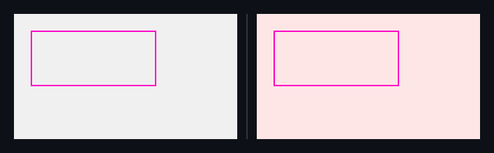

## 🗺️ StyleProof report

**1 change needs review** · 1 distinct change on 1 surface (1 computed-style difference)

**What changed**

- Panel changed colour (1 element)

## Changes

### **Panel** `main.panel` · 1 element restyled

_home @ 320_

`color` `#000000` → `#ff0000`

◀ before  ·  after ▶ — home @ 320

Show highlight overlay

🔍 magenta boxes mark each change — changed: `main.panel`

- **`main.panel`** — text black (`#000000`) → red (`#ff0000`)

Show the property change

**Panel** `main.panel`

Style:

| Property | Before | After |
| --- | --- | --- |
| `color` | `#000000` | `#ff0000` |

Evidence (warnings & failures)

**Certification**
- **Inventory** — ⚠ not checked (no captured map carried an inventory — set `inventory: true` in the capture spec to arm the navigable-removal gate)

<!-- styleproof-receipt head-sha:d9d77bdd5f99c9c5cd12349788b07d21477a8048 run-id:42034847718 run-attempt:1 -->
