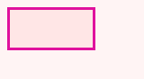

## 🗺️ StyleProof report

**1 change to review** on `home` at 320px wide: 1 element.

## Changes

### Panel

<!-- styleproof-section %7B%22v%22%3A1%2C%22id%22%3A%22panel%22%2C%22paths%22%3A%5B%22body%20%3E%20main%3Anth%2Dchild(1)%22%5D%2C%22more%22%3A0%2C%22pairs%22%3A%5B%7B%22state%22%3A%22rest%22%2C%22before%22%3A%22crops%2Fhome%2D320%2D1%2Dbefore.png%22%2C%22after%22%3A%22crops%2Fhome%2D320%2D1%2Dafter.png%22%2C%22width%22%3A320%2C%22height%22%3A180%2C%22what%22%3A%22the%20panel%22%7D%5D%2C%22where%22%3A%5B%7B%22image%22%3A%22crops%2Fhome%2D320%2D1%2Dwhere.png%22%2C%22side%22%3A%22after%22%2C%22page%22%3A%5B320%2C180%5D%2C%22view%22%3A%5B0%2C0%2C320%2C176%5D%2C%22boxes%22%3A%5B%5B24%2C24%2C180%2C80%5D%5D%7D%5D%2C%22pages%22%3A%5B%7B%22state%22%3A%22rest%22%2C%22before%22%3A%22crops%2Fhome%2D320%2Dpage%2Dbase.png%22%2C%22after%22%3A%22crops%2Fhome%2D320%2Dpage%2Dhead.png%22%2C%22width%22%3A320%2C%22height%22%3A180%7D%5D%7D -->

The panel changes text colour from black to red.

 Where: 1 panel on home @ 320

| Before | After |
| --- | --- |
|  |  |

Show the CSS

`main.panel` · 1 element restyled

| Property | Before | After |
| --- | --- | --- |
| `color` | `#000000` | `#ff0000` |

<!-- styleproof-section-end -->

<!-- styleproof-captured %7B%22v%22%3A1%2C%22pages%22%3A%5B%7B%22base%22%3A%22home%22%2C%22widths%22%3A%5B320%5D%2C%22states%22%3A%5B%5D%7D%5D%2C%22recipes%22%3A%5B%5D%2C%22rules%22%3A%5B%5D%7D -->

Evidence (warnings & failures)

**Certification**
- **Inventory** — ⚠ not checked (no captured map carried an inventory — set `inventory: true` in the capture spec to arm the navigable-removal gate)

<!-- styleproof-receipt head-sha:4fc10822513d1ff928e04e5852e353701f97c97b run-id:42966882955 run-attempt:1 -->
