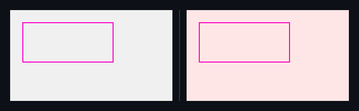

## 🗺️ StyleProof report

**1 change needs review**

**1 distinct change** (1 computed-style difference(s)) in 1 changed surface base with an existing baseline.

**What changed**

- `home @ 320` — **`main.panel`** text black (`#000000`) → red (`#ff0000`)

## Changes

### `main.panel` · 1 element restyled

_home @ 320_

- **`main.panel`** — text black (`#000000`) → red (`#ff0000`)

◀ before  ·  after ▶

Show highlight overlay

🔍 magenta boxes mark each change — changed: `main.panel`

Show the property change

**Panel** `main.panel`

Style:

| Property | Before | After |
| --- | --- | --- |
| `color` | `#000000` | `#ff0000` |

Evidence (warnings & failures)

**Certification**
- **Inventory** — ⚠ not checked (no captured map carried an inventory — set `inventory: true` in the capture spec to arm the navigable-removal gate)

<!-- styleproof-receipt head-sha:b66698cf91372b6a4b743fadeea8f249d1d6c529 run-id:43531005532 run-attempt:1 -->
