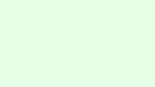

## 🗺️ StyleProof report

**1 change to review** on `about` at 320px wide.

⚠️ **1 surface failed to capture on the base:** `about@auto` at `94ed0fff1e5e4a3e15eba4243ff509a60e5583d7`. The rest of the base was captured; repair that surface on that commit and capture it again.

## One-sided pages, states, or surfaces — review first

### `about@320` · baseline repair needed ⚠️

_about @ 320_

after · about @ 320
<!-- styleproof-captured %7B%22v%22%3A1%2C%22pages%22%3A%5B%7B%22base%22%3A%22about%22%2C%22widths%22%3A%5B320%5D%2C%22states%22%3A%5B%5D%7D%2C%7B%22base%22%3A%22home%22%2C%22widths%22%3A%5B320%5D%2C%22states%22%3A%5B%5D%7D%5D%2C%22recipes%22%3A%5B%5D%2C%22rules%22%3A%5B%5D%7D -->

Evidence (warnings & failures)

**Certification**
- **Inventory** — ⚠ not checked (no captured map carried an inventory — set `inventory: true` in the capture spec to arm the navigable-removal gate)

<!-- styleproof-receipt head-sha:991c9c8afd11e8b981eb4cfa4f9f2cf09491f736 run-id:43866225364 run-attempt:1 -->
